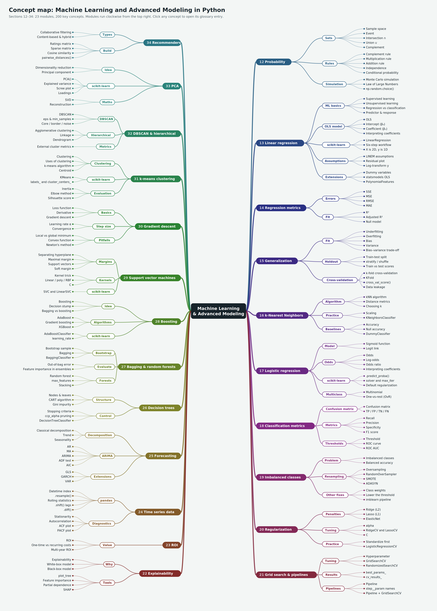

<a id="top"></a>

# Data Science Glossary: Machine Learning and Advanced Modeling

Key terms, functions and methods from the machine learning unit, running from probability to recommender systems. This glossary picks up where the [Unit 2 glossary](https://github.com/CharleyHananiaGA/DSB-Unit-02/blob/main/Readme.MD) (sections 1–11: Python, pandas and EDA) left off, so numbering starts at section 12, and terms already defined there are linked rather than repeated. Each of the 402 entries says what the term means, where it appears in the course, and (where relevant) shows working code.

**How to read the examples.** Examples follow the course notebooks and assume the standard imports below. Extra libraries are imported inside the entries that need them; `statsmodels`, `imbalanced-learn`, `xgboost`, `arch` and `shap` may need installing with `pip install`.

```python
import numpy as np
import pandas as pd
import matplotlib.pyplot as plt
import seaborn as sns

from sklearn import metrics
from sklearn.model_selection import train_test_split, cross_val_score, GridSearchCV
from sklearn.preprocessing import StandardScaler
from sklearn.linear_model import LinearRegression, LogisticRegression
from sklearn.neighbors import KNeighborsClassifier, KNeighborsRegressor
from sklearn.tree import DecisionTreeClassifier
from sklearn.pipeline import Pipeline
from sklearn.metrics import accuracy_score
```

Most notebooks read a CSV from the course `data/` folder, and the entries use the same variable names: `elec` (`elecdemand.csv`), `bike` (`bikeshare.csv`), `admissions` (`grad_admissions.csv`), `wine` (`winequality_merged.csv`), `titanic` (`titanic_clean.csv`), `aapl` (`AAPL.csv`) and so on. Scaled data is named `X_train_sc` or `Z_train`. To try an example without the course files, swap in a built-in dataset such as `load_breast_cancer()`, `load_iris()`, `load_digits()`, `make_classification()` or `make_blobs()` from `sklearn.datasets`, or `sm.datasets.macrodata` for time series.

**Library versions.** Code is written to run on current releases (scikit-learn 1.8, pandas 3). Where a course notebook uses syntax that has since changed or been removed, the entry carries a **Watch out** note with the up-to-date version.

## Contents

12. [Probability](#s12-probability)
13. [Machine learning foundations and linear regression](#s13-machine-learning-foundations-and-linear-regression)
14. [Regression metrics](#s14-regression-metrics)
15. [Generalization, bias–variance and cross-validation](#s15-generalization-bias-variance-and-cross-validation)
16. [k-Nearest Neighbors](#s16-k-nearest-neighbors)
17. [Logistic regression](#s17-logistic-regression)
18. [Classification metrics](#s18-classification-metrics)
19. [Imbalanced classes](#s19-imbalanced-classes)
20. [Regularization](#s20-regularization)
21. [Hyperparameter tuning: grid search and pipelines](#s21-hyperparameter-tuning-grid-search-and-pipelines)
22. [Model explainability](#s22-model-explainability)
23. [Project value and ROI](#s23-project-value-and-roi)
24. [Time series: data handling and stationarity](#s24-time-series-data-handling-and-stationarity)
25. [Time series: forecasting models](#s25-time-series-forecasting-models)
26. [Decision trees](#s26-decision-trees)
27. [Ensembles: bagging and random forests](#s27-ensembles-bagging-and-random-forests)
28. [Ensembles: boosting](#s28-ensembles-boosting)
29. [Support vector machines](#s29-support-vector-machines)
30. [Gradient descent and optimization](#s30-gradient-descent-and-optimization)
31. [Unsupervised learning and k-means clustering](#s31-unsupervised-learning-and-k-means-clustering)
32. [DBSCAN and hierarchical clustering](#s32-dbscan-and-hierarchical-clustering)
33. [Principal component analysis (PCA)](#s33-principal-component-analysis-pca)
34. [Recommender systems](#s34-recommender-systems)

[Concept map](#concept-map) · [A–Z index](#a-z-index)

<a id="concept-map"></a>

## Concept map

The whole unit on one page: 23 modules, grouped into themes, with the key concepts of each. Open the [clickable SVG version](assets/ds-ml-glossary-mindmap.svg) to jump straight to entries in the [HTML glossary](assets/ds-ml-glossary.html).

[](assets/ds-ml-glossary-mindmap.svg)

The same map as a linked outline:

- **[12. Probability](#s12-probability)**
  - _Sets:_ [Sample space](#sample-space), [Event](#event), [Intersection ∩](#intersection-a-b), [Union ∪](#union-a-b), [Complement](#complement-a)
  - _Rules:_ [Complement rule](#complement-rule), [Multiplication rule](#multiplication-rule-intersections), [Addition rule](#addition-rule-unions), [Independence](#statistical-independence), [Conditional probability](#conditional-probability)
  - _Simulation:_ [Monte Carlo simulation](#simulation-monte-carlo), [Law of Large Numbers](#law-of-large-numbers-lln), [np.random.choice()](#np-random-choice)
- **[13. Linear regression](#s13-machine-learning-foundations-and-linear-regression)**
  - _ML basics:_ [Supervised learning](#supervised-learning), [Unsupervised learning](#unsupervised-learning), [Regression vs classification](#regression-vs-classification-tasks), [Predictor & response](#predictor-and-response-and-their-many-names)
  - _OLS model:_ [OLS](#ordinary-least-squares-ols), [Intercept (β₀)](#intercept), [Coefficient (β₁)](#slope-coefficient), [Interpreting coefficients](#interpreting-coefficients)
  - _scikit-learn:_ [LinearRegression](#linearregression), [Six-step workflow](#the-modeling-workflow-in-scikit-learn), [X is 2D, y is 1D](#x-is-2d-y-is-1d)
  - _Assumptions:_ [LINEM assumptions](#linem-assumptions), [Residual plot](#residual-plot), [Log-transform y](#log-transforming-the-target)
  - _Extensions:_ [Dummy variables](#dummy-variables-in-regression), [statsmodels OLS](#statsmodels-ols), [PolynomialFeatures](#polynomialfeatures)
- **[14. Regression metrics](#s14-regression-metrics)**
  - _Errors:_ [SSE](#sum-of-squared-errors-sse), [MSE](#mean-squared-error-mse), [RMSE](#root-mean-squared-error-rmse), [MAE](#mean-absolute-error-mae)
  - _Fit:_ [R²](#r2-coefficient-of-determination), [Adjusted R²](#adjusted-r2), [Null model](#null-model-baseline-for-regression)
- **[15. Generalization](#s15-generalization-bias-variance-and-cross-validation)**
  - _Fit:_ [Underfitting](#underfitting), [Overfitting](#overfitting), [Bias](#bias), [Variance](#variance-model-variance), [Bias–variance trade-off](#bias-variance-trade-off)
  - _Holdout:_ [Train-test split](#train-test-split), [stratify / shuffle](#test-size-stratify-and-shuffle), [Train vs test scores](#reading-train-vs-test-scores)
  - _Cross-validation:_ [k-fold cross-validation](#k-fold-cross-validation), [KFold](#kfold), [cross_val_score()](#cross-val-score), [Data leakage](#data-leakage-in-model-evaluation)
- **[16. k-Nearest Neighbors](#s16-k-nearest-neighbors)**
  - _Algorithm:_ [kNN algorithm](#k-nearest-neighbors-knn), [Distance metrics](#distance-metrics-euclidean-manhattan-minkowski), [Choosing k](#choosing-k)
  - _Practice:_ [Scaling](#scaling-for-distance-based-models), [KNeighborsClassifier](#kneighborsclassifier)
  - _Baselines:_ [Accuracy](#accuracy), [Null accuracy](#null-accuracy), [DummyClassifier](#dummyclassifier)
- **[17. Logistic regression](#s17-logistic-regression)**
  - _Model:_ [Sigmoid function](#logistic-sigmoid-function), [Logit link](#link-function-and-the-logit)
  - _Odds:_ [Odds](#odds), [Log-odds](#log-odds), [Odds ratio](#odds-ratio), [Interpreting coefficients](#interpreting-logistic-regression-coefficients)
  - _scikit-learn:_ [.predict_proba()](#predict-proba), [solver and max_iter](#solver-and-max-iter), [Default regularization](#regularization-is-on-by-default)
  - _Multiclass:_ [Multinomial](#multinomial-logistic-regression), [One-vs-rest (OvR)](#one-vs-rest-ovr)
- **[18. Classification metrics](#s18-classification-metrics)**
  - _Confusion matrix:_ [Confusion matrix](#confusion-matrix), [TP / FP / TN / FN](#true-false-positives-and-negatives)
  - _Metrics:_ [Recall](#recall-sensitivity-true-positive-rate), [Precision](#precision), [Specificity](#specificity-true-negative-rate), [F1 score](#f1-score)
  - _Thresholds:_ [Threshold](#classification-threshold), [ROC curve](#roc-curve), [ROC AUC](#auc-roc-auc)
- **[19. Imbalanced classes](#s19-imbalanced-classes)**
  - _Problem:_ [Imbalanced classes](#imbalanced-classes), [Balanced accuracy](#balanced-accuracy)
  - _Resampling:_ [Oversampling](#oversampling), [RandomOverSampler](#randomoversampler), [SMOTE](#smote), [ADASYN](#adasyn)
  - _Other fixes:_ [Class weights](#class-weights), [Lower the threshold](#changing-the-threshold-for-imbalanced-data), [imblearn pipeline](#imbalanced-learn-pipeline)
- **[20. Regularization](#s20-regularization)**
  - _Penalties:_ [Ridge (L2)](#ridge-regression-l2), [Lasso (L1)](#lasso-regression-l1), [ElasticNet](#elasticnet)
  - _Tuning:_ [alpha](#alpha-regularization-strength), [RidgeCV and LassoCV](#ridgecv-and-lassocv), [C](#c-inverse-regularization-strength)
  - _Practice:_ [Standardize first](#standardize-before-regularizing), [LogisticRegressionCV](#logisticregressioncv)
- **[21. Grid search & pipelines](#s21-hyperparameter-tuning-grid-search-and-pipelines)**
  - _Tuning:_ [Hyperparameter](#hyperparameter), [GridSearchCV](#gridsearchcv), [RandomizedSearchCV](#randomizedsearchcv)
  - _Results:_ [best_params_](#best-params-best-score-and-best-estimator), [cv_results_](#cv-results)
  - _Pipelines:_ [Pipeline](#pipelines-in-tuning), [step__param names](#step-parameter-naming), [Pipeline + GridSearchCV](#pipeline-gridsearchcv)
- **[22. Explainability](#s22-model-explainability)**
  - _Why:_ [Explainability](#model-explainability), [White-box model](#white-box-model), [Black-box model](#black-box-model)
  - _Tools:_ [plot_tree](#visualizing-a-decision-tree-plot-tree), [Feature importance](#feature-importance), [Partial dependence](#partial-dependence-plot-pdp), [SHAP](#shap-shapley-additive-explanations)
- **[23. ROI](#s23-project-value-and-roi)**
  - _Value:_ [ROI](#return-on-investment-roi), [One-time vs recurring costs](#one-time-vs-recurring-costs), [Multi-year ROI](#multi-year-roi)
- **[24. Time series data](#s24-time-series-data-handling-and-stationarity)**
  - _pandas:_ [Datetime index](#datetime-index), [.resample()](#resample-for-time-series), [Rolling statistics](#rolling-statistics), [.shift() lags](#lag-backshift-and-shift), [.diff()](#differencing-and-diff)
  - _Diagnostics:_ [Stationarity](#stationarity), [Autocorrelation](#autocorrelation), [ACF plot](#acf-plot), [PACF plot](#pacf-plot)
- **[25. Forecasting](#s25-time-series-forecasting-models)**
  - _Decomposition:_ [Classical decomposition](#classical-decomposition), [Trend](#trend), [Seasonality](#seasonality)
  - _ARIMA:_ [AR](#autoregression-ar), [MA](#moving-average-model-ma), [ARIMA](#arima-p-d-q), [ADF test](#augmented-dickey-fuller-adf-test), [AIC](#aic-akaike-information-criterion)
  - _Extensions:_ [GLS](#generalized-least-squares-gls), [GARCH](#garch-p-q), [VAR](#vector-autoregression-var)
- **[26. Decision trees](#s26-decision-trees)**
  - _Structure:_ [Nodes & leaves](#root-node-internal-node-leaf-and-branch), [CART algorithm](#cart-algorithm), [Gini impurity](#gini-impurity)
  - _Control:_ [Stopping criteria](#stopping-criteria), [ccp_alpha pruning](#ccp-alpha-cost-complexity-pruning), [DecisionTreeClassifier](#decisiontreeclassifier-and-decisiontreeregressor)
- **[27. Bagging & random forests](#s27-ensembles-bagging-and-random-forests)**
  - _Bootstrap:_ [Bootstrap sample](#bootstrap-sample), [Bagging](#bagging-bootstrap-aggregating), [BaggingClassifier](#baggingclassifier)
  - _Evaluate:_ [Out-of-bag error](#out-of-bag-oob-observations-and-error), [Feature importance in ensembles](#feature-importance-in-ensembles)
  - _Forests:_ [Random forest](#random-forest), [max_features](#max-features), [Stacking](#stacking)
- **[28. Boosting](#s28-ensembles-boosting)**
  - _Idea:_ [Boosting](#boosting), [Decision stump](#decision-stump), [Bagging vs boosting](#bagging-vs-boosting)
  - _Algorithms:_ [AdaBoost](#adaboost), [Gradient boosting](#gradient-boosting), [XGBoost](#xgboost)
  - _scikit-learn:_ [AdaBoostClassifier](#adaboostclassifier), [learning_rate](#learning-rate-and-n-estimators)
- **[29. Support vector machines](#s29-support-vector-machines)**
  - _Margins:_ [Separating hyperplane](#separating-hyperplane), [Maximal margin](#maximal-margin-classifier), [Support vectors](#support-vectors), [Soft margin](#soft-margin-classifier)
  - _Kernels:_ [Kernel trick](#kernel-trick), [Linear / poly / RBF](#linear-polynomial-and-rbf-kernels), [C](#c-svm)
  - _scikit-learn:_ [SVC and LinearSVC](#svc-and-linearsvc)
- **[30. Gradient descent](#s30-gradient-descent-and-optimization)**
  - _Basics:_ [Loss function](#loss-function), [Derivative](#derivative), [Gradient descent](#gradient-descent)
  - _Step size:_ [Learning rate α](#learning-rate-step-size), [Convergence](#convergence-and-tolerance)
  - _Pitfalls:_ [Local vs global minimum](#local-vs-global-minimum), [Convex function](#convex-function), [Newton's method](#newton-s-method)
- **[31. k-means clustering](#s31-unsupervised-learning-and-k-means-clustering)**
  - _Clustering:_ [Clustering](#clustering), [Uses of clustering](#uses-of-clustering), [k-means algorithm](#k-means), [Centroid](#centroid)
  - _scikit-learn:_ [KMeans](#kmeans), [labels_ and cluster_centers_](#labels-and-cluster-centers)
  - _Evaluation:_ [Inertia](#inertia-within-cluster-sum-of-squares), [Elbow method](#elbow-method), [Silhouette score](#silhouette-score)
- **[32. DBSCAN & hierarchical](#s32-dbscan-and-hierarchical-clustering)**
  - _DBSCAN:_ [DBSCAN](#dbscan), [eps & min_samples](#eps-and-min-samples), [Core / border / noise](#core-border-and-noise-points)
  - _Hierarchical:_ [Agglomerative clustering](#agglomerative-clustering), [Linkage](#linkage), [Dendrogram](#dendrogram)
  - _Metrics:_ [External cluster metrics](#external-cluster-metrics)
- **[33. PCA](#s33-principal-component-analysis-pca)**
  - _Idea:_ [Dimensionality reduction](#dimensionality-reduction), [Principal component](#principal-component)
  - _scikit-learn:_ [PCA()](#pca-in-scikit-learn), [Explained variance](#explained-variance-and-explained-variance-ratio), [Scree plot](#scree-plot), [Loadings](#loadings-components)
  - _Maths:_ [SVD](#singular-value-decomposition-svd), [Reconstruction](#dimensionality-reduced-reconstruction)
- **[34. Recommenders](#s34-recommender-systems)**
  - _Types:_ [Collaborative filtering](#collaborative-filtering), [Content-based & hybrid](#content-based-knowledge-based-and-hybrid-recommenders)
  - _Build:_ [Ratings matrix](#utility-ratings-matrix), [Sparse matrix](#sparse-matrix), [Cosine similarity](#cosine-similarity), [pairwise_distances()](#pairwise-distances)

---

<a id="s12-probability"></a>

## 12. Probability

_The language of uncertainty that every model in this unit is built on: experiments, events, set operations, the three probability rules, and estimating probabilities by simulation when the maths gets hard. Examples come from the dice, coin and urn problems in the probability notebook._

<a id="probability"></a>

### Probability

_Concept_

If you repeated an experiment infinitely many times, the **probability** of an event is the proportion of those repeats in which the event happens. It is always a number between 0 and 1: a fair coin lands heads with probability 0.5. Written formally, P(A) = lim (number of times A occurs ÷ n) as n → ∞. We can't run anything infinitely often, so in practice we either calculate probabilities by hand or estimate them by running many simulated trials.

See also: [Simulation (Monte Carlo)](#simulation-monte-carlo), [Law of Large Numbers (LLN)](#law-of-large-numbers-lln)

<a id="probability-notation-p-a"></a>

### Probability notation P(A)

_Concept_

`P(A)` reads "the probability that event A occurs". `P(A | B)` reads "the probability of A given that B has already happened". `P(A ∩ B)` is the probability that both happen and `P(A ∪ B)` the probability that at least one happens.

<a id="experiment"></a>

### Experiment

_Concept_

Any clearly defined process with an outcome: flipping a coin twice, rolling a die, drawing a marble. ("Lab coat optional.") Not to be confused with a designed experiment from Unit 2, though the idea is related.

See also: [Experiment (Unit 2)](https://github.com/CharleyHananiaGA/DSB-Unit-02/blob/main/Readme.MD#experiment)

<a id="outcome"></a>

### Outcome

_Concept_

A single possible result of an experiment, such as rolling a 4 or flipping HT.

<a id="sample-space"></a>

### Sample space

_Concept_

The set of **all** possible outcomes of an experiment, usually written S (or Ω). Flip a coin twice: S = {HH, HT, TH, TT}. Roll one die: S = {1, 2, 3, 4, 5, 6}.

<a id="event"></a>

### Event

_Concept_

Any collection of outcomes, i.e. a subset of the sample space. For one die roll: A = {1}, B = {an even number} = {2, 4, 6}, C = {a prime number} = {2, 3, 5}.

<a id="set-and-element"></a>

### Set and element

_Concept, Python_

A **set** is an unordered collection of distinct objects; each object in it is an **element**. `{Chloe, 17, 😂}` is a set with three elements. Python's built-in `set` behaves the same way and supports the set operations below.

```python
A = {2, 4, 6, 8}
B = {2, 3, 5, 7}
A & B          # {2}                    intersection
A | B          # {2, 3, 4, 5, 6, 7, 8}  union
S = set(range(1, 9))
S - A          # {1, 3, 5, 7}           complement of A within S
S - (A | B)    # {1}
```

See also: [Set (Unit 2)](https://github.com/CharleyHananiaGA/DSB-Unit-02/blob/main/Readme.MD#set)

<a id="intersection-a-b"></a>

### Intersection (A ∩ B)

_Concept_

The elements in **both** A and B ("A and B"). For an 8-sided die with A = {2, 4, 6, 8} and B = {2, 3, 5, 7}, A ∩ B = {2}.

<a id="union-a-b"></a>

### Union (A ∪ B)

_Concept_

The elements in A **or** B, or both. With the sets above, A ∪ B = {2, 3, 4, 5, 6, 7, 8}.

<a id="complement-a"></a>

### Complement (Aᶜ)

_Concept_

Everything in the sample space that is **not** in A. With S = {1, …, 8} and A = {2, 4, 6, 8}, Aᶜ = {1, 3, 5, 7}, and (A ∪ B)ᶜ = {1}.

<a id="disjoint-mutually-exclusive-events"></a>

### Disjoint (mutually exclusive) events

_Concept_

Events that can't happen together, so P(A ∩ B) = 0. "Both marbles are blue" and "both marbles are red" are disjoint. For disjoint events, the union rule simplifies to P(A ∪ B) = P(A) + P(B).

<a id="key-probability-facts"></a>

### Key probability facts

_Concept_

Three facts that always hold: **P(S) = 1** (something happens), **P(∅) = 0** (the probability that nothing happens is zero), and **0 ≤ P(A) ≤ 1** for any event A. If a calculation gives you a probability of 1.3 or −0.2, something has gone wrong.

<a id="conditional-probability"></a>

### Conditional probability

_Concept_

The probability of A **given** that B has already happened, written P(A | B). Drawing marbles without replacement is the classic case: once a blue marble is out, the chance the next one is blue drops from 12/24 to 11/23.

<a id="statistical-independence"></a>

### Statistical independence

_Concept_

Two events are **independent** if one happening doesn't change the probability of the other: P(A | B) = P(A). A coin flip and a die roll are independent. Pizza for lunch and pizza for dinner aren't (one makes the other less likely); shark attacks and ice-cream sales aren't (warm weather drives both); today's and tomorrow's temperature aren't. Independence comes up again and again: it's the **I** in the LINE assumptions, and it's exactly what time series data violate.

See also: [Independence (I)](#independence-i), [Time series](#time-series)

<a id="complement-rule"></a>

### Complement rule

_Concept_

Rule 1: **P(Aᶜ) = 1 − P(A)**. Often the easiest route to a hard probability: P(at least one six in four rolls) = 1 − P(no sixes) = 1 − (5/6)⁴.

<a id="multiplication-rule-intersections"></a>

### Multiplication rule (intersections)

_Concept_

Rule 2: **P(A ∩ B) = P(A) · P(B | A)**. With an urn of 12 red and 12 blue marbles, drawing twice without replacement, P(both blue) = (12/24) × (11/23) = 11/46 ≈ 0.239. If A and B are independent this reduces to P(A) · P(B).

<a id="addition-rule-unions"></a>

### Addition rule (unions)

_Concept_

Rule 3: **P(A ∪ B) = P(A) + P(B) − P(A ∩ B)**. You subtract the intersection because adding P(A) and P(B) counts the overlap twice. P(both marbles the same colour) = P(both blue) + P(both red) − 0 = 0.239 + 0.239 = 0.478, since the two events are disjoint.

<a id="sampling-with-and-without-replacement"></a>

### Sampling with and without replacement

_Concept, NumPy_

**With replacement**, each item goes back before the next draw, so draws are independent and the same item can be picked twice (a bootstrap sample works this way). **Without replacement**, each item can be picked only once, so later draws depend on earlier ones (the urn problems).

```python
urn = np.array([np.repeat("red", 12), np.repeat("blue", 12)]).ravel()
np.random.choice(urn, size=2, replace=False)   # two different marbles
np.random.choice(urn, size=2, replace=True)    # could be the same marble twice
```

See also: [Bootstrap sample](#bootstrap-sample)

<a id="simulation-monte-carlo"></a>

### Simulation (Monte Carlo)

_Concept, Python_

Estimating a probability by running an experiment many times in code and counting how often the event happens: P(A) ≈ (times A occurs) ÷ n. When problems get too hard to do by hand, "why do the maths?" Every problem in the probability notebook follows the same pattern: a counter, a loop, an `if`, and a division.

```python
dice = [1, 2, 3, 4, 5, 6]

def odd_roll(n):
    count = 0
    for i in range(n):
        if np.random.choice(dice) % 2 != 0:   # is the roll odd?
            count += 1
    return count / n

odd_roll(1_000_000)    # ≈ 0.5
```

See also: [Law of Large Numbers (LLN)](#law-of-large-numbers-lln)

<a id="law-of-large-numbers-lln"></a>

### Law of Large Numbers (LLN)

_Concept_

As you repeat an experiment more and more times, the simulated probability of an event gets closer and closer to the true probability. That's why `odd_roll(1_000_000)` is closer to 0.5 than `odd_roll(1_000)`, and it's the justification for every simulation in the course. (The real theorem has conditions and several versions; this is the gist.)

<a id="np-random-choice"></a>

### np.random.choice()

_NumPy_

Picks random items from a list or array. `size` sets how many, `replace` sets whether an item can be picked twice, and `p` sets the probability of each item, which lets you simulate an unfair coin.

```python
np.random.choice(dice)                                   # one die roll
np.random.choice(["heads", "tails"], p=[0.2, 0.8])       # unfair coin, 20% heads
np.random.choice(urn, size=2, replace=False)              # two draws, no replacement
```

See also: [Random number generators (Unit 2)](https://github.com/CharleyHananiaGA/DSB-Unit-02/blob/main/Readme.MD#random-number-generators)

<a id="np-random-randint-and-np-random-uniform"></a>

### np.random.randint() and np.random.uniform()

_NumPy_

`np.random.randint(low, high)` returns a random integer from `low` up to but **not including** `high`: `randint(1, 7)` is a die roll and `randint(0, 2)` a coin flip. `np.random.uniform(low, high)` returns a random decimal, used in the "break a stick in two places" interview problem.

```python
np.random.randint(1, 7)       # 1, 2, 3, 4, 5 or 6
np.random.randint(0, 2)       # 0 or 1
np.random.uniform(0, 1)       # e.g. 0.3745...
```

> **Watch out:** The upper bound is exclusive. `randint(1, 6)` never rolls a 6.

<a id="while-loop"></a>

### while loop

_Python_

Repeats a block **as long as** a condition is true, which suits "keep flipping until you get heads". Use `while True:` with `break` when the stopping condition is easier to check inside the loop.

```python
rolls = 1
while np.random.randint(0, 2) == 0:   # keep flipping while we get tails
    rolls += 1
```

> **Watch out:** If the condition can never become false (say, a probability of heads of 0), the loop runs forever. Guard against impossible inputs first.

See also: [for loop (Unit 2)](https://github.com/CharleyHananiaGA/DSB-Unit-02/blob/main/Readme.MD#for-loop), [continue and break (Unit 2)](https://github.com/CharleyHananiaGA/DSB-Unit-02/blob/main/Readme.MD#continue-and-break)

---

<a id="s13-machine-learning-foundations-and-linear-regression"></a>

## 13. Machine learning foundations and linear regression

_What machine learning is, the two big families of models, and the first model in the toolkit: ordinary least squares linear regression. Covers fitting, interpreting and checking a model in scikit-learn and statsmodels, using the electricity demand (`elecdemand.csv`) and bikeshare (`bikeshare.csv`) notebooks._

<a id="machine-learning"></a>

### Machine learning

_Concept_

Letting a computer use data to learn the relationship between some **predictors** (x-variables) and a **response** (y-variable). The slides call it "a fancy way of saying statistical modeling". Examples: predicting a house's sale price from size, location and rooms, or whether a customer will cancel their subscription next month from their recent activity.

<a id="statistical-modeling"></a>

### Statistical modeling

_Concept_

Combining data with statistical theory to model the real-world relationship between predictors and a response: "a more down-to-earth way of saying machine learning". Statisticians and ML engineers often describe the same thing in different words, which is why so many terms below have synonyms.

<a id="predictor-and-response-and-their-many-names"></a>

### Predictor and response (and their many names)

_Concept_

Because ML grew out of several fields, the same thing has many names. The **predictor** is also called an independent variable, feature, covariate or input (e.g. square footage). The **response** is also called a dependent variable, target, label or output (e.g. house price). Conventionally, predictors go in `X` and the response in `y`.

See also: [Feature (Unit 2)](https://github.com/CharleyHananiaGA/DSB-Unit-02/blob/main/Readme.MD#feature-independent-variable), [Target (Unit 2)](https://github.com/CharleyHananiaGA/DSB-Unit-02/blob/main/Readme.MD#target-dependent-variable)

<a id="supervised-learning"></a>

### Supervised learning

_Concept_

Learning from data where the answer is known: "given X, can we predict Y?" Every row has a label, and the model learns to map features to that label. Supervised learning splits into **regression** and **classification**.

See also: [Unsupervised learning](#unsupervised-learning), [Regression vs classification tasks](#regression-vs-classification-tasks)

<a id="unsupervised-learning"></a>

### Unsupervised learning

_Concept_

Learning from data with **no** y-variable: "what does X look like, really?" Used to find groups (clustering) or to compress many variables into a few (dimensionality reduction). There's no right answer to score against, so results need human interpretation.

See also: [Clustering](#clustering), [Principal component analysis (PCA)](#principal-component-analysis-pca)

<a id="reinforcement-learning"></a>

### Reinforcement learning

_Concept_

A third family where a model takes actions according to a policy, sees the results, and adjusts to do better next time (game-playing agents, robotics). The slides call it "a field still in the process of being invented"; it isn't covered in this course.

See also: [Semi-supervised learning](#semi-supervised-learning)

<a id="regression-vs-classification-tasks"></a>

### Regression vs classification tasks

_Concept_

The two kinds of supervised learning. **Regression**: the y-variable is numeric (tomorrow's closing price, this year's harvest yield, a home's price). **Classification**: the y-variable is a category (will they buy, will it rain, will they pass). A yes/no target is **binary** classification; three or more classes is **multiclass**.

See also: [Regression vs classification (Unit 2)](https://github.com/CharleyHananiaGA/DSB-Unit-02/blob/main/Readme.MD#regression-vs-classification), [Binary and multiclass classification](#binary-and-multiclass-classification)

<a id="ingredients-of-a-supervised-model"></a>

### Ingredients of a supervised model

_Concept_

From the slides, to build a supervised model you need: a **problem statement**, a **data set**, a choice of **independent variables**, a choice of **model**, and a way to **measure how good the model is**. Leaving out the last one is the most common mistake.

<a id="linear-regression"></a>

### Linear regression

_Concept, scikit-learn_

A supervised, white-box regression model that assumes y changes in a straight-line way with each x: y = β₀ + β₁x₁ + … + βₚxₚ + ε. Its big selling point is that the **coefficients are interpretable**. Its weakness is the list of assumptions (LINEM) that need to hold before you trust them.

See also: [Ordinary least squares (OLS)](#ordinary-least-squares-ols), [LINEM assumptions](#linem-assumptions)

<a id="ordinary-least-squares-ols"></a>

### Ordinary least squares (OLS)

_Concept_

The standard way to fit a linear regression: choose the β values that **minimize the sum of squared residuals**, hence "least squares". It is one of the very few models with a closed-form solution, so it doesn't need gradient descent.

See also: [Matrix form of OLS](#matrix-form-of-ols), [Line of best fit](#line-of-best-fit)

<a id="simple-linear-regression"></a>

### Simple linear regression

_Concept_

Linear regression with **one** predictor: ŷ = β̂₀ + β̂₁x. In the notebook: electricity demand predicted from temperature, giving ŷ = 2.32 + 0.11·temp.

<a id="multiple-linear-regression"></a>

### Multiple linear regression

_Concept_

Linear regression with **more than one** predictor: ŷ = β̂₀ + β̂₁x₁ + … + β̂ₚxₚ. Adds one assumption (no multicollinearity) and changes how you interpret coefficients ("holding all else constant").

<a id="error-term"></a>

### Error term (ε)

_Concept_

The part of y the model can't explain: random noise inherent in any prediction "because nothing will be perfect". The model is y = β₀ + β₁x + ε; observation = model + error. Its estimate from data is the residual.

See also: [Residual (Unit 2)](https://github.com/CharleyHananiaGA/DSB-Unit-02/blob/main/Readme.MD#residual)

<a id="intercept"></a>

### Intercept (β₀)

_Concept, scikit-learn_

The expected value of y when every x is zero, i.e. where the line crosses the y-axis. It doesn't always make sense: with y = 12000 + 250x for house price and square footage, "a house with no floor area sells for $12,000" is meaningless. In scikit-learn: `model.intercept_`.

<a id="slope-coefficient"></a>

### Slope / coefficient (β₁)

_Concept, scikit-learn_

The rate of change between x and y: **for every 1-unit increase in x, we expect y to change by β₁**. In the house example, each extra square foot adds about $250. In scikit-learn: `model.coef_` (an array, one value per feature).

<a id="hat-notation"></a>

### Hat notation (ŷ, β̂)

_Concept_

A hat means "estimated" or "predicted". **ŷ** ("y-hat") is a prediction; **β̂** is a coefficient estimated from data. A bold **y** means the whole vector of responses, and **n** is the sample size.

<a id="line-of-best-fit"></a>

### Line of best fit

_Concept, seaborn_

The straight line that minimizes the sum of squared residuals. seaborn draws it for you, which is a quick visual check before fitting anything.

```python
sns.regplot(x="temp", y="demand", data=elec, ci=None,
            scatter_kws={"s": 1}, line_kws={"color": "red"})
plt.axhline(elec["demand"].mean(), color="orange", lw=3)  # the null model, for comparison
```

`sns.lmplot()` does the same but as a figure-level plot.

<a id="interpreting-coefficients"></a>

### Interpreting coefficients

_Concept_

**Simple regression:** "For every 1-unit increase in x, we expect y to increase by β." **Multiple regression:** add "**holding all other variables constant**". **Dummy variables:** the effect is relative to the baseline category. From the bikeshare model: "holding temperature constant, it being Summer means 105 fewer riders per hour relative to Winter"; "for every one-degree increase in temperature, about 14 more riders per hour".

See also: [Dummy variables in regression](#dummy-variables-in-regression), [Coefficients are not importance](#coefficients-are-not-importance)

<a id="coefficients-are-not-importance"></a>

### Coefficients are not importance

_Concept_

A common pitfall: coefficients don't tell you which variable has the biggest impact. Each one is in its feature's own units, so a coefficient of 250 for square feet and 15,000 for bedrooms can't be compared. You can only compare them if all features are on the same scale (for example, after standardizing).

See also: [Feature importance](#feature-importance)

<a id="linearregression"></a>

### LinearRegression

_scikit-learn_

scikit-learn's OLS model, in `sklearn.linear_model`. It follows the six-step workflow below.

```python
from sklearn.linear_model import LinearRegression

X = elec[["temp"]]          # 2D: a DataFrame
y = elec["demand"]          # 1D: a Series
lr = LinearRegression()
lr.fit(X, y)
lr.intercept_, lr.coef_     # (2.32..., array([0.11...]))
```

See also: [The modeling workflow in scikit-learn](#the-modeling-workflow-in-scikit-learn)

<a id="the-modeling-workflow-in-scikit-learn"></a>

### The modeling workflow in scikit-learn

_scikit-learn, Concept_

The six core steps used for linear regression and then reused for every model in the course:

1. **Assemble** predictors `X` (a DataFrame) and target `y` (a Series).
2. **Instantiate** the model.
3. **Fit** the model on training data.
4. **Check out and interpret** the coefficients.
5. **Make predictions** with `.predict()`.
6. **Evaluate** the model, ideally against a baseline.

```python
X_train, X_test, y_train, y_test = train_test_split(X, y, random_state=42)
model = LinearRegression()                       # 2
model.fit(X_train, y_train)                      # 3
dict(zip(X.columns, model.coef_))                # 4
y_pred = model.predict(X_test)                   # 5
metrics.root_mean_squared_error(y_test, y_pred)  # 6
```

See also: [fit / predict (Unit 2)](https://github.com/CharleyHananiaGA/DSB-Unit-02/blob/main/Readme.MD#fit-predict)

<a id="x-is-2d-y-is-1d"></a>

### X is 2D, y is 1D

_scikit-learn_

scikit-learn expects `X` to be two-dimensional (n rows × p features) even when there is only one feature, and `y` to be one-dimensional (length n). That's why the notebooks write `elec[["temp"]]` (double brackets → DataFrame) but `elec["demand"]` (single brackets → Series).

> **Watch out:** `lr.fit(elec["temp"], y)` raises "Expected 2D array, got 1D array". Use double brackets or `.reshape(-1, 1)`. The same applies when predicting one new value: `lr.predict([[25]])`, not `lr.predict([25])`.

See also: [reshape(-1, 1) (Unit 2)](https://github.com/CharleyHananiaGA/DSB-Unit-02/blob/main/Readme.MD#reshape-1-1)

<a id="coef-and-intercept"></a>

### .coef_ and .intercept_

_scikit-learn_

Fitted attributes (note the trailing underscore: scikit-learn's convention for "learned from data"). Pair coefficients with column names to read them.

```python
pd.Series(model.coef_, index=X.columns).sort_values()
```

<a id="score"></a>

### .score()

_scikit-learn_

A built-in evaluation shortcut on every model. For **regressors** it returns **R²**; for **classifiers** it returns **accuracy**. `lr.score(X_test, y_test)` is the same as `metrics.r2_score(y_test, lr.predict(X_test))`.

> **Watch out:** One notebook labels `model.score()` output "Adj R Sq". It's ordinary R², not adjusted R².

See also: [R² (coefficient of determination)](#r2-coefficient-of-determination), [Accuracy](#accuracy)

<a id="null-model-baseline-for-regression"></a>

### Null model (baseline) for regression

_Concept_

The simplest possible regression model: always predict the **mean** of y, whatever the input. Every real model should beat it. Its MSE is the variance of y, and its R² is 0 by definition.

```python
y_bar = np.mean(y)
null_mse = np.mean((y - y_bar) ** 2)
```

See also: [Baseline model (Unit 2)](https://github.com/CharleyHananiaGA/DSB-Unit-02/blob/main/Readme.MD#baseline-model), [Null accuracy](#null-accuracy)

<a id="linem-assumptions"></a>

### LINEM assumptions

_Concept_

What has to hold for OLS results (especially the coefficients) to be trustworthy:

- **L**inearity: the relationship between x and y is roughly a straight line.
- **I**ndependence: observations don't affect each other.
- **N**ormality: residuals are roughly normally distributed.
- **E**qual variance (homoscedasticity): residuals have about the same spread for every predicted value.
- **M**ulticollinearity absent: predictors aren't strongly correlated with each other (multiple regression only).

See also: [Linear model assumptions (Unit 2)](https://github.com/CharleyHananiaGA/DSB-Unit-02/blob/main/Readme.MD#linear-model-assumptions)

<a id="linearity-l"></a>

### Linearity (L)

_Concept, matplotlib_

Checked with a scatter plot of each x against y (or `sns.pairplot`). A gentle curve may be acceptable; a strong curve suggests a transformation or polynomial terms.

```python
plt.scatter(elec["temp"], elec["demand"], s=1)
```

<a id="independence-i"></a>

### Independence (I)

_Concept_

Usually checked by thinking about how the data were collected rather than with a plot. The most common violation is **time series data**, where each observation depends on the previous ones. (The bikeshare data are hourly, so this assumption is "probably violated".)

See also: [Statistical independence](#statistical-independence), [Generalized least squares (GLS)](#generalized-least-squares-gls)

<a id="normality-of-residuals-n"></a>

### Normality of residuals (N)

_Concept, matplotlib_

Plot a histogram of residuals; it should look roughly bell-shaped and centred on zero. Strong skew is a warning sign.

```python
resids = y - y_pred
plt.hist(resids, bins=50)
```

<a id="equal-variance-homoscedasticity-e"></a>

### Equal variance / homoscedasticity (E)

_Concept, matplotlib_

Residuals should have roughly the same spread at every predicted value. Check with a residual plot: you want a random, patternless cloud around zero. A **fan shape** (spread growing with ŷ) is **heteroscedasticity**; a curve means the linearity assumption is also failing.

See also: [Residual plot](#residual-plot), [Homoscedasticity (Unit 2)](https://github.com/CharleyHananiaGA/DSB-Unit-02/blob/main/Readme.MD#homoscedasticity)

<a id="residual-plot"></a>

### Residual plot

_matplotlib_

Predicted values on the x-axis, residuals on the y-axis, with a horizontal line at zero. The single most useful diagnostic for a regression model.

```python
plt.scatter(y_pred, resids, s=1)
plt.axhline(0, color="orange")
```

<a id="no-multicollinearity-m"></a>

### No multicollinearity (M)

_Concept, pandas_

Predictors shouldn't be strongly correlated with each other (e.g. number of cars a garage holds vs garage size). Multicollinearity doesn't hurt predictions but "completely destroys model inference": coefficients become unstable and unreliable. Check with a correlation matrix or heatmap and keep only one of a correlated pair.

```python
X.corr()
np.corrcoef(bike.temp, bike.atemp)     # temp and "feels like" temp: almost 1
```

See also: [Multicollinearity (Unit 2)](https://github.com/CharleyHananiaGA/DSB-Unit-02/blob/main/Readme.MD#multicollinearity)

<a id="log-transforming-the-target"></a>

### Log-transforming the target

_Concept, NumPy_

A common fix when residuals are right-skewed, fan-shaped, or the relationship is slightly curved: model log(y) instead of y ("log regression"). Remember to undo it with `np.exp()` before reporting predictions.

```python
y_log = np.log(df["apps"])
lr_log = LinearRegression().fit(X_train, y_train_log)
preds = np.exp(lr_log.predict(X_test))   # back to the original units
```

> **Watch out:** Forgetting to exponentiate means your "predictions" are in log units. And `np.log` fails on zeros; use `np.log1p` if y can be 0.

See also: [Log transformation (Unit 2)](https://github.com/CharleyHananiaGA/DSB-Unit-02/blob/main/Readme.MD#log-transformation)

<a id="design-matrix"></a>

### Design matrix

_Concept_

The data matrix X used to fit a model: each **row** is an observation, each **column** a variable, and (mathematically) a first column of 1s for the intercept. scikit-learn adds the intercept column for you; statsmodels needs `sm.add_constant()`.

<a id="matrix-form-of-ols"></a>

### Matrix form of OLS

_Concept_

With a design matrix, OLS is written compactly as **y = Xβ + ε**, and its closed-form solution is **β̂ = (XᵀX)⁻¹Xᵀy**. You won't compute it by hand, but it explains why perfectly collinear columns break the model: XᵀX can't be inverted.

```python
Xd = np.column_stack([np.ones(len(X)), X])           # add the column of 1s
beta_hat = np.linalg.inv(Xd.T @ Xd) @ Xd.T @ y       # same as LinearRegression
```

<a id="dummy-variables-in-regression"></a>

### Dummy variables in regression

_Concept, pandas_

To use a categorical predictor with k levels, create k − 1 dummy (0/1) columns. The dropped level becomes the **baseline category**, and every dummy coefficient is interpreted relative to it. In the bikeshare model, Winter (season 1) is dropped, so `season_3` means "Summer compared with Winter".

```python
X = bike[["season", "temp"]]
X = pd.get_dummies(X, columns=["season"], drop_first=True, dtype=int)
```

> **Watch out:** In recent pandas, `get_dummies` returns `True`/`False` columns unless you pass `dtype=int`. Models handle booleans fine, but 0/1 is easier to read.

See also: [One-hot encoding (Unit 2)](https://github.com/CharleyHananiaGA/DSB-Unit-02/blob/main/Readme.MD#one-hot-encoding), [Rank deficiency](#rank-deficiency)

<a id="rank-deficiency"></a>

### Rank deficiency

_Concept_

What happens if you keep **all** k dummy columns: they always add up to 1, which is exactly the intercept column. The design matrix is "rank-deficient" (a column is a combination of others), so the model can't be fitted uniquely. Dropping one dummy fixes it. In Unit 2 this was called the dummy variable trap.

See also: [Dummy variable trap (Unit 2)](https://github.com/CharleyHananiaGA/DSB-Unit-02/blob/main/Readme.MD#dummy-variable-trap)

<a id="feature-scale-in-linear-regression"></a>

### Feature scale in linear regression

_Concept_

Changing the units of a feature (Celsius to Fahrenheit) doesn't change OLS predictions; it just rescales the coefficient. The bikeshare model predicts the same riders for 25 °C as the Fahrenheit model does for 77 °F. Scale **does** matter for regularized models, kNN, SVMs, k-means and PCA.

See also: [Standardize before regularizing](#standardize-before-regularizing)

<a id="statsmodels-ols"></a>

### statsmodels OLS

_statsmodels_

An alternative to scikit-learn that gives a full statistical summary: coefficients with standard errors, p-values, confidence intervals and R². Note the argument order (y first) and that you must add the intercept column yourself.

```python
import statsmodels.api as sm

X = sm.add_constant(elec[["temp", "workday"]])
y = elec["demand"]
ols = sm.OLS(y, X).fit()
ols.summary()
```

> **Watch out:** Without `sm.add_constant()`, the model is forced through the origin (no intercept).

<a id="reading-a-statsmodels-results-object"></a>

### Reading a statsmodels results object

_statsmodels_

The fitted results expose everything in the summary as attributes. `.params` gives coefficients, `.rsquared` gives R², `.pvalues` gives p-values, and `.predict()` gives predictions (new data needs a constant column too).

```python
results.params          # intercept and slopes
results.rsquared
results.pvalues
Xnew = sm.add_constant([20, 21])
results.predict(Xnew)
```

See also: [p-value (Unit 2)](https://github.com/CharleyHananiaGA/DSB-Unit-02/blob/main/Readme.MD#p-value)

<a id="polynomial-regression"></a>

### Polynomial regression

_Concept_

Fitting a curve with linear regression by adding powers of x as extra features: x, x², x³, … The model is still "linear" in its coefficients. Higher degrees make the model more flexible ("responsive") and much more prone to overfitting.

See also: [PolynomialFeatures](#polynomialfeatures), [Model complexity](#model-complexity)

<a id="polynomialfeatures"></a>

### PolynomialFeatures

_scikit-learn_

A transformer that creates powers and **interaction terms** (products such as x₁·x₂) of your features. Used in the review lab for a degree-5 fit and in the regularization notebook to deliberately overfit the wine data.

```python
from sklearn.preprocessing import PolynomialFeatures

poly = PolynomialFeatures(degree=2, include_bias=False)
X_poly = poly.fit_transform(X)
poly.get_feature_names_out(X.columns)   # 'fixed_acidity', 'fixed_acidity^2', 'fixed_acidity density', ...
```

> **Watch out:** The number of columns explodes: 12 features at degree 2 become 90. Combine with regularization.

<a id="interaction-term"></a>

### Interaction term

_Concept_

A feature made by multiplying two others (x₁x₂), letting the effect of one depend on the value of the other. Written in model formulas like `y ~ x1 + x2 + x1x2`. Tree-based models capture interactions automatically.

---

<a id="s14-regression-metrics"></a>

## 14. Regression metrics

_How to put a number on "how good is this regression model?": distance-based error measures, R², and comparison with the null model. Examples use the advertising data (`Advertising.csv`), where `sales` is predicted from TV, radio and newspaper spend. "All models are wrong, but some are useful."_

<a id="euclidean-distance"></a>

### Euclidean distance

_Concept, NumPy_

The straight-line distance between two points, from Pythagoras: √Σ(aᵢ − bᵢ)². Treating y and ŷ as two points in n-dimensional space, their distance is a natural measure of error, and it's the starting point for SSE, MSE and RMSE. It reappears as the distance measure in kNN and k-means.

```python
y = np.array([4, 18, 9, 2, 7, 5])
y_hat = np.array([3, 15, 8, 1, 8, 12])
np.sqrt(np.sum((y - y_hat) ** 2))
```

See also: [Distance metrics (Euclidean, Manhattan, Minkowski)](#distance-metrics-euclidean-manhattan-minkowski)

<a id="sum-of-squared-errors-sse"></a>

### Sum of squared errors (SSE)

_Concept, NumPy_

Add up the squared residuals: SSE = Σ(yᵢ − ŷᵢ)². This is the quantity OLS minimizes. Its size depends on how many rows you have, so it's not great for comparing models on different data.

```python
sse = np.sum((y - y_hat) ** 2)
```

<a id="mean-squared-error-mse"></a>

### Mean squared error (MSE)

_Concept, scikit-learn_

The average squared residual: MSE = (1/n)Σ(yᵢ − ŷᵢ)². Lower is better (as with any metric with "error" in its name). Squaring punishes large errors heavily. It's the traditional metric for estimating the bias–variance trade-off.

```python
np.mean((y - y_hat) ** 2)
metrics.mean_squared_error(y, y_hat)
```

<a id="root-mean-squared-error-rmse"></a>

### Root mean squared error (RMSE)

_Concept, scikit-learn_

The square root of the MSE. Its advantage is that it's in the **same units as the target**, so an RMSE of 2,000 when predicting house prices means "on average, the model is off by roughly ±$2,000".

```python
np.sqrt(metrics.mean_squared_error(y, y_hat))
metrics.root_mean_squared_error(y, y_hat)      # scikit-learn 1.4+
```

> **Watch out:** `root_mean_squared_error` only exists in scikit-learn 1.4 and later. On older versions use `np.sqrt(mean_squared_error(...))` (or `mean_squared_error(..., squared=False)`, which has since been removed).

<a id="mean-absolute-error-mae"></a>

### Mean absolute error (MAE)

_Concept, scikit-learn_

The average absolute residual: (1/n)Σ|yᵢ − ŷᵢ|. Also in the target's units, and less sensitive to a few huge errors than RMSE. The notebook calls it the mean absolute deviation.

```python
metrics.mean_absolute_error(y, y_hat)
```

<a id="r2-coefficient-of-determination"></a>

### R² (coefficient of determination)

_Concept, scikit-learn_

The **proportion of the variability in y that the model explains**: R² = 1 − SSE / SST. It usually runs from 0 to 1 (1 = perfect). "35.2% of the variability in electricity demand can be explained by temperature." On test data it can be negative if the model is worse than predicting the mean.

```python
1 - np.sum((y - y_hat)**2) / np.sum((y - np.mean(y))**2)   # by hand
metrics.r2_score(y, y_hat)
lm.score(X, y)
```

> **Watch out:** Training R² always goes up when you add features, even pure noise. Judge a model on test or cross-validated R².

See also: [Adjusted R²](#adjusted-r2), [Evaluation metrics (Unit 2)](https://github.com/CharleyHananiaGA/DSB-Unit-02/blob/main/Readme.MD#evaluation-metrics-r-mse-rmse-mae-accuracy)

<a id="total-sum-of-squares-sst"></a>

### Total sum of squares (SST)

_Concept_

Σ(yᵢ − ȳ)²: the SSE of the null model that always predicts the mean. R² compares your model's SSE with this. (The notebook calls it `ssto`.)

<a id="adjusted-r2"></a>

### Adjusted R²

_Concept_

A version of R² that penalizes extra features, so it only rises if a new feature improves the fit more than chance would: adj R² = 1 − (1 − R²)(n − 1)/(n − p − 1), with p features. statsmodels reports it in `.summary()` (`results.rsquared_adj`); scikit-learn doesn't have it built in.

```python
r2 = metrics.r2_score(y, y_hat)
n, p = X.shape
adj_r2 = 1 - (1 - r2) * (n - 1) / (n - p - 1)
```

<a id="sklearn-metrics"></a>

### sklearn.metrics

_scikit-learn_

The module holding every scoring function: regression (`mean_squared_error`, `root_mean_squared_error`, `mean_absolute_error`, `r2_score`), classification (`accuracy_score`, `recall_score`, `precision_score`, `f1_score`, `confusion_matrix`, `roc_auc_score`), and clustering (`silhouette_score` and friends). The course usually imports the whole module: `from sklearn import metrics`.

<a id="choosing-a-regression-metric"></a>

### Choosing a regression metric

_Concept_

Use **RMSE** or **MAE** when you need to explain errors in the target's units to a stakeholder (MAE if a few big misses shouldn't dominate). Use **MSE** when comparing models mathematically or as a loss. Use **R²** for "how much of the variation do we explain". Whatever you choose, always compare against the null model and compute it on **test** data.

---

<a id="s15-generalization-bias-variance-and-cross-validation"></a>

## 15. Generalization, bias–variance and cross-validation

_Why a model that's perfect on its training data can be useless, how to measure that, and how to choose a model that will work on data it has never seen. Includes the Bias–Variance Tradeoff deck's "fitting sine" exercise and the College applications model workflow._

<a id="generalization"></a>

### Generalization

_Concept_

A model **generalizes** well if what it learned from a limited amount of training data works on new data. That's the goal of nearly every model you'll build: aiming for a balance between being underfit and overfit. "Having a good training MSE is unimpressive."

<a id="underfitting"></a>

### Underfitting

_Concept_

The model is too simple to capture the shape of the data (a straight line through a parabola). **High error on training data and on new data.** It has high bias.

<a id="overfitting"></a>

### Overfitting

_Concept_

The model memorizes the training data, noise included, so it fails on new values. **Low training error, high error on new data.** It has high variance. Signs: training score much better than test score. "If we overfit our model, we're just modeling noise!"

See also: [Reading train vs test scores](#reading-train-vs-test-scores), [Regularization](#regularization)

<a id="balanced-model"></a>

### Balanced model

_Concept_

The sweet spot between under- and overfitting: medium error on the training data and **low** error on new data. It captures the real pattern without memorizing the noise.

<a id="bias"></a>

### Bias

_Concept_

Error from a model's **inability to capture the true relationship**: plainly, "model badness". A straight line fitted to a sine curve is biased no matter how much data you give it. High bias = underfit. Loosely, bias is about "points within a model".

<a id="variance-model-variance"></a>

### Variance (model variance)

_Concept_

Error from a model being **too sensitive to the particular training data** it saw. If you split your data in half and fit the same kind of model to each half, variance is why you get different models. High variance = overfit. Loosely, variance is about "a point between many models".

> **Watch out:** This is not the same as the variance of a column of data from Unit 2, although it uses the same maths (spread around an average).

<a id="irreducible-error"></a>

### Irreducible error

_Concept_

Error caused by the randomness of the universe, sometimes just called **noise**. No model can remove it. It sets a floor on how good any model can be.

<a id="bias-variance-decomposition"></a>

### Bias–variance decomposition

_Concept_

The expected squared error of a prediction splits into three parts:

**Err(x) = Bias² + Variance + Irreducible error**

where Bias² = (E[f̂(x)] − f(x))², Variance = E[(f̂(x) − E[f̂(x)])²], and the irreducible error is σ²ₑ. A residual mixes all three. You can't calculate bias and variance directly from one dataset; holdout methods estimate their combined effect.

<a id="bias-variance-trade-off"></a>

### Bias–variance trade-off

_Concept_

Making a model more complex lowers bias but raises variance; simplifying it does the reverse. Total error is U-shaped against complexity, and the goal is the **optimum model complexity** at the bottom of the U. Almost every tuning choice in the course (k in kNN, alpha in regularization, tree depth, C in SVMs) is a move along this trade-off.

See also: [Model complexity](#model-complexity), [Training vs test error curve](#training-vs-test-error-curve)

<a id="bullseye-diagram"></a>

### Bullseye diagram

_Concept_

The classic picture of bias and variance: the bullseye is the true value and each dart is one model's prediction. **Low bias, low variance**: tight cluster on the centre (the goal). **Low bias, high variance**: scattered around the centre. **High bias, low variance**: tight cluster off-centre. **High bias, high variance**: scattered and off-centre. Which one you get depends on the training data available.

<a id="model-complexity"></a>

### Model complexity

_Concept_

How complicated the model is to describe. More complexity gives finer control over predictions, which can be a bad thing. Things that raise complexity: more variables, "wiggliness" (polynomial terms x², x³), less regularization, and more complex architectures (neural nets vs OLS).

<a id="training-vs-test-error-curve"></a>

### Training vs test error curve

_Concept_

Plot error against model complexity. **Training error** (blue) keeps falling as complexity rises. **Test / prediction error** (red) falls at first, bottoms out, then rises again: past that point the model is overfitting. Answers the slide's question "why do we care about variance if more complexity always gives a more accurate model?": it's only more accurate on the data it has already seen.

<a id="fitting-sine-exercise"></a>

### Fitting sine exercise

_Concept_

From the Bias–Variance Tradeoff deck (after Caltech's _Learning From Data_). Fit two hypotheses to a sine curve using only **two points**: H₀: f(x) = b (a flat line) and H₁: f(x) = ax + b (a sloped line). With the full curve, H₁ wins (E_out 0.20 vs 0.50). But averaged over every possible pair of points, H₀ has bias 0.50 and variance 0.25 while H₁ has bias 0.21 and variance 1.69, so the **simpler model has lower total error**. The lesson: with little data, choose a model whose complexity matches the data you have, not the target you imagine.

<a id="out-of-sample-data"></a>

### Out-of-sample data

_Concept_

Data the model wasn't trained on. Performance on out-of-sample data is the honest measure of a model. Test sets and cross-validation folds are stand-ins for it.

<a id="holdout-method"></a>

### Holdout method

_Concept_

Any technique that sets data aside during training so it can be used to evaluate the model afterwards: train-test split, k-fold cross-validation, out-of-bag samples. Bias and variance are theoretical quantities, and holdout methods are how we estimate them in practice.

<a id="train-test-split"></a>

### Train-test split

_scikit-learn_

Divide the data into a **training set** (used to build the model) and a **testing set** (used to validate it). Fit on training data, compute a metric on both, and compare. The default split is 75/25.

```python
from sklearn.model_selection import train_test_split

X_train, X_test, y_train, y_test = train_test_split(
    X, y, test_size=0.3, random_state=1653
)
```

See also: [train_test_split() (Unit 2)](https://github.com/CharleyHananiaGA/DSB-Unit-02/blob/main/Readme.MD#train-test-split), [test_size, stratify and shuffle](#test-size-stratify-and-shuffle)

<a id="test-size-stratify-and-shuffle"></a>

### test_size, stratify and shuffle

_scikit-learn_

Key arguments of `train_test_split`. `test_size` (or `train_size`) sets the proportion held out (default 0.25). `stratify=y` keeps the class proportions the same in both sets, which is important for imbalanced classification. `shuffle=False` keeps the original order, which is **required for time series** (you can't train on the future).

```python
train_test_split(X, y, test_size=0.2, stratify=y, random_state=42)
train_test_split(y, test_size=0.1, shuffle=False)     # time series
```

See also: [Time series train/test split](#time-series-train-test-split), [random_state (Unit 2)](https://github.com/CharleyHananiaGA/DSB-Unit-02/blob/main/Readme.MD#random-state)

<a id="train-test-ratio-rule-of-thumb"></a>

### Train-test ratio rule of thumb

_Concept_

You want as much training data as possible, but enough test data to represent everything the model will meet. **Small data** (say 200 rows): hold out more, maybe 50/50. **Huge data** (100M rows): 99/1 is fine because 1M test rows is plenty. Otherwise 75/25 or 70/30 is usually fine.

<a id="reading-train-vs-test-scores"></a>

### Reading train vs test scores

_Concept_

Compare the same metric on training and test data. **Test much worse than train**: overfit (high variance). **Both bad**: underfit (high bias). **Both similar and good**: likely generalizes. From the slides: train RMSE 12.3 / test RMSE 658.2 is badly overfit; 233.9 / 252.1 is not overfit but weak; 132.7 / 200.5 is the best of the three because it has the best test score. Occasionally the test score beats the training score by chance; that's fine.

<a id="k-fold-cross-validation"></a>

### k-fold cross-validation

_Concept_

Split the data into k **folds** (usually 5 or 10). Train on k − 1 folds and test on the remaining one; repeat so every fold is the test set once; then **average** the k scores. Example from the slides: fold MSEs 42.7, 45.1, 72.8, 38.2, 49.2 give a cross-validated MSE of 49.6. More robust than one split, and no data is "thrown away".

See also: [cross_val_score()](#cross-val-score), [Cross-validation (Unit 2)](https://github.com/CharleyHananiaGA/DSB-Unit-02/blob/main/Readme.MD#cross-validation)

<a id="fold"></a>

### Fold

_Concept_

One of the k equal-sized chunks of data in k-fold cross-validation. k is not a tuning parameter: choose it large enough that averaging is meaningful but small enough that each fold isn't tiny.

<a id="kfold"></a>

### KFold

_scikit-learn_

Generates the train/test indices for each fold. Use `shuffle=True` with a `random_state` unless the order matters. You can loop over `kf.split()` to see each fold's model.

```python
from sklearn.model_selection import KFold

kf = KFold(n_splits=5, shuffle=True, random_state=1318)
scores = []
for train_index, test_index in kf.split(X, y):
    lm = LinearRegression().fit(X.iloc[train_index], y.iloc[train_index])
    scores.append(lm.score(X.iloc[test_index], y.iloc[test_index]))
np.mean(scores)
```

See also: [StratifiedKFold](#stratifiedkfold)

<a id="cross-val-score"></a>

### cross_val_score()

_scikit-learn_

Runs the whole k-fold loop in one line and returns one score per fold. `cv` can be a number of folds or a `KFold` object; `scoring` chooses the metric (default: R² for regressors, accuracy for classifiers).

```python
from sklearn.model_selection import cross_val_score

scores = cross_val_score(LinearRegression(), X, y, cv=kf)
scores.mean()
cross_val_score(knn, X_train_sc, y_train, cv=10).mean()
```

See also: [scoring parameter](#scoring-parameter)

<a id="scoring-parameter"></a>

### scoring parameter

_scikit-learn_

Tells `cross_val_score`, `GridSearchCV` and friends which metric to use, as a string: `"r2"`, `"neg_mean_squared_error"`, `"neg_root_mean_squared_error"`, `"accuracy"`, `"recall"`, `"f1"`, `"roc_auc"`, `"balanced_accuracy"`, and more.

> **Watch out:** Error metrics are negated (`neg_…`) because scikit-learn always maximizes the score. Flip the sign back: `-cross_val_score(model, X, y, scoring="neg_mean_squared_error").mean()`.

<a id="leave-one-out-cross-validation-loocv"></a>

### Leave-one-out cross-validation (LOOCV)

_Concept_

The special case of k-fold where k = n: every observation is its own test set. Rarely used now because it means fitting n models.

<a id="three-way-split-validation-set"></a>

### Three-way split (validation set)

_Concept_

Hold out a final **test set** first, then use cross-validation (or a separate **validation set**) on the rest to tune and choose models. The test set is touched only once, at the very end, so its score is an unbiased estimate. This is what you are doing whenever you run `GridSearchCV` on `X_train` and score on `X_test`.

<a id="cross-validation-pros-and-cons"></a>

### Cross-validation pros and cons

_Concept_

**Pros:** a measure of bias/variance that is more robust to outliers, and every observation gets used for training. **Cons:** you have to fit the model k times ("a huge disadvantage!"), and because the folds share data, the averaged score carries a little bias (usually ignored). Train-test split is still useful when CV is too slow, for a quick confusion matrix, or as a final check.

<a id="data-leakage-in-model-evaluation"></a>

### Data leakage (in model evaluation)

_Concept_

Information that won't be available at prediction time sneaks into training, making the model look better than it is. Causes from the slides: **future information used to predict the past**; preprocessing, normalization or splitting errors that let test data into training (e.g. fitting a scaler before splitting); process changes that add new information to the training set; and very large datasets, where subtle leaks are hard to catch.

See also: [Data leakage (Unit 2)](https://github.com/CharleyHananiaGA/DSB-Unit-02/blob/main/Readme.MD#data-leakage), [Pipeline + GridSearchCV](#pipeline-gridsearchcv)

<a id="big-data-considerations"></a>

### Big data considerations

_Concept_

More data is generally good, but large datasets bring their own problems: subtle data leakage is harder to catch, compute costs and time can grow exponentially, and models can overfit spurious correlations that exist in the training data but not the real world.

<a id="refitting-for-production"></a>

### Refitting for production

_Concept_

Train-test split and cross-validation are for **choosing** a model. Once you've chosen, the usual practice is to refit that model configuration on **all** the data you have before deploying it, so it learns from as much information as possible.

<a id="signal-and-noise"></a>

### Signal and noise

_Concept_

You can think of ML as modeling the **signal** (the real relationship between X and y) and separating it from the **noise**. An overfit model has modeled the noise. It's always mathematically possible to fit training data perfectly; the art is fitting only the signal.

<a id="modeling-workflow-end-to-end"></a>

### Modeling workflow (end to end)

_Concept, scikit-learn_

The College applications walkthrough strings everything together: load data → clean (fix `?` values, cast types, drop NaNs) → engineer features (binarize `private`) → EDA (boxplots, histograms, correlation heatmap, pairplot) → build `X` and `y` → train-test split → scale (fit on train only) → fit → score train and test → check LINE assumptions → fix problems (log-transform y) → refit.

```python
X = df.drop(columns=["university", "accept", "enroll", "apps"])
y = df["apps"]
X_train, X_test, y_train, y_test = train_test_split(X, y, random_state=42)
ss = StandardScaler()
X_train = ss.fit_transform(X_train)
X_test = ss.transform(X_test)          # transform only: no peeking at test data
lr = LinearRegression().fit(X_train, y_train)
lr.score(X_train, y_train), lr.score(X_test, y_test)
```

See also: [StandardScaler (Unit 2)](https://github.com/CharleyHananiaGA/DSB-Unit-02/blob/main/Readme.MD#standardscaler-minmaxscaler-robustscaler)

---

<a id="s16-k-nearest-neighbors"></a>

## 16. k-Nearest Neighbors

_The first classification model: label a new point by asking its closest neighbours. Covers distance, choosing k, why scaling is essential, and how to tell whether a classifier beats a do-nothing baseline. Examples use the iris data (`iris.csv`) and the cell phone churn data (`cell_phone_churn.csv`)._

<a id="classification"></a>

### Classification

_Concept_

The branch of supervised learning that predicts a **categorical** response, often yes/no. "Given this person's demographics, will they vote for A or B?" "Given their financial status, will they default?" "Will it rain tomorrow?"

See also: [Regression vs classification tasks](#regression-vs-classification-tasks)

<a id="binary-and-multiclass-classification"></a>

### Binary and multiclass classification

_Concept_

**Binary** classification has two classes (0/1, yes/no, spam/not spam). **Multiclass** has three or more (iris species, handwritten digits 0–9). Some models handle multiclass natively (kNN, trees); logistic regression needs a little help.

See also: [Multinomial logistic regression](#multinomial-logistic-regression), [One-vs-rest (OvR)](#one-vs-rest-ovr)

<a id="k-nearest-neighbors-knn"></a>

### k-nearest neighbors (kNN)

_Concept_

Classify a new point using its **k closest neighbours** in the training data: "birds of a feather flock together". The algorithm: compute the distance from the new point to every training point, rank them, take the k nearest, and predict the **majority class** (classification) or the **average** (regression). Like guessing your favourite music by asking your five closest friends.

See also: [KNeighborsClassifier](#kneighborsclassifier)

<a id="non-parametric-model"></a>

### Non-parametric model

_Concept_

A model that makes no assumptions about the distribution of the data and isn't summarized by a fixed equation with parameters. kNN is non-parametric: there are no coefficients, it just stores the training data. Decision trees are non-parametric too. Linear and logistic regression are parametric.

<a id="distance-metrics-euclidean-manhattan-minkowski"></a>

### Distance metrics (Euclidean, Manhattan, Minkowski)

_Concept_

How "nearest" is measured. **Euclidean**: straight-line distance, √Σ(aᵢ − bᵢ)², the default. **Manhattan** ("taxi distance"): Σ|aᵢ − bᵢ|, moving only along grid lines. **Minkowski**: a general formula, (Σ|aᵢ − bᵢ|ᵖ)^(1/p), that is Manhattan when p = 1 and Euclidean when p = 2. In `KNeighborsClassifier`, choose with `p`.

See also: [Euclidean distance](#euclidean-distance), [Cosine similarity](#cosine-similarity)

<a id="choosing-k"></a>

### Choosing k

_Concept_

k is chosen by you, not learned from the data. **Small k** (k = 1): wiggly boundaries that chase outliers, so low bias and high variance. **Large k** (k = 50): smooth boundaries that ignore outliers, so higher bias and lower variance. Try several values and pick the one with the best **test** (or cross-validated) score. The default is 5; odd values avoid ties in binary problems.

```python
scores = []
for k in range(3, 32, 2):
    knn = KNeighborsClassifier(n_neighbors=k).fit(X_train_sc, y_train)
    scores.append((k, knn.score(X_train_sc, y_train), knn.score(X_test_sc, y_test)))
pd.DataFrame(scores, columns=["k", "acc_train", "acc_test"])
```

See also: [Hyperparameter](#hyperparameter)

<a id="decision-boundary"></a>

### Decision boundary

_Concept_

The line or surface where a classifier switches from predicting one class to another. Plotting it shows how flexible a model is: kNN's boundaries are jagged at k = 1 and smooth at k = 50; logistic regression's is a straight line; an RBF-kernel SVM's can curve.

<a id="voronoi-diagram"></a>

### Voronoi diagram

_Concept_

A map that divides space into regions, each made up of all the points closest to one particular data point (or centroid). The decision regions of 1-nearest-neighbour and the clusters of k-means both form Voronoi cells.

<a id="scaling-for-distance-based-models"></a>

### Scaling for distance-based models

_Concept, scikit-learn_

kNN measures distance, so a feature measured in thousands (square footage) swamps one measured in units (bedrooms). Always standardize first, fitting the scaler on training data only. The same applies to k-means, SVMs, PCA and regularized models.

```python
sc = StandardScaler()
X_train_sc = sc.fit_transform(X_train)
X_test_sc = sc.transform(X_test)
```

See also: [Z-score standardization (Unit 2)](https://github.com/CharleyHananiaGA/DSB-Unit-02/blob/main/Readme.MD#z-score-standardization)

<a id="kneighborsclassifier"></a>

### KNeighborsClassifier

_scikit-learn_

scikit-learn's kNN classifier (`KNeighborsRegressor` for regression). Key hyperparameters: `n_neighbors` (k, default 5), `weights` (`"uniform"`: every neighbour votes equally; `"distance"`: closer neighbours count more), and `p` (1 = Manhattan, 2 = Euclidean).

```python
from sklearn.neighbors import KNeighborsClassifier

knn = KNeighborsClassifier(n_neighbors=5)
cross_val_score(knn, X_train_sc, y_train, cv=10).mean()
knn.fit(X_train_sc, y_train)
knn.score(X_test_sc, y_test)          # accuracy
```

<a id="knn-strengths-and-weaknesses"></a>

### kNN strengths and weaknesses

_Concept_

**Strengths:** few assumptions (non-parametric); works for classification (vote) and regression (average); simple to explain. **Weaknesses:** slow and memory-hungry on large data, since every prediction compares against every training row; sensitive to noisy, imbalanced and irrelevant features; works poorly with many predictors (the curse of dimensionality) or many dummy columns. Best with a small number of predictors and a modest number of rows. Widely used for image and video tasks where similar pixels need to be identified.

See also: [Curse of dimensionality (Unit 2)](https://github.com/CharleyHananiaGA/DSB-Unit-02/blob/main/Readme.MD#curse-of-dimensionality)

<a id="accuracy"></a>

### Accuracy

_Concept, scikit-learn_

The proportion of predictions that are correct: (TP + TN) / total. It's what `.score()` returns for every classifier. Easy to explain, but **misleading when classes are imbalanced**: a 99%-accurate test for a rare disease might just be saying "no" to everyone.

```python
metrics.accuracy_score(y_test, y_pred)
knn.score(X_test_sc, y_test)
```

See also: [Null accuracy](#null-accuracy), [Balanced accuracy](#balanced-accuracy)

<a id="null-accuracy"></a>

### Null accuracy

_Concept, pandas_

The accuracy you'd get by **always predicting the most frequent class** in the training set: the baseline for any classifier. If your model doesn't beat it, it hasn't learned anything useful.

```python
most_freq_class = y_train.value_counts().index[0]
y_test.value_counts()[most_freq_class] / len(y_test)
y_test.value_counts(normalize=True)          # quick version
```

<a id="dummyclassifier"></a>

### DummyClassifier

_scikit-learn_

A ready-made baseline model. `strategy="most_frequent"` always predicts the majority class, so its score is the null accuracy. `DummyRegressor(strategy="mean")` does the same for regression.

```python
from sklearn.dummy import DummyClassifier

dummy = DummyClassifier(strategy="most_frequent")
dummy.fit(X_train, y_train)
dummy.score(X_test, y_test)
```

<a id="categorical-features-in-knn"></a>

### Categorical features in kNN

_Concept_

You can use dummy-coded categorical features in kNN, but each one adds a column, pushing up dimensionality and degrading performance; scaling 0/1 columns is also hard to justify. The notebook drops them for the churn model. Keep them only if they are critical to the problem.

```python
cat_cols = churn.select_dtypes("object").columns
X = churn.drop(columns=cat_cols).drop(columns=["churn"])
```

---

<a id="s17-logistic-regression"></a>

## 17. Logistic regression

_Regression bent into a classifier: predicting the probability that y = 1 with an S-shaped curve, and reading its coefficients as changes in odds. Examples use graduate school admissions (`grad_admissions.csv`, admit predicted from GPA and GRE) and the possum data._

<a id="logistic-regression"></a>

### Logistic regression

_Concept, scikit-learn_

A supervised, white-box **classification** model. It predicts the **probability** that an observation belongs to class 1, then assigns a class using a threshold (0.5 by default). It's linear regression passed through a link function so outputs stay between 0 and 1. Fast, interpretable and by far the most common classifier.

```python
from sklearn.linear_model import LogisticRegression

X = admissions[["gpa"]]
y = admissions["admit"]
X_train, X_test, y_train, y_test = train_test_split(X, y, random_state=50)
logreg = LogisticRegression()
logreg.fit(X_train, y_train)
logreg.score(X_test, y_test)          # accuracy
```

<a id="why-not-linear-regression-for-classification"></a>

### Why not linear regression for classification?

_Concept_

A straight line predicts any value from −∞ to ∞, so for a 0/1 target it happily predicts −0.3 or 1.4, which aren't probabilities. Logistic regression "bends" the line into an S-curve that stays between 0 and 1.

<a id="logistic-sigmoid-function"></a>

### Logistic (sigmoid) function

_Concept_

The S-shaped curve that turns any number into a value between 0 and 1: p = e^z / (1 + e^z) = 1 / (1 + e^−z), where z = β₀ + β₁x₁ + … It's the inverse of the logit, and it converts log-odds back into probability.

```python
def sigmoid(z):
    return 1 / (1 + np.exp(-z))
```

<a id="link-function-and-the-logit"></a>

### Link function and the logit

_Concept_

A **link function** connects a linear equation to the kind of output you need. Logistic regression uses the **logit**: logit(p) = ln(p / (1 − p)) = β₀ + β₁x₁ + … + βₚxₚ. It maps a probability (0 to 1) to the whole number line (−∞ to ∞), which is exactly what a linear equation produces.

<a id="odds"></a>

### Odds

_Concept_

The probability that something happens divided by the probability it doesn't: **odds = p / (1 − p)**. The odds of rolling a 1 on a fair die are (1/6)/(5/6) = 1/5, or "1 to 5" (gamblers write 5:1 against). Convert back with p = odds / (1 + odds).

<a id="log-odds"></a>

### Log-odds

_Concept_

The natural log of the odds, ln(p / (1 − p)). This is what logistic regression actually predicts as a linear function of the features. Log-odds of 0 means p = 0.5.

<a id="odds-ratio"></a>

### Odds ratio

_Concept_

The odds in one group divided by the odds in another. From the slides' purchase table: returning customers' odds of buying are 22/5 = 4.4, new customers' are 2/15 ≈ 0.133, so returning customers have **33 times** greater odds of purchasing. Exponentiated logistic regression coefficients are odds ratios.

<a id="interpreting-logistic-regression-coefficients"></a>

### Interpreting logistic regression coefficients

_Concept, NumPy_

A one-unit increase in xᵢ changes the **log-odds** of success by βᵢ, which is hard to picture. Exponentiate to get an odds ratio: **a one-unit increase in xᵢ makes success e^βᵢ times as likely** (in odds terms), holding all else constant. In the admissions model, β ≈ 4.9 for GPA, and e^4.9 ≈ 135: each extra GPA point multiplies the odds of admission by about 135.

```python
np.exp(logreg.coef_)
pd.Series(logreg.coef_[0], index=X.columns)     # pair with feature names
```

<a id="from-coefficients-to-probability"></a>

### From coefficients to probability

_Concept, NumPy_

Plug values into the equation to get log-odds, exponentiate to get odds, then convert to probability. It matches `.predict_proba()`.

```python
logodds = logreg.intercept_ + logreg.coef_[0] * 3.5     # GPA = 3.5
odds = np.exp(logodds)
prob = odds / (1 + odds)                                 # ≈ 0.43
logreg.predict_proba([[3.5]])[:, 1]                       # same answer
```

<a id="predict-proba"></a>

### .predict_proba()

_scikit-learn_

Returns the predicted **probability** of each class, one column per class in the order of `model.classes_`. Column 1 (`[:, 1]`) is P(y = 1). `.predict()` simply picks the class with the higher probability, i.e. uses a 0.5 threshold for binary problems.

```python
logreg.predict(X_test)[:10]                      # classes: 0 or 1
np.round(logreg.predict_proba(X_test), 3)        # [[P(y=0), P(y=1)], ...]
y_pred_prob = logreg.predict_proba(X_test)[:, 1]
```

See also: [Classification threshold](#classification-threshold)

<a id="plotting-the-logistic-curve"></a>

### Plotting the logistic curve

_matplotlib_

Sort the x-values, then plot predicted P(y = 1) to see the S-shape over the data.

```python
plt.scatter(X_test, y_test, s=10)
xs = X_test.sort_values("gpa")
plt.plot(xs, logreg.predict_proba(xs)[:, 1], color="red", lw=3)
```

<a id="logistic-regression-assumptions"></a>

### Logistic regression assumptions

_Concept_

Similar to OLS but fewer: **L**inearity between the features and the **log-odds**; **I**ndependence of observations; and no **M**ulticollinearity (for multiple logistic regression). There's no normality or equal-variance assumption on residuals.

<a id="log-loss-binary-cross-entropy"></a>

### Log loss (binary cross-entropy)

_Concept_

The loss function logistic regression minimizes (the notebook calls it the **deviance**). It heavily penalizes confident wrong predictions. Unlike OLS there's no closed-form solution, so the β's are found by an iterative optimizer (the `solver`).

```python
metrics.log_loss(y_test, logreg.predict_proba(X_test))
```

See also: [Gradient descent](#gradient-descent), [solver and max_iter](#solver-and-max-iter)

<a id="solver-and-max-iter"></a>

### solver and max_iter

_scikit-learn_

`solver` picks the optimization algorithm that finds the coefficients (`"lbfgs"` is the default; `"liblinear"` supports L1 penalties on small data; `"newton-cg"`, `"saga"` are others). `max_iter` caps the number of iterations. If you see a **ConvergenceWarning**, scale your features, raise `max_iter`, or try another solver.

```python
LogisticRegression(max_iter=1_000)
LogisticRegression(solver="newton-cg")      # used for the possum data
```

<a id="regularization-is-on-by-default"></a>

### Regularization is on by default

_scikit-learn_

scikit-learn's `LogisticRegression` applies an L2 penalty with strength `C=1.0` unless told otherwise, which shrinks coefficients and makes them harder to interpret. For a classical, unpenalized model, switch it off.

```python
LogisticRegression(penalty=None)     # scikit-learn 1.2–1.7
LogisticRegression(C=np.inf)         # scikit-learn 1.8+ (penalty is deprecated)
```

> **Watch out:** Older notebooks write `penalty='none'` (a string). That raises an error in current scikit-learn; use `penalty=None` or `C=np.inf`.

See also: [C (inverse regularization strength)](#c-inverse-regularization-strength)

<a id="multinomial-logistic-regression"></a>

### Multinomial logistic regression

_Concept, scikit-learn_

Extends logistic regression to more than two classes by modelling all classes at once (the multinomial distribution instead of the Bernoulli). It's what `LogisticRegression` does automatically when y has 3+ classes with the default `lbfgs` solver, as in the iris example.

```python
iris_logreg = LogisticRegression().fit(X_train, y_train)   # y has 3 species
iris_logreg.coef_.shape                                    # (3, 4): one row per class
```

<a id="one-vs-rest-ovr"></a>

### One-vs-rest (OvR)

_Concept, scikit-learn_

The other multiclass "hack": for each class k, fit a binary model of "k vs everything else", then predict the class whose model gives the highest probability. Use `OneVsRestClassifier`.

```python
from sklearn.multiclass import OneVsRestClassifier
ovr = OneVsRestClassifier(LogisticRegression()).fit(X_train, y_train)
```

<a id="logistic-regression-vs-decision-trees"></a>

### Logistic regression vs decision trees

_Concept_

A classic interview question. **Interpretability:** both are white-box (coefficients vs a flowchart). **Overfitting:** trees overfit easily; logistic regression rarely does. **Assumptions:** trees have none about the data's distribution; logistic regression has some. **Target:** trees do regression and classification; logistic regression only classification.

---

<a id="s18-classification-metrics"></a>

## 18. Classification metrics

_Accuracy isn't enough. The confusion matrix and the metrics built from it, how moving the probability threshold trades one kind of error for another, and the ROC curve and AUC. Examples use the breast cancer data (`load_breast_cancer`, malignant = 1) and the Whickham smoking data._

<a id="confusion-matrix"></a>

### Confusion matrix

_Concept, scikit-learn_

A table of actual vs predicted classes. For a binary problem it has four cells: **TN** (actual 0, predicted 0), **FP** (actual 0, predicted 1), **FN** (actual 1, predicted 0), **TP** (actual 1, predicted 1). scikit-learn lays it out with actual classes as rows and predicted as columns, negative class first.

```python
cm = metrics.confusion_matrix(y_test, y_pred)
pd.DataFrame(cm,
             columns=["pred benign", "pred malignant"],
             index=["actual benign", "actual malignant"])
tn, fp, fn, tp = cm.ravel()
```

<a id="confusionmatrixdisplay"></a>

### ConfusionMatrixDisplay

_scikit-learn, matplotlib_

Plots a labelled, colour-coded confusion matrix directly from a fitted model.

```python
from sklearn.metrics import ConfusionMatrixDisplay

ConfusionMatrixDisplay.from_estimator(knn, X_test_sc, y_test,
                                      display_labels=["benign", "malignant"],
                                      cmap="Blues")
ConfusionMatrixDisplay.from_predictions(y_test, y_pred)   # if you only have predictions
```

<a id="true-false-positives-and-negatives"></a>

### True/false positives and negatives

_Concept_

**Positive** means "predicted the class of interest" (malignant, spam, fraud), **true/false** means whether that prediction was right. A **false positive** (type I error) is a false alarm: a benign tumour flagged as malignant. A **false negative** (type II error) is a miss: a malignant tumour called benign. Which is worse depends on the problem, and that decides which metric to optimize.

<a id="misclassification-rate"></a>

### Misclassification rate

_Concept_

The share of predictions that are wrong: (FP + FN) / total = 1 − accuracy. The kNN slides call "1 minus the accuracy" the error when choosing k.

<a id="recall-sensitivity-true-positive-rate"></a>

### Recall (sensitivity, true positive rate)

_Concept, scikit-learn_

Of all **actual** positives, how many did we catch? **TP / (TP + FN)**. With 42 TP and 2 FN, recall = 42/44 = 0.95. Optimize recall when missing a positive is costly (cancer screening, fraud).

```python
metrics.recall_score(y_test, y_pred)
```

<a id="precision"></a>

### Precision

_Concept, scikit-learn_

Of all **predicted** positives, how many were right? **TP / (TP + FP)**. With 42 TP and 1 FP, precision = 42/43 = 0.98. Optimize precision when false alarms are costly (spam filters deleting real email).

```python
metrics.precision_score(y_test, y_pred)
```

<a id="specificity-true-negative-rate"></a>

### Specificity (true negative rate)

_Concept_

Of all **actual** negatives, how many did we correctly call negative? **TN / (TN + FP)**. With 98 TN and 1 FP, 98/99 = 0.99. scikit-learn has no `specificity_score`, so compute it from the confusion matrix.

```python
tn, fp, fn, tp = metrics.confusion_matrix(y_test, y_pred).ravel()
specificity = tn / (tn + fp)
```

<a id="false-positive-rate-fpr"></a>

### False positive rate (FPR)

_Concept_

FP / (FP + TN) = 1 − specificity. It's the x-axis of the ROC curve.

<a id="f1-score"></a>

### F1 score

_Concept, scikit-learn_

The harmonic mean of precision and recall: **2 · (precision · recall) / (precision + recall)** = 2TP / (2TP + FP + FN). High only when both are high, so it's a good single number when you care about the positive class and classes are imbalanced.

```python
metrics.f1_score(y_test, y_pred)
```

<a id="f-beta-score"></a>

### F-beta score

_Concept, scikit-learn_

A generalization of F1 that weights recall β times as much as precision. β = 2 favours recall; β = 0.5 favours precision.

```python
metrics.fbeta_score(y_test, y_pred, beta=2)
```

<a id="classification-report"></a>

### classification_report()

_scikit-learn_

Prints precision, recall, F1 and support (number of true cases) for every class, plus averages. Used in the boosting notebook.

```python
from sklearn.metrics import classification_report
print(classification_report(y_test, y_pred))
```

<a id="pos-label"></a>

### pos_label

_scikit-learn_

When the classes are strings rather than 0/1, tell the metric which one counts as "positive". The imbalanced-data notebook uses the income labels.

```python
metrics.recall_score(y_test, preds, pos_label=">50K")
```

<a id="classification-threshold"></a>

### Classification threshold

_Concept, NumPy_

The probability cut-off for predicting class 1 (0.5 by default). **Lowering** it predicts more positives: recall goes up, precision and specificity go down. The cancer notebook drops it to 0.1 to catch more malignant cases, accepting more false alarms.

```python
y_pred_prob = knn.predict_proba(X_test_sc)[:, 1]
y_pred_class = np.where(y_pred_prob > 0.1, 1, 0)
metrics.confusion_matrix(y_test, y_pred_class)
```

See also: [Changing the threshold for imbalanced data](#changing-the-threshold-for-imbalanced-data)

<a id="precision-recall-trade-off"></a>

### Precision–recall trade-off

_Concept_

Because both depend on the threshold, you can almost always raise one by lowering the other. Decide which error is worse **before** you model ("framing the problem is a necessary first step"), then choose the metric and threshold to match.

<a id="roc-curve"></a>

### ROC curve

_Concept, scikit-learn_

The Receiver Operating Characteristic curve plots the **true positive rate** (y-axis) against the **false positive rate** (x-axis) at every possible threshold from 0 to 1. A perfect model hugs the top-left corner; a useless one follows the diagonal. One curve per model, and it doesn't change your model's actual predictions.

```python
metrics.RocCurveDisplay.from_estimator(lr, X_test, y_test)
plt.plot([0, 1], [0, 1], linestyle="--")      # random-guess line
```

> **Watch out:** `metrics.plot_roc_curve()` from older tutorials has been removed; use `RocCurveDisplay.from_estimator()`.

<a id="auc-roc-auc"></a>

### AUC (ROC AUC)

_Concept, scikit-learn_

The **area under the ROC curve**, a single number summarizing how well the model separates the classes across all thresholds. **1.0**: perfectly separated. **0.5**: the classes completely overlap (no better than chance). **Below 0.5**: the model has them backwards; flip its predictions and 0.2 becomes 0.8. Needs predicted **probabilities**, not classes.

```python
y_pred_prob = lr.predict_proba(X_test)[:, 1]
metrics.roc_auc_score(y_test, y_pred_prob)
```

<a id="choosing-a-classification-metric"></a>

### Choosing a classification metric

_Concept_

Start from the cost of each mistake. **Accuracy**: classes balanced and errors equally bad (e.g. digit recognition, where misreading a 4 as a 3 or a 9 is equally wrong). **Recall**: misses are expensive. **Precision**: false alarms are expensive. **F1**: imbalanced classes and you care about the positive class. **Balanced accuracy**: you care about all classes equally. **ROC AUC**: comparing models' ranking ability independent of threshold.

---

<a id="s19-imbalanced-classes"></a>

## 19. Imbalanced classes

_When one class vastly outnumbers another, a model can look brilliant by ignoring the rare class. How to spot it, measure it properly, and fix it with resampling, synthetic data, class weights or a new threshold, using the `imbalanced-learn` library and the adult census income data._

<a id="imbalanced-classes"></a>

### Imbalanced classes

_Concept, pandas_

When the classes in the target aren't equally represented (also called **unbalanced classes** or **imbalanced data**). In the West Nile Virus example, 99.9% of observations are "no WNV", so predicting "no WNV" every time scores **0.999 accuracy** while being useless. Very common in practice: fraud, disease, churn, equipment failure, defaults.

```python
claims["class"].value_counts(normalize=True)
```

See also: [Class imbalance (Unit 2)](https://github.com/CharleyHananiaGA/DSB-Unit-02/blob/main/Readme.MD#class-imbalance)

<a id="majority-and-minority-class"></a>

### Majority and minority class

_Concept_

The **majority class** is the common one; the **minority class** is the rare one, and usually the one you care about. Models learn what they see most, so they struggle to predict the minority class.

<a id="when-imbalance-matters"></a>

### When imbalance matters

_Concept_

Not every imbalance needs fixing. It matters when the minority class is important and the model is under-predicting it. Diagnose with the confusion matrix and minority-class recall rather than accuracy, and always compare with a null model.

<a id="balanced-accuracy"></a>

### Balanced accuracy

_Concept, scikit-learn_

The average of the recall for each class: (1/N) Σ TPᵢ / (TPᵢ + FNᵢ). A null model that always predicts the majority class scores 0.5 for a binary problem, however imbalanced the data. Use it when you care about all classes equally, and as the `scoring` for grid searches on imbalanced data.

```python
from sklearn.metrics import balanced_accuracy_score
balanced_accuracy_score(y_test, preds)
null_preds = ["<=50K"] * len(y_test)
balanced_accuracy_score(y_test, null_preds)     # 0.5
```

<a id="undersampling"></a>

### Undersampling

_Concept_

Throwing away majority-class rows until the classes are balanced. The slides' advice: **in general, don't undersample the majority class**, because you lose valuable information.

<a id="oversampling"></a>

### Oversampling

_Concept_

Increasing the number of minority-class rows by sampling them **with replacement**, so the model sees more of them during training. Risk: the duplicated rows can lead to overfitting the minority examples.

<a id="randomoversampler"></a>

### RandomOverSampler

_imbalanced-learn_

Randomly duplicates minority-class rows. `sampling_strategy` sets the target ratio of minority to majority after resampling (1.0 = equal).

```python
from imblearn.over_sampling import RandomOverSampler
from imblearn.pipeline import make_pipeline

pipe = make_pipeline(RandomOverSampler(random_state=34),
                     LogisticRegression(max_iter=1_000))
gs = GridSearchCV(pipe,
                  {"randomoversampler__sampling_strategy": [.25, .5, .75, 1]},
                  scoring="balanced_accuracy", n_jobs=-1)
gs.fit(X_train_ss, y_train)
```

<a id="synthetic-data-generation"></a>

### Synthetic data generation

_Concept_

Instead of copying minority rows, create new, plausible ("fake") minority observations by interpolating between existing ones. The main methods are SMOTE and ADASYN.

<a id="smote"></a>

### SMOTE

_imbalanced-learn_

**S**ynthetic **M**inority **O**ver-sampling **TE**chnique. For each minority point, pick one of its nearest minority neighbours and create a new point somewhere on the line between them.

```python
from imblearn.over_sampling import SMOTE

pipe3 = make_pipeline(SMOTE(random_state=34), LogisticRegression(max_iter=1_000))
gs3 = GridSearchCV(pipe3, {"logisticregression__C": [.1, 1, 10]},
                   scoring="balanced_accuracy")
gs3.fit(X_train_ss, y_train)
```

<a id="adasyn"></a>

### ADASYN

_imbalanced-learn_

**Ada**ptive **Syn**thetic sampling: like SMOTE, but generates more synthetic points next to the minority observations that a kNN classifier gets **wrong**, i.e. it focuses on the hard cases.

```python
from imblearn.over_sampling import ADASYN
pipe4 = make_pipeline(ADASYN(random_state=34), LogisticRegression(max_iter=1000))
```

<a id="smotenc-and-smoten"></a>

### SMOTENC and SMOTEN

_imbalanced-learn_

SMOTE interpolates numbers, which makes no sense for categories. Use **SMOTENC** when features are a mix of categorical and continuous (tell it which columns are categorical) and **SMOTEN** when all features are categorical.

```python
from imblearn.over_sampling import SMOTENC
SMOTENC(categorical_features=[0, 3], random_state=34)
```

<a id="imbalanced-learn-pipeline"></a>

### imbalanced-learn pipeline

_imbalanced-learn_

`imblearn.pipeline.make_pipeline` (or `Pipeline`) works like scikit-learn's but supports samplers. Crucially, resampling happens **only when fitting**, i.e. on the training folds, so the test set and validation folds keep their real class balance and your scores aren't inflated. "Use `make_pipeline` to keep your test set safe."

> **Watch out:** scikit-learn's own `Pipeline` won't accept a sampler, and resampling before splitting leaks duplicated or synthetic rows into the test data.

See also: [make_pipeline()](#make-pipeline), [Data leakage (Unit 2)](https://github.com/CharleyHananiaGA/DSB-Unit-02/blob/main/Readme.MD#data-leakage)

<a id="class-weights"></a>

### Class weights

_scikit-learn_

Option 3: make errors on the minority class count for more in the model's loss function instead of changing the data. `class_weight="balanced"` sets weights inversely proportional to class frequencies. Available on logistic regression, SVMs, trees and random forests.

```python
logr5 = LogisticRegression(max_iter=1000, class_weight="balanced")
logr5.fit(X_train_ss, y_train)
```

<a id="changing-the-threshold-for-imbalanced-data"></a>

### Changing the threshold for imbalanced data

_Concept, NumPy_

Option 4: lower the probability cut-off for the minority class to get more minority predictions. Only sensible if the model is reasonably **calibrated**.

```python
prob = logr5.predict_proba(X_test_ss)[:, 1]
(prob >= .5).sum(), (prob >= .4).sum()   # more positives at the lower threshold
```

See also: [Classification threshold](#classification-threshold)

<a id="calibration"></a>

### Calibration

_Concept_

A classifier is **well calibrated** if its probabilities mean what they say: of all the cases it gives a 40% probability, about 40% are actually positive. Threshold-moving relies on calibration.

<a id="stratified-split-for-imbalanced-data"></a>

### Stratified split for imbalanced data

_scikit-learn_

With a rare class, a random split might put almost none of it in the test set. `stratify=y` keeps the same class proportions in train and test.

```python
X_train, X_test, y_train, y_test = train_test_split(X, y, stratify=y, random_state=6)
```

<a id="make-imbalance"></a>

### make_imbalance()

_imbalanced-learn_

A convenience function that makes a dataset more imbalanced on purpose, for practising these techniques.

```python
from imblearn.datasets import make_imbalance
X, y = make_imbalance(X, y, sampling_strategy={">50K": 300}, random_state=1)
```

<a id="imbalanced-data-checklist"></a>

### Imbalanced data checklist

_Concept_

From the notebook summary: think carefully about your metrics; change the grid search `scoring` (e.g. to `balanced_accuracy`); always build a null model; look at the confusion matrix; then try oversampling, SMOTE/ADASYN, class weights or a lower threshold, using the `imblearn` pipeline so the test set stays untouched. Getting more data is often the best fix of all. For image models with neural nets, having enough minority samples (or data augmentation) matters more than the ratio.

---

<a id="s20-regularization"></a>

## 20. Regularization

_Adding a penalty to a model's loss function so it can't make its coefficients too large, trading a little bias for a big drop in variance. Ridge, Lasso and ElasticNet, how to tune them, and the regularization that has been quietly switched on in logistic regression all along. Examples use the wine quality data (`winequality_merged.csv`) blown up with polynomial features to force overfitting._

<a id="regularization"></a>

### Regularization

_Concept_

A method for constraining ("regularizing") the size of a model's coefficients by adding a **penalty term** to the loss function. It shrinks coefficients toward zero, reduces variance and overfitting, and tends to reduce variance more than it increases bias. Use it when evidence suggests high variance: training scores much better than test scores.

<a id="why-linear-models-overfit"></a>

### Why linear models overfit

_Concept_

Linear models are low-complexity and high-bias, so they don't tend to overfit, but they can if you allow them high variance. Three causes from the slides: **irrelevant features** (the model learns a coefficient for every feature, signal or noise, especially when p is close to n); **correlated features** (the design matrix becomes nearly singular, so estimates swing wildly with small changes in the data); and **large coefficients** after standardization (a big coefficient has more power to move predictions).

<a id="penalty-term"></a>

### Penalty term

_Concept_

The extra piece added to the loss function. OLS minimizes MSE; ridge minimizes **MSE + α Σβⱼ²**; lasso minimizes **MSE + α Σ|βⱼ|**. The model now has to balance fitting the data against keeping coefficients small. The intercept is not penalized.

<a id="ridge-regression-l2"></a>

### Ridge regression (L2)

_scikit-learn, Concept_

Penalizes the **sum of squared coefficients** (the L2 norm). It shrinks all coefficients toward zero but never exactly to zero. Preferred when you have many relevant features that are correlated with each other. Sometimes called **weight decay** in neural networks.

```python
from sklearn.linear_model import Ridge

ridge = Ridge(alpha=10)
ridge.fit(Z_train, y_train)
ridge.score(Z_train, y_train), ridge.score(Z_test, y_test)
```

<a id="lasso-regression-l1"></a>

### Lasso regression (L1)

_scikit-learn, Concept_

Penalizes the **sum of absolute coefficients** (the L1 norm, i.e. Manhattan distance). It shrinks coefficients and can push unimportant ones **exactly to zero**, so it also does feature selection. Preferred when you suspect many features are irrelevant or want a sparse model. "More brutal" than ridge. LASSO = **L**east **A**bsolute **S**hrinkage and **S**election **O**perator.

```python
from sklearn.linear_model import Lasso
lasso = Lasso(alpha=0.01, max_iter=50_000).fit(Z_train, y_train)
(lasso.coef_ == 0).sum()        # how many features were dropped
```

<a id="shrinkage-and-selection"></a>

### Shrinkage and selection

_Concept_

The two things Lasso's name promises. **Shrinkage:** a higher α pulls β's toward zero. **Selection:** a higher α zeros out small β's entirely. Ridge only shrinks.

<a id="elasticnet"></a>

### ElasticNet

_scikit-learn, Concept_

Combines both penalties: SSE + α[ρ Σ|βⱼ| + (1 − ρ) Σβⱼ²]. It can do feature selection like Lasso while handling correlated features like Ridge. In scikit-learn, `alpha` is the overall strength and `l1_ratio` (ρ) the mix: 0 is pure Ridge, 1 is pure Lasso.

```python
from sklearn.linear_model import ElasticNetCV

enet = ElasticNetCV(alphas=np.linspace(0.5, 1.0, 100), l1_ratio=0.5, cv=5)
enet.fit(Z_train, y_train)
enet.alpha_
```

> **Watch out:** The notebook notes that an `l1_ratio` below about 0.05 can cause numerical problems in scikit-learn.

<a id="alpha-regularization-strength"></a>

### alpha (regularization strength)

_Concept, scikit-learn_

The tuning parameter that sets how strong the penalty is. **α = 0**: plain OLS. **α → ∞**: every coefficient is forced to 0. **Raising α**: more bias, less variance. **Lowering α**: less bias, more variance. Many textbooks (including ISLR) call it **λ**.

> **Watch out:** This α has nothing to do with the significance level α from hypothesis testing, or the learning rate α in gradient descent.

<a id="ridge-and-lasso-trace-plot"></a>

### Ridge and Lasso trace plot

_Concept_

A plot of each coefficient's value against α. Ridge coefficients glide smoothly toward zero; Lasso coefficients hit zero one by one as α grows.

```python
alphas = np.logspace(-3, 2, 50)
coefs = [Lasso(alpha=a, max_iter=50_000).fit(Z_train, y_train).coef_ for a in alphas]
plt.plot(alphas, coefs)
plt.xscale("log")
```

<a id="standardize-before-regularizing"></a>

### Standardize before regularizing

_Concept, scikit-learn_

Penalties are based on coefficient size, and coefficient size depends on a feature's units. Without scaling, features are penalized for their scale rather than their importance. Always standardize first (fit on training data). The notebook relabels scaled data `Z`.

```python
sc = StandardScaler()
Z_train = sc.fit_transform(X_train)
Z_test = sc.transform(X_test)
```

> **Watch out:** Standardizing and regularizing are different things; you need both.

<a id="ridgecv-and-lassocv"></a>

### RidgeCV and LassoCV

_scikit-learn_

Versions of Ridge and Lasso that try a list of alphas with built-in cross-validation and keep the best one (`.alpha_`). Give them a log-spaced grid.

```python
from sklearn.linear_model import RidgeCV, LassoCV

ridge_cv = RidgeCV(alphas=np.logspace(0, 5, 100), scoring="r2", cv=5)
ridge_cv.fit(Z_train, y_train)            # fit the CV object itself
ridge_cv.alpha_

lasso_cv = LassoCV(alphas=np.logspace(-3, 0, 100), cv=5, max_iter=50_000)
lasso_cv.fit(Z_train, y_train)
lasso_cv.alpha_
```

> **Watch out:** The course notebook writes `ridge_cv = ridge_model.fit(Z_train, y_train)`, which refits the earlier `Ridge(alpha=10)` and throws the cross-validation away. Call `.fit()` on the `RidgeCV` object.

<a id="np-logspace"></a>

### np.logspace()

_NumPy_

Creates numbers evenly spaced on a **log** scale: `np.logspace(0, 5, 100)` gives 100 values from 10⁰ = 1 to 10⁵ = 100,000. Ideal for regularization grids, where trying 0.001, 0.01, 0.1, 1, 10 matters more than 1, 2, 3.

```python
np.logspace(-2, 0, 5)     # [0.01, 0.0316, 0.1, 0.316, 1.0]
```

See also: [np.arange() and np.linspace() (Unit 2)](https://github.com/CharleyHananiaGA/DSB-Unit-02/blob/main/Readme.MD#np-arange-and-np-linspace)

<a id="c-inverse-regularization-strength"></a>

### C (inverse regularization strength)

_scikit-learn_

Logistic regression and SVMs specify regularization with **C = 1/α**, so the direction is reversed: **small C = strong regularization** (more bias), **large C = weak regularization** (more variance). `C=1e9` effectively turns regularization off.

```python
LogisticRegression(C=1e9)          # practically unregularized: overfits 200 features
LogisticRegression(C=0.1)          # strong penalty
```

See also: [Regularization is on by default](#regularization-is-on-by-default), [C (SVM)](#c-svm)

<a id="penalty-and-l1-ratio-in-logisticregression"></a>

### penalty and l1_ratio in LogisticRegression

_scikit-learn_

Which kind of penalty logistic regression uses. The course writes `penalty="l1"` or `"l2"` (L1 needs `solver="liblinear"` or `"saga"`). From scikit-learn 1.8, `penalty` is deprecated in favour of `l1_ratio`: 0 = L2, 1 = L1, values between = ElasticNet.

```python
LogisticRegression(penalty="l1", solver="liblinear")   # course syntax
LogisticRegression(l1_ratio=1, solver="liblinear")     # scikit-learn 1.8+
```

<a id="logisticregressioncv"></a>

### LogisticRegressionCV

_scikit-learn_

Logistic regression with built-in cross-validation over a list (or number) of C values. The chosen value is in `.C_`.

```python
from sklearn.linear_model import LogisticRegressionCV

logreg_cv = LogisticRegressionCV(Cs=10, cv=5, penalty="l1", solver="liblinear")
logreg_cv.fit(X_train_sc, y_train)
logreg_cv.C_
```

<a id="regularizing-categorical-variables"></a>

### Regularizing categorical variables

_Concept_

Scaling a 0/1 dummy and then shrinking its coefficient is hard to interpret, and it's a problem for every algorithm that needs scaling. Options (none perfect): separate penalties per variable or grouped Lasso (not in scikit-learn), choosing a scale by hand, dropping the variables, or "just do it anyway ¯\\_(ツ)_/¯", which is usually fine in practice.

<a id="fit-regularized-in-statsmodels"></a>

### fit_regularized() in statsmodels

_statsmodels_

statsmodels' way to regularize an OLS model. `L1_wt=0` gives ridge, `L1_wt=1` gives lasso. As alpha increases the SSE rises and the coefficients move toward 0, as in the review lab.

```python
model = sm.OLS(y, X)
for a in [0, .001, .01, .25, .5, 1, 10]:
    res = model.fit_regularized(alpha=a, L1_wt=0)
    print(a, np.mean(abs(res.params)))
```

<a id="make-classification"></a>

### make_classification()

_scikit-learn_

Generates a synthetic classification dataset with a chosen number of informative and noise features. The regularization notebook uses 200 features, only 15 informative, to show an unregularized logistic regression overfitting.

```python
from sklearn.datasets import make_classification
X, y = make_classification(n_samples=1000, n_features=200,
                           n_informative=15, random_state=123)
```

---

<a id="s21-hyperparameter-tuning-grid-search-and-pipelines"></a>

## 21. Hyperparameter tuning: grid search and pipelines

_Automating the search for the best model settings, and wrapping preprocessing and modeling into one object so tuning and evaluation are leak-free. Examples use the abalone data (rings predicted with kNN), South African heart disease data, and NBA game data._

<a id="hyperparameter"></a>

### Hyperparameter

_Concept_

A model configuration setting **chosen before training** rather than learned from the data: k in kNN, α in Ridge, C in logistic regression and SVMs, `max_depth` in trees. Also called a **tuning parameter**. Choosing them is "challenging and time-consuming", which is why scikit-learn has tools for it.

<a id="hyperparameter-vs-parameter"></a>

### Hyperparameter vs parameter

_Concept_

A classic interview question. **Statistical parameters** are quantities the model learns from data, such as β₀ and β₁ in linear regression (scikit-learn's `coef_`, `intercept_`). **Hyperparameters** can't be learned by the model but affect its fit, such as k or α, so you set them and compare.

<a id="hyperparameter-tuning"></a>

### Hyperparameter tuning

_Concept_

Trying different hyperparameter values and keeping the ones with the best **cross-validated** score. The course started with "sloppy loops" over k or max_depth; grid search automates it.

<a id="grid-search"></a>

### Grid search

_Concept_

A systematic approach to tuning that **exhaustively** evaluates every combination of the parameter values you list in a grid, scoring each with cross-validation, to find the optimal set.

<a id="gridsearchcv"></a>

### GridSearchCV

_scikit-learn_

scikit-learn's grid search. Pass an estimator (model or pipeline) and a `param_grid` dictionary; `.fit()` cross-validates every combination and then **refits the best one on all the training data**, so the fitted object can predict and score directly.

```python
from sklearn.model_selection import GridSearchCV

knn = KNeighborsRegressor()
pgrid = {"n_neighbors": np.arange(1, 202, 5)}
gs = GridSearchCV(estimator=knn, param_grid=pgrid, cv=5)
gs.fit(X_train_sc, y_train)
gs.best_params_
gs.score(X_test_sc, y_test)     # uses the refitted best model
```

<a id="param-grid"></a>

### param_grid

_scikit-learn, Python_

A dictionary mapping hyperparameter names to lists of values to try. The number of models fitted is the product of the list lengths, times the number of folds.

```python
pgrid = {
    "lr__penalty": ["l1", "l2"],
    "lr__C": np.logspace(-2, 0, 100),
}                                  # 2 × 100 = 200 combinations × 5 folds = 1,000 fits
```

<a id="best-params-best-score-and-best-estimator"></a>

### best_params_, best_score_ and best_estimator_

_scikit-learn_

Attributes of a fitted grid search. `best_params_`: the winning combination. `best_score_`: its mean cross-validated score (on the training data). `best_estimator_`: the winning model, already refitted on all of the training data.

```python
gs.best_params_          # {'n_neighbors': 26}
gs.best_score_           # mean CV score of that setting
gs.best_estimator_       # KNeighborsRegressor(n_neighbors=26)
```

<a id="cv-results"></a>

### cv_results_

_scikit-learn, pandas_

A dictionary with the full results of every combination: parameter values (`param_...`), `mean_test_score`, `std_test_score`, `rank_test_score`, fit times. Turn it into a DataFrame to plot how the score changes with a hyperparameter.

```python
df_gs = pd.DataFrame(gs.cv_results_)
plt.plot(df_gs.param_n_neighbors, df_gs.mean_test_score)
```

<a id="n-jobs-and-verbose"></a>

### n_jobs and verbose

_scikit-learn_

`n_jobs` sets how many CPU cores to use in parallel (`-1` = all of them), which speeds up big searches. `verbose=1` prints progress, e.g. "Fitting 5 folds for each of 48 candidates, totalling 240 fits".

<a id="the-cost-of-grid-searching"></a>

### The cost of grid searching

_Concept_

Grid search fits **every** combination. The notebook's cautionary grid of 150 × 3 × 4 × 151 × 2 × 2 = 1,087,200 combinations with 5-fold CV means 5,436,000 model fits. The search space grows exponentially with each added parameter, so understand what each hyperparameter does, choose sensible ranges, and start small. "Friends don't let friends use Grid Search" (without thinking).

<a id="randomizedsearchcv"></a>

### RandomizedSearchCV

_scikit-learn_

Tries a fixed number (`n_iter`) of **randomly chosen** combinations instead of all of them, so it covers large or high-dimensional parameter spaces far more cheaply. Also called random or stochastic search. Can sample from distributions as well as lists.

```python
from sklearn.model_selection import RandomizedSearchCV
from scipy.stats import randint

rs = RandomizedSearchCV(KNeighborsRegressor(),
                        {"n_neighbors": randint(1, 200), "p": [1, 2]},
                        n_iter=25, cv=5, random_state=42)
rs.fit(X_train_sc, y_train)
```

<a id="stratifiedkfold"></a>

### StratifiedKFold

_scikit-learn_

Like `KFold`, but each fold keeps the same class proportions as the whole dataset. scikit-learn uses it automatically when you pass `cv=5` to a classifier; create it yourself to add shuffling.

```python
from sklearn.model_selection import StratifiedKFold
cv = StratifiedKFold(n_splits=5, shuffle=True, random_state=42)
GridSearchCV(svc, pgrid, cv=cv)
```

<a id="pipelines-in-tuning"></a>

### Pipelines (in tuning)

_scikit-learn_

A pipeline chains transformers and a final model into one estimator, giving reproducible workflows, consistent preprocessing every time new data arrives, faster tuning and protection from data leakage. The same steps are applied to training folds, validation folds and test data automatically.

```python
from sklearn.pipeline import Pipeline

pipe = Pipeline([
    ("sc", StandardScaler()),
    ("knn", KNeighborsRegressor(n_neighbors=27)),
])
pipe.fit(X_train, y_train)          # unscaled data in: the pipeline scales it
pipe.score(X_test, y_test)
```

See also: [Pipeline (Unit 2)](https://github.com/CharleyHananiaGA/DSB-Unit-02/blob/main/Readme.MD#pipeline), [ColumnTransformer (Unit 2)](https://github.com/CharleyHananiaGA/DSB-Unit-02/blob/main/Readme.MD#columntransformer)

<a id="make-pipeline"></a>

### make_pipeline()

_scikit-learn_

A shortcut that builds a pipeline without naming the steps; names are the lowercased class names (`standardscaler`, `logisticregression`). The `imblearn` version is the same but also accepts samplers.

```python
from sklearn.pipeline import make_pipeline
pipe = make_pipeline(StandardScaler(), LogisticRegression())
pipe.named_steps        # {'standardscaler': ..., 'logisticregression': ...}
```

<a id="step-parameter-naming"></a>

### step__parameter naming

_scikit-learn_

To tune a hyperparameter inside a pipeline, prefix it with the **step name and two underscores**. The same works for models nested inside models, such as the base tree of a bagging classifier.

```python
{"knn__n_neighbors": [3, 5, 10], "ss__with_mean": [True, False]}
{"randomoversampler__sampling_strategy": [.25, .5, 1]}     # make_pipeline names
{"estimator__max_depth": [1, 2, 3, None]}                  # BaggingClassifier's tree
```

> **Watch out:** One underscore (`knn_n_neighbors`) raises an "Invalid parameter" error. List valid names with `pipe.get_params().keys()`.

<a id="pipeline-gridsearchcv"></a>

### Pipeline + GridSearchCV

_scikit-learn_

Put the pipeline inside the grid search. Each fold then fits the scaler on that fold's training part only, so scaling never sees validation data, and you can tune preprocessing and model hyperparameters together.

```python
pipe = Pipeline([("sc", StandardScaler()),
                 ("lr", LogisticRegression(solver="liblinear"))])
pgrid = {"lr__penalty": ["l1", "l2"], "lr__C": np.logspace(-2, 0, 100)}
gs = GridSearchCV(pipe, param_grid=pgrid, n_jobs=8)
gs.fit(X_train, y_train)
gs.best_params_
```

<a id="pipeline-memory-and-debugging"></a>

### Pipeline memory and debugging

_scikit-learn_

Practical tips from the slides. **Memory:** transformations can copy large datasets; the `memory` argument caches intermediate results. **Errors:** a failure in an early step breaks every later step. **Debugging** inside a pipeline is harder, so test each component on its own before combining.

```python
Pipeline(steps, memory="cache_dir")
```

<a id="choosing-a-scoring-metric-for-tuning"></a>

### Choosing a scoring metric for tuning

_Concept_

`GridSearchCV` picks whatever scores best on its `scoring` metric (default `.score()`: R² or accuracy). Always set a metric aligned with your problem, e.g. `scoring="balanced_accuracy"` for imbalanced classes or `"recall"` when misses are costly.

<a id="season-based-train-test-split"></a>

### Season-based train/test split

_pandas_

Not every split should be random. In the basketball practice notebook, the test set is the most recent season and the training set is everything before it, mimicking how the model would be used.

```python
train = bball[bball["Season"] != 2016]
test = bball[bball["Season"] == 2016]
```

---

<a id="s22-model-explainability"></a>

## 22. Model explainability

_Understanding how a model makes its decisions, why that matters (trust, fairness, regulation), which models are white or black boxes, and four tools for explaining them: tree diagrams, feature importance, partial dependence plots and SHAP. Examples use the iris data._

<a id="model-explainability"></a>

### Model explainability

_Concept_

The ability to understand **how a model makes its decisions**: why it made this prediction, which factors mattered most, whether you can trust the output, and what would happen if the inputs changed slightly. If an AI model gave you a surprisingly low credit score, these are the questions you'd ask.

<a id="transparency"></a>

### Transparency

_Concept_

One of three components of explainability: how easy it is to understand the model's decision-making process and the relationships between inputs and outputs.

<a id="interpretability"></a>

### Interpretability

_Concept_

Whether the model's decision can be explained in human-friendly terms, e.g. "the customer was denied a loan because their income was below the threshold".

<a id="why-explainability-matters"></a>

### Why explainability matters

_Concept_

Five reasons from the slides: **trust** (people use models they understand), **fairness** (explainable models are easier to audit for bias), **regulation** (in healthcare and finance, decisions must be explainable; the GDPR includes a "right to an explanation"), **model improvement** (understanding decisions helps troubleshoot and refine), and **ethical risk reduction** (spot problems before deployment). It's most critical for decisions affecting health or livelihood, legal requirements and policy; less critical for image recognition or real-time systems.

<a id="white-box-model"></a>

### White-box model

_Concept_

A model whose decision process is easy to see: **linear regression** (a simple equation), **logistic regression** (a weighted sum giving log-odds), **decision trees** (an intuitive flowchart). The King's College COVID symptom model is a simple, explainable but still powerful example.

<a id="black-box-model"></a>

### Black-box model

_Concept_

A model whose decisions are hard to explain: **deep neural networks** (including most AI models and LLMs), **random forests** (hundreds of trees), **SVMs** in high dimensions, boosted ensembles. The credit-scoring start-up that used handwriting ("we don't know why, it just is") is the cautionary example.

<a id="visualizing-a-decision-tree-plot-tree"></a>

### Visualizing a decision tree (plot_tree)

_scikit-learn, matplotlib_

Draws a fitted tree. Each node shows its split rule, Gini impurity, number of samples and class counts; leaves show the prediction. The most important features sit near the top, and the thresholds tell you the cut-off values.

```python
from sklearn.tree import DecisionTreeClassifier, plot_tree

clf = DecisionTreeClassifier(random_state=42).fit(X_train, y_train)
plt.figure(figsize=(12, 8))
plot_tree(clf, feature_names=feature_names, class_names=class_names,
          filled=True, rounded=True)
```

See also: [export_text()](#export-text)

<a id="feature-importance"></a>

### Feature importance

_Concept, scikit-learn_

A quantitative score for how much each feature contributed to a model. For trees, it's the total amount a feature **reduces Gini impurity** (or MSE for regression) across all its splits, normalized to sum to 1. Ensembles average it over their trees.

```python
importances = clf.feature_importances_
order = np.argsort(importances)[::-1]
plt.barh(np.array(feature_names)[order], importances[order])
plt.gca().invert_yaxis()
```

> **Watch out:** Importances show how much a feature was used, not the direction of its effect, and they favour features with many possible split points.

See also: [Gini impurity](#gini-impurity)

<a id="partial-dependence-plot-pdp"></a>

### Partial dependence plot (PDP)

_Concept, scikit-learn_

Shows **how changing one feature affects the model's predictions on average**. To build one: fix the feature at a value for every training row, predict, average, and repeat across the feature's range. **Linear** PDP: proportional effect. **Curved**: diminishing or accelerating effect; a plateau means the feature stops mattering past a point. **Step-like**: the model uses thresholds.

```python
from sklearn.inspection import PartialDependenceDisplay

PartialDependenceDisplay.from_estimator(clf, X_train, features=[0, 1, 2, 3],
                                        feature_names=feature_names,
                                        target=clf.classes_[0])
```

<a id="individual-conditional-expectation-ice"></a>

### Individual conditional expectation (ICE)

_scikit-learn_

The per-row version of a PDP: one line per observation instead of the average, which reveals when the effect differs between observations. Request it with `kind="individual"` (or `"both"` for ICE lines plus the PDP average), as the notebook does.

<a id="shap-shapley-additive-explanations"></a>

### SHAP (SHapley Additive exPlanations)

_Concept, shap_

Explains individual predictions by showing how much **each feature pushed this prediction up or down** from the average prediction. Based on **Shapley values** from game theory, which fairly share a game's payout among its players; here the players are the features. Works with any model.

```python
import shap   # pip install shap

explainer = shap.KernelExplainer(dtree.predict_proba, X_train)
shap_values = explainer.shap_values(X_test)
shap.initjs()
shap.force_plot(explainer.expected_value[0], shap_values[..., 0], X_test)
```

<a id="shapley-value"></a>

### Shapley value

_Concept_

From cooperative game theory: a player's fair share of the total payout, computed by averaging how much they add across every possible order of joining the team. SHAP treats each feature as a player and the prediction as the payout.

<a id="kernelexplainer-and-force-plot"></a>

### KernelExplainer and force plot

_shap_

`shap.KernelExplainer` works with any model's prediction function (slow but general; `TreeExplainer` is much faster for tree models). A **force plot** shows features pushing the prediction above (red) or below (blue) the base value, the model's average output.

---

<a id="s23-project-value-and-roi"></a>

## 23. Project value and ROI

_Before building a model, check that it's worth building. Calculating the return on investment for the wind farm predictive maintenance project from its one-time costs, recurring costs and expected savings._

<a id="return-on-investment-roi"></a>

### Return on investment (ROI)

_Concept, Python_

How much a project returns relative to what it costs: **ROI (%) = (benefits − total investment) / total investment × 100**. A positive ROI means the project pays for itself. In the wind farm example, first-year investment is $76,000 and benefits are $99,175, giving an ROI of about 30.5%.

```python
total_investment = 21_000 + 45_000 + 10_000          # IT + development + maintenance
total_benefits = 418_500 * 0.15 + 182_000 * 0.20      # maintenance + downtime savings
roi = (total_benefits - total_investment) / total_investment * 100
print(f"The ROI for the first year is {roi:.1f}%")
```

<a id="one-time-vs-recurring-costs"></a>

### One-time vs recurring costs

_Concept_

**One-time costs** are paid once (initial development labour). **Recurring costs** are paid every year (cloud infrastructure, APIs, maintenance). Separating them matters because a project that loses money in year 1 can be very profitable by year 3.

<a id="multi-year-roi"></a>

### Multi-year ROI

_Concept, Python_

Over n years: ROI = (Σ annual benefits − (one-time costs + Σ yearly costs)) / (one-time costs + Σ yearly costs) × 100.

```python
years = 3
one_time = 45_000
recurring = 21_000 + 10_000
investment = one_time + recurring * years
roi_3yr = (total_benefits * years - investment) / investment * 100
```

<a id="baseline-costs-and-projected-savings"></a>

### Baseline costs and projected savings

_Concept_

To estimate benefits, start from what the business spends now (the **baseline**: $418,500 maintenance and $182,000 downtime losses a year) and apply the improvement the model is expected to deliver (15% and 20%). The quality of an ROI estimate depends on how credible those percentages are, so they're worth agreeing with stakeholders.

---

<a id="s24-time-series-data-handling-and-stationarity"></a>

## 24. Time series: data handling and stationarity

_Data where order matters. Working with dates in pandas (indexing, resampling, rolling windows, lags and differences), stationarity, and reading autocorrelation plots. Examples use Apple stock prices (`AAPL.csv`), Australian population, New Haven temperatures and UK lung disease deaths._

<a id="time-series"></a>

### Time series

_Concept_

A series of observations taken at **equally spaced intervals** (days, months, quarters, years). The data are **dependent**: each row is related to the rows before it, so we care about row-to-row relationships. That breaks the independence assumption behind OLS and ordinary train-test splitting. Forecasting works best when the past genuinely predicts the future: weather, sales and deaths, yes; the stock market, no.

See also: [Statistical independence](#statistical-independence)

<a id="datetime-index"></a>

### Datetime index

_pandas_

Most time series tools expect the dates to be the DataFrame's index. Convert the column to datetime, set it as the index and sort.

```python
aapl = pd.read_csv("data/AAPL.csv")
aapl["Date"] = pd.to_datetime(aapl["Date"])
aapl.set_index("Date", inplace=True)
aapl.sort_index(inplace=True)
```

See also: [pd.to_datetime() (Unit 2)](https://github.com/CharleyHananiaGA/DSB-Unit-02/blob/main/Readme.MD#pd-to-datetime), [.set_index() (Unit 2)](https://github.com/CharleyHananiaGA/DSB-Unit-02/blob/main/Readme.MD#set-index-and-reset-index)

<a id="date-based-slicing"></a>

### Date-based slicing

_pandas_

With a datetime index, `.loc` accepts partial date strings: a year, a year-month, or a range. Index attributes such as `.month` filter across years.

```python
aapl.loc["2018"]                          # all of 2018
aapl.loc["2019-01"]                       # January 2019
aapl.loc["2018-06":"2018-09"]             # a range
aapl.loc[aapl.index.month == 1]           # every January
```

<a id="resample-for-time-series"></a>

### .resample() for time series

_pandas_

Like `groupby`, but by time period: change the frequency of the data and aggregate. Common codes: `"D"` day, `"W"` week, `"ME"` month end, `"MS"` month start, `"QE"` quarter end, `"QS"` quarter start, `"YE"` year end.

```python
aapl.resample("ME").mean()      # monthly averages
aapl.resample("QS").sum()       # quarterly totals, labelled by quarter start
```

> **Watch out:** The notebook uses `"M"` and `"Q"`. pandas 2.2 deprecated those and pandas 3 rejects them; use `"ME"` and `"QE"`. Resampling to `"D"` also creates rows for weekends, filled with 0 when you `.sum()`.

See also: [.resample() (Unit 2)](https://github.com/CharleyHananiaGA/DSB-Unit-02/blob/main/Readme.MD#resample)

<a id="rolling-statistics"></a>

### Rolling statistics

_pandas_

A statistic over a **moving window** of the last h periods. The 3-day rolling mean is Mₜ = (Xₜ + Xₜ₋₁ + Xₜ₋₂)/3. The first h − 1 values are NaN because the window isn't full yet. A rolling mean is a simple **smoother** and even a simple forecast.

```python
aapl["Adj Close"].rolling(3).mean()
aapl["Adj Close"].rolling(12).std()
```

> **Watch out:** A rolling forecast uses "delayed" information, and choosing the wrong window makes it either too jumpy or too slow to react.

<a id="macd-chart"></a>

### MACD chart

_matplotlib, pandas_

The "fun fact" in the notebook: plot a fast (12-day) and slow (26-day) moving average of a price. A simple trading rule buys or sells when the lines cross.

```python
adj = aapl["Adj Close"]
plt.plot(adj, color="whitesmoke")
plt.plot(adj.rolling(12).mean(), label="Fast Line")
plt.plot(adj.rolling(26).mean(), label="Slow Line")
plt.legend()
```

<a id="lag-backshift-and-shift"></a>

### Lag (backshift) and .shift()

_pandas_

**Backshifting** slides every value down one period: BXₜ = Xₜ₋₁. The new column is called the **first lag**. Lag features let a regular model use yesterday's value to predict today's.

```python
aapl["open_lag1"] = aapl["Open"].shift()       # yesterday's open
aapl["Open"].shift(7)                          # one week ago
```

<a id="differencing-and-diff"></a>

### Differencing and .diff()

_pandas_

Today's value minus yesterday's: ∇Xₜ = Xₜ − Xₜ₋₁ = Xₜ − BXₜ. Differencing removes trend and is the main way to make a series stationary. Differencing twice is `.diff().diff()`.

```python
aapl["open_diff"] = aapl["Open"].diff()        # same as Open - Open.shift()
air.diff().diff()                              # second difference
```

<a id="stationarity"></a>

### Stationarity

_Concept_

A series is **stationary** if its statistical properties (mean, variance, autocorrelation) don't change over time: no trend, constant spread. Most classical forecasting models (AR, MA, ARMA) only work on stationary data. Australia's population is clearly not stationary (strong upward trend) but its first difference roughly is; New Haven's annual temperature is "trendless enough" already.

See also: [Augmented Dickey–Fuller (ADF) test](#augmented-dickey-fuller-adf-test), [Differencing and .diff()](#differencing-and-diff)

<a id="autocorrelation"></a>

### Autocorrelation

_Concept_

The correlation of a series with **its own past values**. Autocorrelation at lag 1 compares each value with the previous one; at lag 12 (monthly data), with the same month last year. Strong autocorrelation is why time series data aren't independent.

<a id="acf-plot"></a>

### ACF plot

_statsmodels_

The **autocorrelation function** plot shows the autocorrelation at every lag, with a shaded band of values not significantly different from zero. A slow steady decline signals a trend (non-stationary); spikes at 12, 24, 36 in monthly data signal seasonality, as in the lung deaths data (more deaths in colder months).

```python
from statsmodels.graphics.tsaplots import plot_acf, plot_pacf
plot_acf(lung)
```

<a id="pacf-plot"></a>

### PACF plot

_statsmodels_

The **partial autocorrelation function** shows the correlation with each lag **after removing** the effect of the shorter lags in between. Helps choose the number of AR terms p. Values can also be computed with `acf()` and `pacf()` from `statsmodels.tsa.stattools`.

```python
plot_pacf(lung)
from statsmodels.tsa.stattools import acf, pacf
acf(lung.deaths, nlags=24)
```

<a id="seasonality"></a>

### Seasonality

_Concept_

A pattern that repeats with a fixed, known **period** d: d = 12 for monthly data, d = 4 for quarterly, d = 7 for daily data with a weekly cycle. Mathematically sₜ = sₜ₊d: the December 2010 effect equals the December 2011 effect.

<a id="trend"></a>

### Trend

_Concept_

The long-run upward or downward movement of a series (mₜ). It can be estimated with OLS on time, a rolling mean, or removed by differencing.

<a id="white-noise"></a>

### White noise

_Concept_

A series of independent random values with mean zero and constant variance: no pattern left to model. The goal of time series modeling, as with OLS residuals, is to reduce what's left over to white noise.

---

<a id="s25-time-series-forecasting-models"></a>

## 25. Time series: forecasting models

_From simple decomposition to ARIMA, then three extensions from Time Series III: GLS (adding x-variables), GARCH (modeling changing volatility) and VAR (forecasting several series together). Examples use Nottingham temperatures, airline passengers, Disney stock and U.S. macroeconomic data (`sm.datasets.macrodata`)._

<a id="classical-decomposition"></a>

### Classical decomposition

_Concept_

Splitting a series into three parts: **Yₜ = mₜ + sₜ + εₜ**, a **trend** component, a **seasonal** component with fixed period d, and random **noise**. If what's left after removing trend and seasonality is pure noise, you have a sensible forecasting model.

<a id="seasonal-decompose"></a>

### seasonal_decompose()

_statsmodels_

Decomposes a series and plots the observed data, trend, seasonal and residual components. Its algorithm beats doing it by hand.

```python
from statsmodels.tsa.seasonal import seasonal_decompose
decomp = seasonal_decompose(nottem)       # needs a datetime index with a frequency
decomp.plot()
```

<a id="seasonal-mean-forecast"></a>

### Seasonal-mean forecast

_pandas_

A "simple" model from the notebook that's surprisingly good for Nottingham temperatures: assume no trend (mₜ = mean), estimate sₜ as each month's mean minus the overall mean, and predict trend + seasonal effect.

```python
mt = y_train.temp.mean()
st = y_train.groupby("month", as_index=False).temp.mean()
st["seasonal"] = st.temp - mt
pred = y_test.merge(st[["month", "seasonal"]], how="left")
pred["y_pred"] = mt + pred["seasonal"]
```

<a id="time-series-train-test-split"></a>

### Time series train/test split

_scikit-learn, pandas_

Never shuffle a time series: the test set must come **after** the training set, or you'd be training on the future. Either pass `shuffle=False` or slice off the last h rows.

```python
y_train, y_test = train_test_split(nottem, test_size=0.1, shuffle=False)
y_train, y_test = air.iloc[:-24], air.iloc[-24:]       # hold out the last two years
```

<a id="autoregression-ar"></a>

### Autoregression (AR)

_Concept_

A model that regresses a series on **its own past values**: AR(p) uses the last p values, Yₜ = φ₀ + φ₁Yₜ₋₁ + … + φₚYₜ₋ₚ + εₜ. For certain φ values it's the same as a rolling mean.

<a id="moving-average-model-ma"></a>

### Moving average model (MA)

_Concept_

A model that predicts the current value from **past error terms**: MA(q) uses the last q errors. It captures autocorrelation structure, especially seasonality at a given lag.

> **Watch out:** This is **not** the rolling mean, which is also commonly called a "moving average".

<a id="arma-p-q"></a>

### ARMA(p, q)

_Concept_

AR(p) and MA(q) combined: Yₜ = intercept + AR terms + MA terms + error. Requires a stationary series.

<a id="arima-p-d-q"></a>

### ARIMA(p, d, q)

_Concept, statsmodels_

An ARMA model fitted to a series that has been **differenced d times** to make it stationary; the I stands for **Integrated**. p = number of AR terms, d = number of differences, q = number of MA terms. The base model for time series forecasting, with many variants.

```python
from statsmodels.tsa.arima.model import ARIMA

model = ARIMA(y_train, order=(1, 2, 1)).fit()
model.summary()
y_test_pred = model.predict(start=y_test.index[0], end=y_test.index[-1])
```

<a id="choosing-p-d-and-q"></a>

### Choosing p, d and q

_Concept_

**d** is the smallest number of differences that makes the series stationary, judged by eye or with the ADF test. **p** and **q** are chosen by searching over values and keeping the model with the lowest AIC. `GridSearchCV` doesn't work with statsmodels, so the notebook writes its own loop.

```python
from itertools import product

results = []
for p, q in product(range(13), range(13)):
    m = ARIMA(y_train, order=(p, 2, q)).fit()
    results.append((p, q, m.aic))
pd.DataFrame(results, columns=["p", "q", "aic"]).sort_values("aic").head()
```

<a id="itertools-product"></a>

### itertools.product()

_Python_

Generates every combination of items from several lists: the Cartesian product, a home-made grid. `product([0, 1], [0, 1])` gives (0,0), (0,1), (1,0), (1,1).

<a id="augmented-dickey-fuller-adf-test"></a>

### Augmented Dickey–Fuller (ADF) test

_statsmodels_

A hypothesis test for stationarity. **H₀: the series is not stationary; H₁: it is.** A small p-value (below 0.05) means you can treat the series as stationary. The airline data needed two differences.

```python
from statsmodels.tsa.stattools import adfuller
adf, pval, *_ = adfuller(air.diff().diff().dropna())
pval
```

> **Watch out:** Drop the NaNs that differencing creates, or `adfuller` will fail. Recent statsmodels releases also warn that `adfuller`'s return format is changing; the p-value is the second value returned.

See also: [p-value (Unit 2)](https://github.com/CharleyHananiaGA/DSB-Unit-02/blob/main/Readme.MD#p-value)

<a id="aic-akaike-information-criterion"></a>

### AIC (Akaike Information Criterion)

_Concept, statsmodels_

The preferred evaluation metric for ARIMA models in place of R². It balances fit against the number of parameters, penalizing complexity. **Lower is better.** Only compare AICs of models fitted to the same data.

```python
model.aic
```

<a id="generalized-least-squares-gls"></a>

### Generalized least squares (GLS)

_Concept_

OLS on time series violates independence, because its errors are assumed iid (identical, independent and with no subscript on σ²). GLS lets the residuals **track the dependence from row to row** by changing the assumed covariance structure: yₜ = xₜᵀβ + Wₜ, where Wₜ is an ARMA(p, q) process instead of plain noise. In practice: regression on x-variables with ARIMA errors.

<a id="exogenous-and-endogenous-variables"></a>

### Exogenous and endogenous variables

_Concept_

Time series vocabulary for x and y. **Exogenous** (the x-variables, from outside the system; note the **x** in e**x**ogenous) and **endogenous** (the y-variable being forecast). statsmodels arguments are named `exog` and `endog`.

<a id="arima-with-exog-gls-in-python"></a>

### ARIMA with exog (GLS in Python)

_statsmodels_

Pass x-variables as `exog` to fit a GLS-style model, and supply the future x-values when predicting.

```python
y = df["realgdp"]
X = df[["realcons", "realinv", "realgovt", "cpi", "m1"]]
X_train, X_test, y_train, y_test = train_test_split(X, y, shuffle=False, test_size=20)
gls = ARIMA(y_train, exog=X_train, order=(2, 1, 2), freq="QE-DEC").fit()
preds = gls.predict(start=X_test.index[0], end=X_test.index[-1], exog=X_test)
```

> **Watch out:** The notebook writes `freq="Q-DEC"`; with pandas 3 use `"QE-DEC"`.

<a id="statsmodels-macrodata"></a>

### statsmodels macrodata

_statsmodels, pandas_

A built-in quarterly U.S. economic dataset (real GDP, consumption, investment, unemployment, population, CPI…) used in Time Series III. Build a datetime index from the year and quarter columns.

```python
import statsmodels.api as sm
from statsmodels.tsa.base.datetools import dates_from_str

df = sm.datasets.macrodata.load_pandas().data
qtr = df["year"].astype(int).astype(str) + "Q" + df["quarter"].astype(int).astype(str)
df.index = pd.to_datetime(dates_from_str(qtr))
df = df.drop(columns=["year", "quarter"])
```

<a id="log-returns"></a>

### Log returns

_Concept, NumPy_

For prices Pₜ: Pₜ itself is non-stationary, Xₜ = log Pₜ behaves like a random walk, and the difference Zₜ = Xₜ − Xₜ₋₁ (the log return) looks like white noise. But it is **not independent** white noise: big moves cluster together, and that dependence isn't visible in the ACF.

```python
z = 100 * np.log(prices["Adj Close"]).diff().dropna()    # scaled log returns
```

<a id="volatility-clustering"></a>

### Volatility clustering

_Concept_

Calm periods are followed by calm periods and turbulent periods by turbulent ones: the size of today's move predicts the size (not the direction) of tomorrow's. GARCH models exist to capture this.

<a id="conditional-heteroscedasticity"></a>

### Conditional heteroscedasticity

_Concept_

Variance that changes over time and depends on recent history. "Heteroscedastic" = unequal variance; "conditional" = conditional on the past. Series like this "jump around too much" for ARIMA.

<a id="arch-p"></a>

### ARCH(p)

_Concept_

**A**uto**R**egressive **C**onditional **H**eteroscedasticity. Models the series as Zₜ ~ N(0, hₜ) where the variance hₜ = α₀ + Σαᵢ Z²ₜ₋ᵢ depends on the last p squared values. It looks like an AR(p) process, but on the conditional **variance** of Zₜ rather than its value.

<a id="garch-p-q"></a>

### GARCH(p, q)

_Concept, arch_

**G**eneralized ARCH: adds an MA-like term so the variance also depends on its own past values: hₜ = α₀ + Σαᵢ Z²ₜ₋ᵢ + Σβⱼ hₜ₋ⱼ. Used heavily in finance to forecast **volatility** (risk). Its mean forecast is usually flat near zero; the useful output is the forecast **variance**.

```python
from arch import arch_model   # pip install arch

z_train, z_test = train_test_split(z, shuffle=False, test_size=0.05)
garch = arch_model(z_train, vol="Garch", p=2, q=2).fit()
preds = garch.forecast(horizon=len(z_test), reindex=False)
preds.variance          # forecast volatility along the horizon
```

> **Watch out:** `arch` asks you to rescale small numbers (like daily returns) for numerical stability, which is why the notebook multiplies by 100.

<a id="univariate-vs-multivariate-time-series"></a>

### Univariate vs multivariate time series

_Concept_

**Univariate**: forecasting one response variable. **Multivariate**: forecasting several at once in a single model, like simultaneous regression, because the series influence each other (hot and iced coffee sales).

<a id="vector-autoregression-var"></a>

### Vector autoregression (VAR)

_Concept, statsmodels_

A multivariate AR model in which each series is predicted from the past values of **every** series. Two series with one lag: hₜ = β₁₁hₜ₋₁ + β₁₂iₜ₋₁ + ε₁ₜ and iₜ = β₂₁hₜ₋₁ + β₂₂iₜ₋₁ + ε₂ₜ, written compactly as **yₜ = Byₜ₋₁ + εₜ** with a coefficient matrix B. Each series must be made stationary first.

```python
from statsmodels.tsa.api import VAR

df_var_diff = pd.DataFrame({
    "pop_d2": df["pop"].diff().diff(),
    "unemp_d1": df["unemp"].diff(),
    "realgdp_d1": df["realgdp"].diff(),
}).dropna()
model = VAR(df_var_diff, freq="QE-DEC").fit(maxlags=15, ic="aic")
model.k_ar               # number of lags chosen (9 in the notebook)
model.plot_forecast(10)
```

---

<a id="s26-decision-trees"></a>

## 26. Decision trees

_A flowchart learned from data. How the CART algorithm chooses splits using Gini impurity, how to stop a tree from memorizing the training data, and how to read and visualize one. Examples use the cleaned Titanic data (`titanic_clean.csv`)._

<a id="decision-tree"></a>

### Decision tree

_Concept_

A model shaped like a flowchart that ends in a decision; each split represents a condition being true or false ("age < 34?", "has degree?"). For linear models an algorithm learns β; for trees it learns **where the splits occur**. Works for classification and regression, and is white-box.

<a id="root-node-internal-node-leaf-and-branch"></a>

### Root node, internal node, leaf and branch

_Concept_

The **root node** is the first split at the top. **Internal nodes** are later splits. **Leaves** (terminal nodes) hold the final predictions. **Branches** are the paths between them. **Depth** is the number of split levels from root to the deepest leaf.

<a id="cart-algorithm"></a>

### CART algorithm

_Concept_

**C**lassification **A**nd **R**egression **T**rees, the standard way to fit a tree: (1) for each variable, find the best split value according to a splitting criterion; (2) split the data at the best split overall; (3) repeat on each new subset until a stopping criterion is met; (4) optionally prune (not done by default).

<a id="greedy-algorithm"></a>

### Greedy algorithm

_Concept_

An algorithm that makes the best choice at each step without looking ahead. CART is greedy: it picks the best split now even if a worse split now would allow a much better tree later. Usually fine, but not guaranteed optimal.

<a id="splitting-criterion"></a>

### Splitting criterion

_Concept_

The loss a split is chosen to reduce. For **regression trees**: the MSE. For **classification trees**: Gini impurity by default (entropy is an alternative). The tree tries every possible split and keeps the one that reduces the loss most.

<a id="gini-impurity"></a>

### Gini impurity

_Concept_

How mixed the classes in a node are: **Gini = 1 − Σ pᵢ²**, where pᵢ is the proportion of class i. **0**: pure node (one class). **0.5**: maximum for two classes, a 50/50 split. With 10 iPhone and 15 Android buyers: 1 − (0.4² + 0.6²) = 0.48. Lower Gini means a purer node.

```python
def gini(counts):
    p = np.array(counts) / sum(counts)
    return 1 - np.sum(p ** 2)

gini([10, 15])          # 0.48
```

<a id="evaluating-a-split-with-gini"></a>

### Evaluating a split with Gini

_Concept_

Compute the Gini of each child node, then take the average **weighted by the number of observations** in each. The split with the lowest weighted Gini wins. Splitting the phone buyers by gender (males 2 iPhone/12 Android, females 8/3) beats splitting by age (≤30: 4/8, 31+: 6/7), so the tree splits on gender first.

```python
w_gender = 14/25 * gini([2, 12]) + 11/25 * gini([8, 3])   # ≈ 0.31
w_age = 12/25 * gini([4, 8]) + 13/25 * gini([6, 7])       # ≈ 0.47
```

<a id="entropy-and-cross-entropy"></a>

### Entropy and cross-entropy

_Concept_

An alternative impurity measure, −Σ pᵢ log pᵢ (`criterion="entropy"`). Gini's "cousin": both are differentiable, but Gini is usually preferred for its preference for pure nodes.

<a id="stopping-criteria"></a>

### Stopping criteria

_Concept, scikit-learn_

By default a tree keeps splitting until every leaf is pure, which is the perfectly overfit model. Any stopping rule acts as regularization, and each is a tuning parameter: **`max_depth`** (levels allowed), **`min_samples_split`** (minimum rows needed to split a node, default 2), **`min_samples_leaf`** (minimum rows in a leaf, default 1: alarm bells), and `min_impurity_decrease`.

<a id="ccp-alpha-cost-complexity-pruning"></a>

### ccp_alpha (cost-complexity pruning)

_scikit-learn_

A complexity penalty like α in regularization: grow the tree, then prune back branches that don't improve the fit enough to justify their complexity. Larger `ccp_alpha` = smaller tree. Default 0 (no pruning).

<a id="decisiontreeclassifier-and-decisiontreeregressor"></a>

### DecisionTreeClassifier and DecisionTreeRegressor

_scikit-learn_

scikit-learn's tree models. No scaling or polynomial terms needed.

```python
from sklearn.tree import DecisionTreeClassifier

X = pd.get_dummies(titanic.drop(columns=["PassengerId", "Name", "Survived"]),
                   columns=["Pclass", "Sex", "Embarked"], drop_first=True)
y = titanic["Survived"]
tree = DecisionTreeClassifier(max_depth=4, min_samples_split=5)
tree.fit(X, y)
pd.DataFrame({"feature": X.columns, "importance": tree.feature_importances_}) \
  .sort_values("importance", ascending=False)
```

<a id="tuning-tree-depth"></a>

### Tuning tree depth

_scikit-learn_

Loop over depths and compare scores. **Training** accuracy always rises with depth, so make the decision using test or cross-validated scores.

```python
depths = range(1, 30)
cv_scores = [cross_val_score(DecisionTreeClassifier(max_depth=d), X, y, cv=5).mean()
             for d in depths]
plt.plot(depths, cv_scores)
```

> **Watch out:** The notebook's first loop scores on the training data, which only shows overfitting increasing.

<a id="export-text"></a>

### export_text()

_scikit-learn_

Prints a fitted tree as indented plain-text rules, handy when plotting isn't practical.

```python
from sklearn.tree import export_text
print(export_text(tree, feature_names=list(X.columns)))
```

<a id="partitioning-the-feature-space"></a>

### Partitioning the feature space

_Concept_

Another way to picture a tree: each split draws an axis-parallel line, dividing the feature space into rectangles, each with one prediction. For regression it looks like a 3D staircase. This is why trees can't draw smooth diagonal boundaries.

<a id="decision-tree-pros-and-cons"></a>

### Decision tree pros and cons

_Concept_

**Pros:** white-box (easy to visualize and explain), non-parametric, scale of features doesn't matter, fast, little feature engineering (interactions are built in), handle categorical features naturally. **Cons:** prone to overfitting without tuning, overly simple when tuned (both high bias and high variance), work poorly with imbalanced data, greedy. Ensembles fix most of the cons.

---

<a id="s27-ensembles-bagging-and-random-forests"></a>

## 27. Ensembles: bagging and random forests

_Combining many models into one stronger one. Bootstrapping, bagging decision trees to cut their variance, estimating error with out-of-bag samples, and random forests' extra trick of decorrelating the trees. Examples use the ISLR heart disease data (`Heart.csv`)._

<a id="ensemble-model"></a>

### Ensemble model

_Concept_

A model that combines the predictions of many (often weaker) models into one. It's an actual statistical fact that aggregating many "ok" models beats relying on one. Ensembling mainly reduces variance, which makes overfit decision trees a prime candidate. Three main methods: **bagging**, **boosting** and **stacking**.

<a id="wisdom-of-the-crowd"></a>

### Wisdom of the crowd

_Concept_

"Individuals are dumb, but crowds are smart." The average of many people's guesses at Penelope the cow's weight is closer than most individual guesses, because independent errors cancel out. Ensembles apply the same idea to models.

<a id="bootstrap-sample"></a>

### Bootstrap sample

_Concept, NumPy_

A random sample **with replacement**, the same size as the original data. Some rows appear several times and some (about 37%) not at all.

```python
idx = np.random.choice(len(df), size=len(df), replace=True)
boot = df.iloc[idx]
```

<a id="bootstrapping"></a>

### Bootstrapping

_Concept, NumPy_

A resampling method that estimates the sampling distribution of a statistic (a mean, median, coefficient…) by recomputing it on many bootstrap samples. The notebook estimates the distribution of the median cholesterol level.

```python
chol = df["Chol"]
boot_medians = [np.median(np.random.choice(chol, size=len(chol), replace=True))
                for _ in range(500)]
plt.hist(boot_medians, bins=20)
```

<a id="bagging-bootstrap-aggregating"></a>

### Bagging (bootstrap aggregating)

_Concept_

Draw a bootstrap sample, fit a model (usually an overfit decision tree) to it, and repeat B times (often 100–500). Predict with the **mean** of the B predictions (regression) or the **majority vote** (classification). Averaging unbiased, high-variance models gives an unbiased model with lower variance.

> **Watch out:** The trees are built from largely the same data, so they're correlated, which limits how much averaging can reduce variance. Random forests address this.

<a id="baggingclassifier"></a>

### BaggingClassifier

_scikit-learn_

scikit-learn's bagging ensemble. `estimator` is the base model and `n_estimators` the number of bootstrap models. It can be grid-searched, including the base tree's own settings.

```python
from sklearn.ensemble import BaggingClassifier

bag = BaggingClassifier(estimator=DecisionTreeClassifier(), n_estimators=100,
                        random_state=2022)
bag.fit(X_train, y_train)
bag.score(X_test, y_test)

pgrid = {"estimator__max_depth": [1, 2, 3, 4, None],
         "estimator__min_samples_leaf": [1, 3, 5, 7]}
gs = GridSearchCV(bag, pgrid, cv=5, n_jobs=4)
```

> **Watch out:** Older code uses `base_estimator=`; it was renamed `estimator` in scikit-learn 1.2.

<a id="out-of-bag-oob-observations-and-error"></a>

### Out-of-bag (OOB) observations and error

_Concept, scikit-learn_

The rows a tree didn't see in its bootstrap sample are **out-of-bag** for that tree. Predict each row using only the trees for which it was out-of-bag, then compare with the truth: the OOB score is an estimate of out-of-sample performance without a train-test split or cross-validation.

```python
bag = BaggingClassifier(estimator=DecisionTreeClassifier(max_depth=4),
                        n_estimators=100, oob_score=True, random_state=2022)
bag.fit(X, y)
bag.oob_score_
```

<a id="feature-importance-in-ensembles"></a>

### Feature importance in ensembles

_Concept, NumPy_

Bagging gains accuracy but loses the single readable tree. You can still summarize importance: the total decrease in Gini (classification) or MSE (regression) from splits on each feature, averaged over all the trees. Random forests provide it directly as `feature_importances_`.

```python
importances = np.mean([t.feature_importances_ for t in bag.estimators_], axis=0)
```

<a id="random-forest"></a>

### Random forest

_Concept_

Bagged decision trees plus one more source of randomness: **at each split, only a random subset of m features is considered**. If one feature is very strong, plain bagging would put it at the top of every tree, so the trees are near-copies; random forests **decorrelate** the trees so that averaging reduces variance more. When m = p it's ordinary bagging.

<a id="max-features"></a>

### max_features

_scikit-learn_

How many features each split may consider (m). The original authors recommend **√p for classification** and **p/3 for regression**; the authors of _The Elements of Statistical Learning_ suggest treating it as a tuning parameter.

<a id="randomforestclassifier-and-randomforestregressor"></a>

### RandomForestClassifier and RandomForestRegressor

_scikit-learn_

```python
from sklearn.ensemble import RandomForestClassifier

rf = RandomForestClassifier(n_estimators=150, max_features=4,
                            oob_score=True, random_state=1)
rf.fit(X, y)
rf.oob_score_
pd.DataFrame({"feature": X.columns, "importance": rf.feature_importances_}) \
  .sort_values("importance", ascending=False)
cross_val_score(rf, X, y, cv=10).mean()
```

<a id="random-forest-pros-and-cons"></a>

### Random forest pros and cons

_Concept_

**Pros:** performance competitive with the best supervised methods; more reliable feature importance than a single tree; OOB error for free (though you still need a test set when tuning). **Cons:** less interpretable (black box), slower to train and to predict.

<a id="parallelizable"></a>

### Parallelizable

_Concept_

The trees in bagging and random forests are independent, so they can be trained simultaneously on several cores or machines (`n_jobs=-1`). Boosting can't do this because each model depends on the last.

<a id="stacking"></a>

### Stacking

_Concept_

Ensembling models of **any** kind together (linear regression, Lasso, a tree, a neural net…), then combining their predictions, either by voting/averaging or with a final model that learns how to weight them (`StackingClassifier`).

<a id="votingclassifier"></a>

### VotingClassifier

_scikit-learn_

Combines different classifiers by majority vote (`voting="hard"`, default) or by averaging probabilities (`voting="soft"`).

```python
from sklearn.ensemble import VotingClassifier

vc = VotingClassifier([
    ("lr", LogisticRegression(max_iter=1000)),
    ("knn", KNeighborsClassifier(n_neighbors=7)),
    ("tree", DecisionTreeClassifier(max_depth=4, min_samples_leaf=7)),
])
vc.fit(X_train, y_train)
vc.score(X_test, y_test)
```

<a id="which-model-is-best"></a>

### Which model is best?

_Concept_

It depends on the task. In many business cases interpretability matters more than accuracy, so a decision tree or logistic regression may be preferred over an ensemble. Every model is a trade-off between bias and variance: ensembles reduce overfitting by lowering variance, at the cost of some bias and most of the interpretability.

---

<a id="s28-ensembles-boosting"></a>

## 28. Ensembles: boosting

_The opposite strategy to bagging: chain weak, high-bias models together so each one fixes the previous one's mistakes. AdaBoost (built from scratch and in scikit-learn), gradient boosting and XGBoost. Examples use the spam detection data (`spam.csv`) and `make_moons`._

<a id="boosting"></a>

### Boosting

_Concept_

An ensemble method that fits models **sequentially**, each one paying more attention to the parts of the data the previous ones got wrong. It takes **weak learners** and successively boosts them to **reduce bias**, just as a tutor focuses on the fractions a friend keeps getting wrong rather than the multiplication they already know.

<a id="weak-learner"></a>

### Weak learner

_Concept_

A model only a little better than random guessing: underfit, high-bias. In boosting it's almost always a very shallow decision tree.

<a id="decision-stump"></a>

### Decision stump

_Concept, scikit-learn_

A decision tree with **a single split** (`max_depth=1`). The classic weak learner for AdaBoost. On the spam data, one stump alone is a weak classifier; a hundred boosted stumps are a strong one.

```python
stump = DecisionTreeClassifier(max_depth=1)
```

<a id="bagging-vs-boosting"></a>

### Bagging vs boosting

_Concept_

| | Bagging | Boosting |
| --- | --- | --- |
| Learners | Independent (parallel) | Sequential |
| Goal | Reduce **variance** | Reduce **bias** |
| Typical learner | Deep, overfit trees | Decision stumps |

<a id="adaboost"></a>

### AdaBoost

_Concept_

**Ada**ptive **Boost**ing. Start with equal weights on every observation. Repeat: fit a weak learner on the weighted data; compute its weighted error rate εₘ; give the learner a say in the final vote of **αₘ = ½ ln((1 − εₘ)/εₘ)**; then **increase the weights of the misclassified points** and decrease the rest. The final prediction is the sign of the weighted vote: sign(Σ αₘ Gₘ(x)). For the maths, y is coded as −1/1 instead of 0/1.

<a id="observation-weights"></a>

### Observation weights

_Concept_

In AdaBoost, a probability distribution Dₜ over the rows that says how much each one matters to the next learner. After each round: Dₜ₊₁(i) = Dₜ(i) · e^(−αₜ yᵢ hₜ(xᵢ)), then normalize to sum to 1. Correctly classified rows (yᵢhₜ(xᵢ) = +1) shrink; misclassified rows (−1) grow.

<a id="adaboost-from-scratch"></a>

### AdaBoost from scratch

_NumPy, scikit-learn_

The code-along builds AdaBoost from four small functions: a weighted vote, the learner weight, the weight update and weighted resampling.

```python
def calculate_alpha(y_true, predictions):
    error_rate = 1. - np.mean(y_true == predictions)
    return 0.5 * np.log((1. - error_rate) / error_rate)

def update_importance_weights(X, y_true, D, alpha, estimator):
    y_signed = np.where(y_true == 1, 1, -1)
    yhat_signed = np.where(estimator.predict(X) == 1, 1, -1)
    D = D * np.exp(-alpha * y_signed * yhat_signed)
    return D / D.sum()

def sample_with_weights(X, y, D):
    idx = np.random.choice(np.arange(len(y)), size=len(y), replace=True, p=D)
    return X[idx], y[idx]

D = np.ones(len(y)) / len(y)
estimators, alphas = [], []
for _ in range(10):
    Xb, yb = sample_with_weights(X, y, D)
    tree = DecisionTreeClassifier(max_depth=2).fit(Xb, yb)
    alpha = calculate_alpha(y, tree.predict(X))
    D = update_importance_weights(X, y, D, alpha, tree)
    estimators.append(tree); alphas.append(alpha)
```

<a id="signum-and-indicator-functions"></a>

### Signum and indicator functions

_Concept, NumPy_

Notation used in boosting and SVM maths. **sign(x)** is 1 if x is positive and −1 if negative (`np.sign`). The **indicator** I(A) is 1 if A is true and 0 otherwise, so the mean of an indicator is a proportion: `np.mean(y == y_hat)` is accuracy.

<a id="adaboostclassifier"></a>

### AdaBoostClassifier

_scikit-learn_

scikit-learn's AdaBoost (it implements the SAMME variant, very similar to the AdaBoost.M1 in the slides). Key hyperparameters: `estimator` (default a stump), `n_estimators` (number of rounds) and `learning_rate` (shrinks each learner's contribution).

```python
from sklearn.ensemble import AdaBoostClassifier

ada = AdaBoostClassifier(estimator=DecisionTreeClassifier(max_depth=1),
                         n_estimators=100, learning_rate=1)
ada.fit(X_train, y_train)
ada.score(X_train, y_train), ada.score(X_test, y_test)
```

<a id="learning-rate-and-n-estimators"></a>

### learning_rate and n_estimators

_scikit-learn_

`n_estimators` is the number of boosting rounds; more rounds lower bias but can eventually overfit. `learning_rate` scales how much each new model contributes; smaller values learn more slowly and usually need more rounds. They trade off against each other; "if you train for long enough, the learning rate won't matter" much.

<a id="gradient-boosting"></a>

### Gradient boosting

_Concept_

Instead of reweighting observations, each new weak tree is fitted to the **residuals** (more precisely, the negative gradient of the loss) of the current ensemble, and its predictions are added on to correct them. Start from the null model, fit a shallow tree to the residuals, adjust, add, repeat. Unlike AdaBoost, you can choose the loss function.

<a id="gradientboostingclassifier"></a>

### GradientBoostingClassifier

_scikit-learn_

scikit-learn's gradient boosting (`GradientBoostingRegressor` for regression). Defaults: 100 trees of depth 3, learning rate 0.1. Strong out of the box.

```python
from sklearn.ensemble import GradientBoostingClassifier

gb = GradientBoostingClassifier(random_state=222)
pgrid = {"learning_rate": [0.1, 1], "n_estimators": [10, 100], "max_depth": [1, 2, 3]}
gs = GridSearchCV(gb, pgrid, cv=5, n_jobs=6).fit(X_train, y_train)
gs.best_params_
```

<a id="xgboost"></a>

### XGBoost

_Concept, xgboost_

e**X**treme **G**radient **Boost**ing: an optimized, regularized gradient boosting algorithm with its own library. Pros: Kaggle-winning predictions, handles missing data natively, engineered to be parallelizable and to scale to massive (distributed) data. Cons: prone to overfitting, can be slow on large data.

```python
# pip install xgboost
from xgboost import XGBClassifier

xgb = XGBClassifier(n_estimators=100, max_depth=1)
xgb.fit(X_train, y_train)
xgb.score(X_test, y_test)
```

<a id="catboost"></a>

### CatBoost

_Concept_

Another gradient boosting library, suggested as a next step. Its strength is native support for categorical features, so there's no need to one-hot encode them.

<a id="boosting-pros-and-cons"></a>

### Boosting pros and cons

_Concept_

**Pros:** top-tier performance and all the benefits of tree-based models. **Cons:** "all hope of interpretation, gone"; the highest computational cost in the course; and because each model depends on the last, the core algorithm can't be parallelized (XGBoost parallelizes within each tree).

<a id="comparing-adaboost-gradient-boosting-and-xgboost"></a>

### Comparing AdaBoost, gradient boosting and XGBoost

_Concept_

**AdaBoost** reweights the observations the previous model got wrong. **Gradient boosting** fits each new model to the previous model's residuals. **XGBoost** is gradient boosting optimized for large data with missing values.

<a id="make-moons"></a>

### make_moons()

_scikit-learn_

Generates two interleaving half-circles: a toy dataset that a straight line can't separate, used to visualize boosting rounds.

```python
from sklearn.datasets import make_moons
X, y = make_moons(n_samples=300, noise=0.5, random_state=42)
```

---

<a id="s29-support-vector-machines"></a>

## 29. Support vector machines

_Classifiers that find the widest possible gap between classes, then bend that gap with kernels. Maximal margin, soft margin and kernel SVMs, and the hyperparameters C and kernel. Examples use the wine data (red vs white) and the MNIST handwritten digits._

<a id="support-vector-machine-svm"></a>

### Support vector machine (SVM)

_Concept_

A classification model (support vector regressors exist but are rarely used) that separates classes with the boundary that leaves the **widest margin** around it. Part of a wider family called **discriminant models**. Exceptional performance and works in high dimensions, but a black box, and data must be scaled.

<a id="separating-hyperplane"></a>

### Separating hyperplane

_Concept_

The boundary an SVM draws between classes: a line in 2D, a plane in 3D, a hyperplane in higher dimensions. Also called the **linear discriminant** or **decision boundary**. It is **not** the support vector.

<a id="maximal-margin-classifier"></a>

### Maximal margin classifier

_Concept_

SVM part I. Of all the lines that separate two perfectly separable classes, choose the one with the **maximal margin**: the widest empty space around it. Only possible when the classes can be separated perfectly, which never happens in real life.

<a id="margin"></a>

### Margin

_Concept_

The gap between the separating hyperplane and the nearest points on each side. Wider margins tend to generalize better.

<a id="support-vectors"></a>

### Support vectors

_Concept_

The points that lie exactly on the margin (or, in a soft-margin SVM, on the wrong side of it). They alone determine where the boundary sits. Important for how SVMs are fitted, but "not too relevant for us".

<a id="soft-margin-classifier"></a>

### Soft margin classifier

_Concept_

SVM part II. Real classes overlap, so allow some points to sit inside the margin or on the wrong side, measuring how far each one strays with a **slack variable** ξᵢ. The optimization balances a wide margin against the total slack.

<a id="slack-variable"></a>

### Slack variable

_Concept_

ξᵢ, the distance from a "wrong" point to its correct margin. Zero for points on the right side of their margin.

<a id="c-svm"></a>

### C (SVM)

_scikit-learn_

The SVM's regularization hyperparameter, controlling how much slack is tolerated. **Small C**: heavy regularization, a wider margin, more misclassified training points: more bias, less variance. **Large C**: little regularization, a near-perfect fit to the training data: less bias, more variance.

```python
pgrid = {"C": np.linspace(0.0001, 2, 10)}
gcv = GridSearchCV(LinearSVC(max_iter=20000), pgrid, cv=cv).fit(X_sc, y)
gcv.best_params_
```

See also: [C (inverse regularization strength)](#c-inverse-regularization-strength)

<a id="optimization-problem-objective-and-constraints"></a>

### Optimization problem: objective and constraints

_Concept_

Almost every ML model is fitted by optimizing a loss function. An optimization problem has an **objective function** to minimize or maximize and, optionally, **constraints** it must satisfy (unconstrained if there are none). OLS is unconstrained; Lasso can be written either way; SVMs are constrained ("maximize the margin subject to every point being on the right side").

<a id="kernel"></a>

### Kernel

_Concept_

Any function that takes two vectors and returns one number. The dot product is the **linear kernel**. Kernels let an SVM measure similarity in a transformed space where the classes become separable.

<a id="kernel-trick"></a>

### Kernel trick

_Concept_

Wherever a dot product between two vectors appears in an algorithm, replace it with a kernel. This bends the model by effectively mapping the data into a higher-dimensional space without ever computing that space. Adding polynomial features does something similar but one discrete term at a time; kernelizing "curves the very axes the model is fit upon".

<a id="linear-polynomial-and-rbf-kernels"></a>

### Linear, polynomial and RBF kernels

_Concept, scikit-learn_

**Linear**: does nothing; same as not kernelizing. **Polynomial**: adjust the degree d to add curvature (degree 2 works well for NLP data). **RBF (radial basis function)**: the most adjustable, so the most common; start with this. Which kernel? "As long as it's not linear, it matters surprisingly little" or, better, grid search it.

```python
SVC(kernel="linear"); SVC(kernel="poly", degree=2); SVC(kernel="rbf")
```

<a id="mercer-kernel"></a>

### Mercer kernel

_Concept_

The mathematical condition a kernel must meet for the trick to work: there must be some mapping h with K(x, y) = h(x)·h(y). A 2nd-degree polynomial kernel maps n features to about n(n + 1)/2; the RBF kernel's h is **infinite-dimensional**, which is why regularization (C) is essential.

<a id="gamma"></a>

### gamma

_scikit-learn_

An RBF (and polynomial) kernel hyperparameter controlling how far one training point's influence reaches. High gamma = very local, wiggly boundaries (risk of overfitting). `gamma="scale"` is the sensible default.

<a id="svc-and-linearsvc"></a>

### SVC and LinearSVC

_scikit-learn_

`SVC` is the general kernel SVM. `LinearSVC` is a faster implementation for the linear kernel only, good for large datasets. Always scale first: SVMs use distances and regularization.

```python
from sklearn.svm import SVC, LinearSVC

svc = SVC(C=100, kernel="rbf", gamma="scale")
svc.fit(X_train, y_train)
accuracy_score(y_test, svc.predict(X_test))
```

<a id="mnist-digits-load-digits"></a>

### MNIST digits (load_digits)

_scikit-learn_

8×8 images of handwritten digits 0–9, each flattened into 64 pixel features. A multiclass problem where accuracy is a fair metric because every mistake is equally bad.

```python
from sklearn.datasets import load_digits

digits = load_digits()
X, y = digits.data, digits.target
plt.imshow(digits.images[42], cmap=plt.cm.gray_r)
```

<a id="svm-pros-and-cons"></a>

### SVM pros and cons

_Concept_

**Pros:** exceptional performance (historically widely used), effective with high-dimensional data, handle non-linear boundaries, fast on most datasets thanks to the kernel trick. **Cons:** complete black box, slow on very tall datasets, and must be scaled. Use them when predictive ability is all you care about.

---

<a id="s30-gradient-descent-and-optimization"></a>

## 30. Gradient descent and optimization

_How models are actually fitted when there's no formula for the answer: walk downhill on the loss function. The algorithm, the learning rate, and what goes wrong. Examples fit a slope by hand to simulated soda sales._

<a id="optimization"></a>

### Optimization

_Concept_

Finding the minimum or maximum of an **objective function**, possibly subject to constraints. The calculus way is to set the derivative to zero and solve. With one notable exception (OLS), ML loss functions can't be solved that way, so we use iterative methods.

<a id="derivative"></a>

### Derivative

_Concept_

The slope of the tangent line to a function at a point. **Positive**: the function goes up to the right, so move left to go down. **Negative**: move right. **Zero**: a minimum, maximum or inflection point. For several parameters the vector of derivatives is the **gradient**.

<a id="loss-function"></a>

### Loss function

_Concept_

A function measuring the difference between y and ŷ, where **lower is better**. Examples: MSE (OLS), MSE + penalty (Ridge, Lasso), log loss (logistic regression), Gini/MSE (trees). R² and accuracy aren't loss functions, because higher is better.

<a id="closed-form-solution"></a>

### Closed-form solution

_Concept_

An exact formula for the answer. OLS has one: β̂ = (XᵀX)⁻¹Xᵀy. Lasso and logistic regression don't, so they need gradient descent or a similar algorithm.

<a id="gradient-descent"></a>

### Gradient descent

_Concept_

"Goin' downhill." Start at a random point, compute the derivative there, take a step in the **opposite direction** of the gradient, and repeat until the steps become tiny:

**new position = old position − α × gradient**

Gradient descent is how most models with no closed-form solution are fitted, including neural networks.

```python
x, alpha = 1, 1
for i in range(300):
    x = x - alpha * f_deriv(x)
```

<a id="learning-rate-step-size"></a>

### Learning rate (step size, α)

_Concept_

How far to move each step. **Too large**: you overshoot the minimum and bounce around or diverge. **Too small**: convergence takes forever, or never happens in your iteration budget. Choosing it is "probably the most difficult problem". In the soda example, α = 0.01 diverges and α = 0.0001 converges near the true slope of 1,000.

<a id="convergence-and-tolerance"></a>

### Convergence and tolerance

_Concept, Python_

Stop when an update changes the parameter by less than a small **tolerance**, and give up after `max_iter` iterations. If you hit the limit without converging, don't trust the result: change α rather than just raising the limit.

```python
def check_update(beta_1, updated_beta_1, tolerance=0.1):
    return abs(beta_1 - updated_beta_1) < tolerance
```

<a id="gradient-descent-for-ols"></a>

### Gradient descent for OLS

_NumPy, Python_

The notebook fits β₁ in sodas = 200,000 + 1,000·temp + ε by minimizing MSE. The gradient of MSE with respect to β₁ is (2/n) Σ −xᵢ(yᵢ − (β₁xᵢ + β₀)).

```python
def beta_1_gradient(x, y, beta_1, beta_0):
    return 2 * np.mean(-x * (y - (beta_1 * x + beta_0)))

def gradient_descent(x, y, beta_1=0, alpha=0.01, max_iter=100):
    for step in range(max_iter):
        new_beta_1 = beta_1 - alpha * beta_1_gradient(x, y, beta_1, 200_000)
        if abs(new_beta_1 - beta_1) < 0.1:
            return new_beta_1                  # converged
        beta_1 = new_beta_1
    print("Did not converge: don't trust beta_1")
    return beta_1

gradient_descent(df["temp"], df["sodas"], beta_1=20, alpha=0.0001)
```

<a id="local-vs-global-minimum"></a>

### Local vs global minimum

_Concept_

A **local minimum** is lower than its neighbours; the **global minimum** is the lowest point overall. Gradient descent can get trapped in a local minimum depending on where it starts. The fix is to check that the loss function is convex.

<a id="convex-function"></a>

### Convex function

_Concept_

A perfectly U-shaped function: the straight line between any two points on it lies above the curve. A convex function has only one minimum, so gradient descent can't get trapped. All the loss functions in this course are convex, except neural networks'.

<a id="flat-curves-vanishing-steps"></a>

### Flat curves (vanishing steps)

_Concept_

Problem 4: where the curve is very flat, the gradient is tiny, so steps shrink and progress stalls even far from the minimum.

<a id="choosing"></a>

### Choosing α

_Concept_

Four approaches from the slides: (1) **manually**, by guess-and-check (also standard for neural nets); (2) **let α shrink over time** (sensible, but rarely works well); (3) **use a fancier algorithm**: IRLS (used by GLMs such as logistic regression), Adam and RMSProp (neural networks); (4) **second-order methods** such as Newton's method.

<a id="adam-rmsprop-and-irls"></a>

### Adam, RMSProp and IRLS

_Concept_

Smarter optimizers that adapt the step size automatically. **Adam** (adaptive momentum) and **RMSProp** are standard for neural networks. **Iteratively reweighted least squares** fits generalized linear models such as logistic regression.

<a id="newton-s-method"></a>

### Newton's method

_Concept_

A **second-order** method: it uses the second derivative too, replacing α with 1/f″(x), so steps automatically shrink near the minimum. Faster and more reliable than first-order gradient descent, but second derivatives (and, with many parameters, the inverse Hessian matrix) are usually far too expensive to compute.

<a id="stochastic-gradient-descent-sgd"></a>

### Stochastic gradient descent (SGD)

_Concept, scikit-learn_

A variant that estimates the gradient from one row or a small batch at a time instead of the whole dataset: noisier steps, but much faster on big data. The basis for training neural networks, and available in scikit-learn as `SGDRegressor` and `SGDClassifier`.

---

<a id="s31-unsupervised-learning-and-k-means-clustering"></a>

## 31. Unsupervised learning and k-means clustering

_No y-variable: finding structure in X itself. What clustering is for, how k-means works, and how to judge clusters when there's no right answer, using inertia, the elbow method and the silhouette score. Examples use `make_blobs`, Old Faithful geyser eruptions and the seeds and iris labs._

<a id="unlabeled-data"></a>

### Unlabeled data

_Concept_

Data with no y-variable (no **label**). Unsupervised learning works with it. There is no clear objective, no "right answer" and so no easy way to tell how well you're doing; results need domain expertise and human interpretation.

See also: [Unsupervised learning](#unsupervised-learning)

<a id="semi-supervised-learning"></a>

### Semi-supervised learning

_Concept_

A model that uses both labelled and unlabelled data, useful when labels are expensive to get.

<a id="clustering"></a>

### Clustering

_Concept_

Grouping observations into clusters so that members of the same cluster are more similar to each other than to members of other clusters. The algorithm decides what the clusters look like; you decide what they mean.

<a id="uses-of-clustering"></a>

### Uses of clustering

_Concept_

**Market segmentation** (which customer group isn't buying, and why?), **recommender systems** (what are people in your cluster watching?), **political polling** (voter groups), discovering categories, reducing the number of classes (apples, pears → fruit), dimensionality reduction, and **pre-processing**: creating labels for supervised learning.

<a id="clustering-algorithms"></a>

### Clustering algorithms

_Concept_

There are many because "the notion of cluster cannot be precisely defined": **k-means** (mean centroids), **DBSCAN** (density), **hierarchical/agglomerative** (merging), affinity propagation, mean shift, spectral clustering, Birch and k-medoids. Clustering is exploratory, not confirmatory.

<a id="k-means"></a>

### k-means

_Concept_

Partitions the data into **k** clusters, each with a **centroid** (its mean), assigning every point to its nearest centroid so as to minimize the within-cluster sum of squares. Algorithm: (1) pick k; (2) initialize k centroids; (3) assign each point to the nearest centroid; (4) move each centroid to the centre of its cluster; (5) repeat 3–4 until the centroids stop moving. It's guaranteed to converge, but possibly to a local minimum.

<a id="centroid"></a>

### Centroid

_Concept_

The centre (mean position) of a cluster. It doesn't have to be an actual data point.

<a id="centroid-initialization"></a>

### Centroid initialization

_scikit-learn_

How the starting centroids are chosen (`init`): **`"k-means++"`** (default: spreads the starting centroids far apart), `"random"`, or an array of starting points you supply (only if you already know the data well). Because results depend on the start, scikit-learn runs several initializations (`n_init`) and keeps the best.

<a id="kmeans"></a>

### KMeans

_scikit-learn_

```python
from sklearn.cluster import KMeans
from sklearn.datasets import make_blobs

data, _ = make_blobs(n_samples=100, centers=3, cluster_std=1.5, random_state=42)
df = pd.DataFrame(data, columns=["x1", "x2"])
X_scaled = StandardScaler().fit_transform(df)       # very important step!
km = KMeans(n_clusters=3, random_state=42)
km.fit(X_scaled)
df["cluster"] = km.labels_
```

<a id="labels-and-cluster-centers"></a>

### labels_ and cluster_centers_

_scikit-learn_

After fitting, `labels_` holds each row's cluster number (same as `km.predict(X)`), and `cluster_centers_` holds the centroid coordinates **in the scaled units** the model saw. Un-scale them with the scaler's `inverse_transform` to read them in original units.

```python
km.labels_
centroids = pd.DataFrame(sc.inverse_transform(km.cluster_centers_), columns=["x1", "x2"])
df.groupby("cluster").mean()        # same centroids, computed from the data
```

<a id="scaling-before-clustering"></a>

### Scaling before clustering

_Concept_

k-means uses distances, so a feature with a large range dominates. In the slides, the red point's 5 nearest neighbours look completely different once the x-axis is rescaled. Standardize first, though in the seeds lab unscaled data happened to score better, so it's worth checking.

<a id="make-blobs"></a>

### make_blobs()

_scikit-learn_

Generates round, well-separated clusters: the ideal case for k-means. `make_circles()` and `make_moons()` generate the shapes k-means fails on.

<a id="inertia-within-cluster-sum-of-squares"></a>

### Inertia (within-cluster sum of squares)

_Concept, scikit-learn_

The sum of squared distances from each point to its cluster's centroid. **Low inertia = dense clusters.** Worked example from the slides: centroid (5, 7) and points (7, 10), (8, 8), (3, 5), (7, 5) give 13 + 10 + 8 + 8 = 39. (The slide shows 9 for the point (8, 8) and a total of 38, but 3² + 1² = 10.) Problems: it isn't interpretable, and it always falls as k rises, so you can't just minimize it.

```python
km.inertia_
```

<a id="elbow-method"></a>

### Elbow method

_Concept, matplotlib_

Plot inertia against k and look for the "elbow": the k after which adding clusters stops improving inertia much.

```python
inertia_list = [KMeans(n_clusters=k, random_state=42).fit(X_scaled).inertia_
                for k in range(1, 11)]
plt.plot(range(1, 11), inertia_list, marker="o")
```

<a id="silhouette-score"></a>

### Silhouette score

_Concept, scikit-learn_

How well separated and cohesive the clusters are. For each point, **sᵢ = (bᵢ − aᵢ) / max(aᵢ, bᵢ)**, where aᵢ (**cohesion**) is its mean distance to points in its own cluster and bᵢ (**separation**) is its mean distance to points in the nearest other cluster. Average over all points. **1** = perfect clustering, **0** = just OK (overlapping), **−1** = points in the wrong clusters. Higher is better; needs k ≥ 2.

```python
from sklearn.metrics import silhouette_score

silhouette_list = [silhouette_score(X_scaled,
                                    KMeans(n_clusters=k, random_state=42).fit(X_scaled).labels_)
                   for k in range(2, 11)]
plt.plot(range(2, 11), silhouette_list, marker="o")
```

<a id="choosing-the-number-of-clusters"></a>

### Choosing the number of clusters

_Concept_

There's no single right answer. Options: domain knowledge or business needs ("I need three marketing profiles"), visualization (only practical in 2–3 dimensions), the elbow method, the silhouette score, or, if the clusters feed a supervised model, tuning k for that model's performance.

<a id="k-means-assumptions"></a>

### k-means assumptions

_Concept_

k-means works best when k is right, clusters are **isotropic** (round/spherical), every variable has similar variance, and clusters are roughly the same size. These are "pretty much never met with real data", yet k-means often still works well.

<a id="k-means-sensitivities"></a>

### k-means sensitivities

_Concept_

k-means is sensitive to **outliers** (they drag centroids), **centroid initialization** (different starts, different clusters) and **non-linear shapes** (it can't find rings or crescents). Worst of all, it always returns k clusters, even when the data have no natural groups.

<a id="k-means-strengths-and-weaknesses"></a>

### k-means strengths and weaknesses

_Concept_

**Strengths:** simple, computationally efficient, intuitive results, always converges. **Weaknesses:** scale dependent, unsuitable for varying shapes and densities, evaluation is subjective, sensitive to outliers, initialization and non-linearity.

<a id="transfer-learning"></a>

### Transfer learning

_Concept_

Reusing a model trained on one task as the starting point for a related task. Using cluster labels as inputs to a later supervised model is mentioned as part of this idea.

---

<a id="s32-dbscan-and-hierarchical-clustering"></a>

## 32. DBSCAN and hierarchical clustering

_Two clustering methods that break k-means's rules: DBSCAN finds dense regions of any shape and labels outliers, and agglomerative clustering builds clusters by merging. Plus metrics for comparing clusters with known labels. Examples use NHL team statistics, `make_circles` and seven shape-testing datasets (flame, spiral, jain…)._

<a id="dbscan"></a>

### DBSCAN

_Concept_

**D**ensity-**B**ased **S**patial **C**lustering of **A**pplications with **N**oise. Clusters are areas of **high density** separated by low-density areas. It finds clusters of any contiguous shape, works out how many clusters there are, and leaves outliers unclustered.

<a id="eps-and-min-samples"></a>

### eps and min_samples

_scikit-learn_

DBSCAN's two hyperparameters. **`eps`** (epsilon) is the search radius: the maximum distance for two points to count as neighbours. **`min_samples`** is the minimum number of points within `eps` to form a dense region. Having to choose both is "a huge disadvantage": poor choices give too many outliers or one giant cluster.

```python
from sklearn.cluster import DBSCAN

dbscan = DBSCAN(eps=0.5, min_samples=3)
dbscan.fit(X_scaled)
dbscan.labels_
```

<a id="core-border-and-noise-points"></a>

### Core, border and noise points

_Concept_

**Core points** have at least `min_samples` points within `eps`. **Border points** are in a cluster (within `eps` of a core point) but don't have enough neighbours themselves. **Noise points** belong to no cluster.

```python
core = np.zeros_like(dbscan.labels_, dtype=bool)
core[dbscan.core_sample_indices_] = True
```

<a id="noise-label-1"></a>

### Noise label (−1)

_scikit-learn, Python_

DBSCAN labels noise points **−1**, so don't count it as a cluster.

```python
labels = dbscan.labels_
n_clusters = len(set(labels)) - (1 if -1 in labels else 0)
(labels == -1).sum()          # number of outliers
```

<a id="dbscan-pros-and-cons"></a>

### DBSCAN pros and cons

_Concept_

**Pros:** any contiguous shape (k-means only handles round blobs); tells you how many clusters there are; finds outliers. **Cons:** needs roughly uniform density; two hyperparameters to tune; bad settings flag too many outliers; struggles when data are dense in one area and spread out elsewhere (as with the NHL data). Ideal for rings (`make_circles`).

<a id="make-circles"></a>

### make_circles()

_scikit-learn_

Generates one ring inside another: the shape where DBSCAN succeeds and k-means fails.

```python
from sklearn.datasets import make_circles
X, y = make_circles(n_samples=1000, noise=0.1, factor=0.2, random_state=123)
```

<a id="hierarchical-clustering"></a>

### Hierarchical clustering

_Concept_

Builds a hierarchy of nested clusters. **Agglomerative** (bottom-up): start with every point as its own cluster and merge the closest pair repeatedly. **Divisive** (top-down): start with one cluster and split. Agglomerative is almost always preferred.

<a id="agglomerative-clustering"></a>

### Agglomerative clustering

_scikit-learn_

Merge clusters one by one until `n_clusters` remain, using a **linkage** rule to decide which clusters are closest.

```python
from sklearn.cluster import AgglomerativeClustering

agg = AgglomerativeClustering(n_clusters=3, linkage="ward")
agg.fit(X_scaled)
agg.labels_
```

<a id="linkage"></a>

### Linkage

_Concept_

How the distance between two clusters is measured when merging. **Ward** (default): merge the pair that least increases within-cluster variance. **Single**: minimum distance between any two points (single-linkage clustering; can follow long chains and odd shapes). Also **complete** (maximum distance) and **average**.

<a id="dendrogram"></a>

### Dendrogram

_Concept, SciPy_

A tree diagram of the merges in agglomerative clustering, from individual points at the bottom up to a single cluster ("until All is One"). The height of each join shows how far apart the merged clusters were; cutting the tree at a height gives a set of clusters.

```python
from scipy.cluster.hierarchy import linkage, dendrogram
Z = linkage(X_scaled, method="ward")
dendrogram(Z)
```

<a id="comparing-clustering-algorithms"></a>

### Comparing clustering algorithms

_Concept_

The comparison lab runs k-means, agglomerative and DBSCAN side by side on seven shape datasets. Rough lessons: k-means and Ward suit compact, similar-sized blobs (r15); single linkage and DBSCAN follow curved or nested shapes (spiral, jain, flame); varying densities defeat DBSCAN. Always look at the clusters, not just a score.

<a id="external-cluster-metrics"></a>

### External cluster metrics

_Concept, scikit-learn_

When true labels happen to be available (as in the labs), you can check clusters against them. **Homogeneity**: each cluster contains only one class. **Completeness**: all members of a class end up in the same cluster. **V-measure**: their harmonic mean. **Adjusted mutual information**: agreement corrected for chance. All range up to 1 and don't care about the cluster numbering.

```python
from sklearn import metrics
metrics.homogeneity_score(y, labels)
metrics.completeness_score(y, labels)
metrics.v_measure_score(y, labels)
metrics.adjusted_mutual_info_score(y, labels)
```

<a id="normalize-vs-scalers"></a>

### normalize() vs scalers

_scikit-learn_

`sklearn.preprocessing.normalize` rescales each **row** to length 1 (useful for direction-based similarity), whereas `StandardScaler` and `MinMaxScaler` rescale each **column**. The seeds lab compares all three for k-means.

```python
from sklearn.preprocessing import normalize, MinMaxScaler
Xn = normalize(X)
Xmm = MinMaxScaler().fit_transform(X)
```

---

<a id="s33-principal-component-analysis-pca"></a>

## 33. Principal component analysis (PCA)

_Squeezing many correlated variables into a few uncorrelated ones that keep most of the information. What PCA does visually, how SVD does it mathematically, how many components to keep, and when not to use it. Examples use the wine data and the "Doug the Pug" image compression demo._

<a id="dimensionality-reduction"></a>

### Dimensionality reduction

_Concept_

Reducing the number of variables (dimensions) while keeping as much useful information as possible. Helps when there are too many variables, some meaningless and some redundant (multicollinear). An unsupervised technique.

<a id="principal-component-analysis-pca"></a>

### Principal component analysis (PCA)

_Concept_

Condenses your x-variables into **principal components**: new variables that are combinations of the originals, ordered by how much of the data's variability they capture, and **uncorrelated** with each other. Keep the first few and drop the rest: perhaps z₁…z₁₀ carry as much information as x₁…x₂₀₀. PCA ignores y entirely.

See also: [PCA (Unit 2)](https://github.com/CharleyHananiaGA/DSB-Unit-02/blob/main/Readme.MD#principal-component-analysis-pca)

<a id="principal-component"></a>

### Principal component

_Concept_

One of the new axes PCA creates. PC1 points in the direction of greatest variance, PC2 the greatest remaining variance at right angles to PC1, and so on. Sometimes called **rotations**, because geometrically PCA rotates the axes to line up with the data.

<a id="pca-in-scikit-learn"></a>

### PCA in scikit-learn

_scikit-learn_

Scale first, then fit and transform. The result `Z` has the same number of rows, with columns now being principal components.

```python
from sklearn.decomposition import PCA

X_sc = StandardScaler().fit_transform(X)
pc = PCA()                       # or PCA(n_components=5)
Z = pc.fit_transform(X_sc)
plt.scatter(Z[:, 0], Z[:, 1], c=wine["red_wine"], alpha=0.2, cmap="Dark2")
```

> **Watch out:** Always standardize first, or the column with the biggest units dominates PC1.

<a id="explained-variance-and-explained-variance-ratio"></a>

### Explained variance and explained variance ratio

_scikit-learn_

`explained_variance_` is the variance captured by each component; `explained_variance_ratio_` scales those to proportions that sum to 1, so you can say "the first two components explain 50% of the variance". Use `np.cumsum` to see how many components reach, say, 90%.

```python
pc.explained_variance_ratio_
np.cumsum(pc.explained_variance_ratio_)
```

<a id="loadings-components"></a>

### Loadings (components_)

_scikit-learn_

`pc.components_` holds the weights (loadings) that build each component from the original features, one row per component. Large absolute weights show which features drive a component; in the wine data, sulfur dioxide and density contribute most to PC1. This is the Vᵀ matrix from the SVD.

```python
pd.DataFrame(pc.components_[:3], columns=X.columns, index=["PC1", "PC2", "PC3"])
```

<a id="scree-plot"></a>

### Scree plot

_matplotlib_

A plot of explained variance ratio against component number. The old statistician's rule of thumb: keep the components before the "elbow". In modern practice, grid search the number of components instead.

```python
plt.plot(pc.explained_variance_ratio_, marker="o")
```

<a id="choosing-n-components-with-grid-search"></a>

### Choosing n_components with grid search

_scikit-learn_

Put PCA inside a pipeline and treat the number of components as a hyperparameter.

```python
pipe = Pipeline([
    ("sc", StandardScaler()),
    ("poly", PolynomialFeatures(include_bias=False)),
    ("pc", PCA()),
    ("lr", LogisticRegression(max_iter=1000)),
])
gs = GridSearchCV(pipe, {"pc__n_components": np.arange(1, 40)}, cv=5, n_jobs=4)
gs.fit(X_train, y_train)
```

<a id="singular-value-decomposition-svd"></a>

### Singular value decomposition (SVD)

_Concept, NumPy_

Every matrix can be decomposed as **X = U D Vᵀ**. For an n × p scaled data matrix: **U** (n × p) holds the left-singular vectors, **D** (p × p, diagonal) the **singular values** (always positive, in descending order, measuring how much information each direction holds), and **Vᵀ** (p × p) the right-singular vectors. U and V are orthogonal (UᵀU = I). PCA is computed this way.

```python
u, s, vh = np.linalg.svd(X_sc, full_matrices=False)
vh[:3, :3]          # matches pc.components_ (up to sign)
```

<a id="dimensionality-reduced-reconstruction"></a>

### Dimensionality-reduced reconstruction

_NumPy_

Keep only the first k singular values and vectors to rebuild an approximation of the data. The Doug the Pug demo does this to an image: k = 50 or 100 looks almost like the full picture with a fraction of the numbers, while k = 5 is a blur.

```python
doug = np.mean(plt.imread("doug.jpg"), axis=2)      # greyscale image as a matrix
u, s, vh = np.linalg.svd(doug)
k = 50
approx = u[:, :k] @ np.diag(s)[:k, :k] @ vh[:k, :]
plt.imshow(1 - approx, cmap="Greys")
```

<a id="pca-assumptions"></a>

### PCA assumptions

_Concept_

**Linearity**: PCA finds linear relationships (from the covariance matrix) and misses non-linear ones; methods like t-SNE handle those. **Large variance means importance**: directions with lots of spread are assumed to matter and directions with little spread are discarded.

<a id="when-to-use-pca-and-when-not"></a>

### When to use PCA (and when not)

_Concept_

**Use it** when p ≫ n (or p ≈ n), when variables are highly multicollinear (including images, which are correlated by design), or when there are simply many variables. **Don't use it** when you need to interpret the model, since components are blends of the original features, or when you only have a few features.

<a id="covariance-matrix-eigenvectors-and-eigenvalues"></a>

### Covariance matrix, eigenvectors and eigenvalues

_Concept_

Matt's "three signposts" for explaining PCA in an interview. PCA finds the **eigenvectors** of the data's **covariance matrix** (the directions of the principal components); the **eigenvalues** say how much variance each direction captures.

---

<a id="s34-recommender-systems"></a>

## 34. Recommender systems

_Suggesting items a user will like. The main families of recommenders, and an item-based collaborative filter built from MovieLens ratings with a pivot table, a sparse matrix and cosine similarity._

<a id="recommender-system"></a>

### Recommender system

_Concept_

A system that predicts which items (films, products, songs) a user will like and suggests them. The approach you choose depends on what rating data, if any, you have.

<a id="collaborative-filtering"></a>

### Collaborative filtering

_Concept_

Recommends based on **patterns in many users' ratings**, without needing to know anything about the items themselves. **Item-based**: "people who liked this film also liked…" (items are similar if the same users rate them similarly). **User-based**: find users similar to you and recommend what they liked.

<a id="content-based-knowledge-based-and-hybrid-recommenders"></a>

### Content-based, knowledge-based and hybrid recommenders

_Concept_

**Content-based** recommenders use information about the items themselves (genre, actors, keywords). **Knowledge-based** recommenders use input from the user to make informed suggestions (filters, preferences). **Hybrid** recommenders combine several approaches.

<a id="utility-ratings-matrix"></a>

### Utility (ratings) matrix

_pandas_

A table with one row per item, one column per user and ratings as values: the input for an item-based recommender. (For user-based, swap rows and columns.) Most cells are empty because each user rates only a few items.

```python
df = pd.merge(ratings, movies, on="movieId", how="left")
rating_mx = pd.pivot_table(df, index="title", columns="userId", values="rating")
```

See also: [.merge() (Unit 2)](https://github.com/CharleyHananiaGA/DSB-Unit-02/blob/main/Readme.MD#merge)

<a id="sparse-matrix"></a>

### Sparse matrix

_SciPy_

A data structure that stores only the non-zero values of a mostly-empty matrix, saving huge amounts of memory. Fill missing ratings with 0 first.

```python
from scipy import sparse
ratings_sparse = sparse.csr_matrix(rating_mx.fillna(0))
```

<a id="cosine-similarity"></a>

### Cosine similarity

_Concept_

Similarity between two vectors measured by the **angle** between them: cos θ = (a·b) / (‖a‖‖b‖). 1 = pointing the same way (identical taste pattern), 0 = unrelated. It ignores vector length, so a user who rates everything highly still compares sensibly. **Cosine distance** = 1 − cosine similarity.

<a id="pairwise-distances"></a>

### pairwise_distances()

_scikit-learn_

Computes the distance between every pair of rows, returning a square matrix. With `metric="cosine"` it compares every film with every other film.

```python
from sklearn.metrics.pairwise import pairwise_distances

dists = pairwise_distances(ratings_sparse, metric="cosine")
df_rec = pd.DataFrame(dists, index=rating_mx.index, columns=rating_mx.index)
df_rec["John Wick (2014)"].sort_values().head()       # closest = most similar
```

`cosine_distances(ratings_sparse)` is an identical, shorter alternative.

<a id="mean-centering-ratings"></a>

### Mean centering ratings

_Concept_

Subtracting each user's (or the overall) average rating so that a 4 from a harsh critic and a 4 from someone who rates everything 5 aren't treated the same. Mentioned as an optional step before computing similarities.

> **Watch out:** Films with very few ratings produce strange recommendations (the notebook's "What the hell?" Frozen example). Filtering out rarely rated items helps.

---

<a id="a-z-index"></a>

## A–Z index

**A**

- [Accuracy](#accuracy)
- [ACF plot](#acf-plot)
- [AdaBoost](#adaboost)
- [AdaBoost from scratch](#adaboost-from-scratch)
- [AdaBoostClassifier](#adaboostclassifier)
- [Adam, RMSProp and IRLS](#adam-rmsprop-and-irls)
- [ADASYN](#adasyn)
- [Addition rule (unions)](#addition-rule-unions)
- [Adjusted R²](#adjusted-r2)
- [Agglomerative clustering](#agglomerative-clustering)
- [AIC (Akaike Information Criterion)](#aic-akaike-information-criterion)
- [alpha (regularization strength)](#alpha-regularization-strength)
- [ARCH(p)](#arch-p)
- [ARIMA with exog (GLS in Python)](#arima-with-exog-gls-in-python)
- [ARIMA(p, d, q)](#arima-p-d-q)
- [ARMA(p, q)](#arma-p-q)
- [AUC (ROC AUC)](#auc-roc-auc)
- [Augmented Dickey–Fuller (ADF) test](#augmented-dickey-fuller-adf-test)
- [Autocorrelation](#autocorrelation)
- [Autoregression (AR)](#autoregression-ar)

**B**

- [Bagging (bootstrap aggregating)](#bagging-bootstrap-aggregating)
- [Bagging vs boosting](#bagging-vs-boosting)
- [BaggingClassifier](#baggingclassifier)
- [Balanced accuracy](#balanced-accuracy)
- [Balanced model](#balanced-model)
- [Baseline costs and projected savings](#baseline-costs-and-projected-savings)
- [best_params_, best_score_ and best_estimator_](#best-params-best-score-and-best-estimator)
- [Bias](#bias)
- [Bias–variance decomposition](#bias-variance-decomposition)
- [Bias–variance trade-off](#bias-variance-trade-off)
- [Big data considerations](#big-data-considerations)
- [Binary and multiclass classification](#binary-and-multiclass-classification)
- [Black-box model](#black-box-model)
- [Boosting](#boosting)
- [Boosting pros and cons](#boosting-pros-and-cons)
- [Bootstrap sample](#bootstrap-sample)
- [Bootstrapping](#bootstrapping)
- [Bullseye diagram](#bullseye-diagram)

**C**

- [C (inverse regularization strength)](#c-inverse-regularization-strength)
- [C (SVM)](#c-svm)
- [Calibration](#calibration)
- [CART algorithm](#cart-algorithm)
- [CatBoost](#catboost)
- [Categorical features in kNN](#categorical-features-in-knn)
- [ccp_alpha (cost-complexity pruning)](#ccp-alpha-cost-complexity-pruning)
- [Centroid](#centroid)
- [Centroid initialization](#centroid-initialization)
- [Changing the threshold for imbalanced data](#changing-the-threshold-for-imbalanced-data)
- [Choosing a classification metric](#choosing-a-classification-metric)
- [Choosing a regression metric](#choosing-a-regression-metric)
- [Choosing a scoring metric for tuning](#choosing-a-scoring-metric-for-tuning)
- [Choosing k](#choosing-k)
- [Choosing n_components with grid search](#choosing-n-components-with-grid-search)
- [Choosing p, d and q](#choosing-p-d-and-q)
- [Choosing the number of clusters](#choosing-the-number-of-clusters)
- [Choosing α](#choosing)
- [Class weights](#class-weights)
- [Classical decomposition](#classical-decomposition)
- [Classification](#classification)
- [Classification threshold](#classification-threshold)
- [classification_report()](#classification-report)
- [Closed-form solution](#closed-form-solution)
- [Clustering](#clustering)
- [Clustering algorithms](#clustering-algorithms)
- [.coef_ and .intercept_](#coef-and-intercept)
- [Coefficients are not importance](#coefficients-are-not-importance)
- [Collaborative filtering](#collaborative-filtering)
- [Comparing AdaBoost, gradient boosting and XGBoost](#comparing-adaboost-gradient-boosting-and-xgboost)
- [Comparing clustering algorithms](#comparing-clustering-algorithms)
- [Complement (Aᶜ)](#complement-a)
- [Complement rule](#complement-rule)
- [Conditional heteroscedasticity](#conditional-heteroscedasticity)
- [Conditional probability](#conditional-probability)
- [Confusion matrix](#confusion-matrix)
- [ConfusionMatrixDisplay](#confusionmatrixdisplay)
- [Content-based, knowledge-based and hybrid recommenders](#content-based-knowledge-based-and-hybrid-recommenders)
- [Convergence and tolerance](#convergence-and-tolerance)
- [Convex function](#convex-function)
- [Core, border and noise points](#core-border-and-noise-points)
- [Cosine similarity](#cosine-similarity)
- [Covariance matrix, eigenvectors and eigenvalues](#covariance-matrix-eigenvectors-and-eigenvalues)
- [Cross-validation pros and cons](#cross-validation-pros-and-cons)
- [cross_val_score()](#cross-val-score)
- [cv_results_](#cv-results)

**D**

- [Data leakage (in model evaluation)](#data-leakage-in-model-evaluation)
- [Date-based slicing](#date-based-slicing)
- [Datetime index](#datetime-index)
- [DBSCAN](#dbscan)
- [DBSCAN pros and cons](#dbscan-pros-and-cons)
- [Decision boundary](#decision-boundary)
- [Decision stump](#decision-stump)
- [Decision tree](#decision-tree)
- [Decision tree pros and cons](#decision-tree-pros-and-cons)
- [DecisionTreeClassifier and DecisionTreeRegressor](#decisiontreeclassifier-and-decisiontreeregressor)
- [Dendrogram](#dendrogram)
- [Derivative](#derivative)
- [Design matrix](#design-matrix)
- [Differencing and .diff()](#differencing-and-diff)
- [Dimensionality reduction](#dimensionality-reduction)
- [Dimensionality-reduced reconstruction](#dimensionality-reduced-reconstruction)
- [Disjoint (mutually exclusive) events](#disjoint-mutually-exclusive-events)
- [Distance metrics (Euclidean, Manhattan, Minkowski)](#distance-metrics-euclidean-manhattan-minkowski)
- [Dummy variables in regression](#dummy-variables-in-regression)
- [DummyClassifier](#dummyclassifier)

**E**

- [ElasticNet](#elasticnet)
- [Elbow method](#elbow-method)
- [Ensemble model](#ensemble-model)
- [Entropy and cross-entropy](#entropy-and-cross-entropy)
- [eps and min_samples](#eps-and-min-samples)
- [Equal variance / homoscedasticity (E)](#equal-variance-homoscedasticity-e)
- [Error term (ε)](#error-term)
- [Euclidean distance](#euclidean-distance)
- [Evaluating a split with Gini](#evaluating-a-split-with-gini)
- [Event](#event)
- [Exogenous and endogenous variables](#exogenous-and-endogenous-variables)
- [Experiment](#experiment)
- [Explained variance and explained variance ratio](#explained-variance-and-explained-variance-ratio)
- [export_text()](#export-text)
- [External cluster metrics](#external-cluster-metrics)

**F**

- [F-beta score](#f-beta-score)
- [F1 score](#f1-score)
- [False positive rate (FPR)](#false-positive-rate-fpr)
- [Feature importance](#feature-importance)
- [Feature importance in ensembles](#feature-importance-in-ensembles)
- [Feature scale in linear regression](#feature-scale-in-linear-regression)
- [fit_regularized() in statsmodels](#fit-regularized-in-statsmodels)
- [Fitting sine exercise](#fitting-sine-exercise)
- [Flat curves (vanishing steps)](#flat-curves-vanishing-steps)
- [Fold](#fold)
- [From coefficients to probability](#from-coefficients-to-probability)

**G**

- [gamma](#gamma)
- [GARCH(p, q)](#garch-p-q)
- [Generalization](#generalization)
- [Generalized least squares (GLS)](#generalized-least-squares-gls)
- [Gini impurity](#gini-impurity)
- [Gradient boosting](#gradient-boosting)
- [Gradient descent](#gradient-descent)
- [Gradient descent for OLS](#gradient-descent-for-ols)
- [GradientBoostingClassifier](#gradientboostingclassifier)
- [Greedy algorithm](#greedy-algorithm)
- [Grid search](#grid-search)
- [GridSearchCV](#gridsearchcv)

**H**

- [Hat notation (ŷ, β̂)](#hat-notation)
- [Hierarchical clustering](#hierarchical-clustering)
- [Holdout method](#holdout-method)
- [Hyperparameter](#hyperparameter)
- [Hyperparameter tuning](#hyperparameter-tuning)
- [Hyperparameter vs parameter](#hyperparameter-vs-parameter)

**I**

- [Imbalanced classes](#imbalanced-classes)
- [Imbalanced data checklist](#imbalanced-data-checklist)
- [imbalanced-learn pipeline](#imbalanced-learn-pipeline)
- [Independence (I)](#independence-i)
- [Individual conditional expectation (ICE)](#individual-conditional-expectation-ice)
- [Inertia (within-cluster sum of squares)](#inertia-within-cluster-sum-of-squares)
- [Ingredients of a supervised model](#ingredients-of-a-supervised-model)
- [Interaction term](#interaction-term)
- [Intercept (β₀)](#intercept)
- [Interpretability](#interpretability)
- [Interpreting coefficients](#interpreting-coefficients)
- [Interpreting logistic regression coefficients](#interpreting-logistic-regression-coefficients)
- [Intersection (A ∩ B)](#intersection-a-b)
- [Irreducible error](#irreducible-error)
- [itertools.product()](#itertools-product)

**K**

- [k-fold cross-validation](#k-fold-cross-validation)
- [k-means](#k-means)
- [k-means assumptions](#k-means-assumptions)
- [k-means sensitivities](#k-means-sensitivities)
- [k-means strengths and weaknesses](#k-means-strengths-and-weaknesses)
- [k-nearest neighbors (kNN)](#k-nearest-neighbors-knn)
- [Kernel](#kernel)
- [Kernel trick](#kernel-trick)
- [KernelExplainer and force plot](#kernelexplainer-and-force-plot)
- [Key probability facts](#key-probability-facts)
- [KFold](#kfold)
- [KMeans](#kmeans)
- [KNeighborsClassifier](#kneighborsclassifier)
- [kNN strengths and weaknesses](#knn-strengths-and-weaknesses)

**L**

- [labels_ and cluster_centers_](#labels-and-cluster-centers)
- [Lag (backshift) and .shift()](#lag-backshift-and-shift)
- [Lasso regression (L1)](#lasso-regression-l1)
- [Law of Large Numbers (LLN)](#law-of-large-numbers-lln)
- [Learning rate (step size, α)](#learning-rate-step-size)
- [learning_rate and n_estimators](#learning-rate-and-n-estimators)
- [Leave-one-out cross-validation (LOOCV)](#leave-one-out-cross-validation-loocv)
- [Line of best fit](#line-of-best-fit)
- [Linear regression](#linear-regression)
- [Linear, polynomial and RBF kernels](#linear-polynomial-and-rbf-kernels)
- [Linearity (L)](#linearity-l)
- [LinearRegression](#linearregression)
- [LINEM assumptions](#linem-assumptions)
- [Link function and the logit](#link-function-and-the-logit)
- [Linkage](#linkage)
- [Loadings (components_)](#loadings-components)
- [Local vs global minimum](#local-vs-global-minimum)
- [Log loss (binary cross-entropy)](#log-loss-binary-cross-entropy)
- [Log returns](#log-returns)
- [Log-odds](#log-odds)
- [Log-transforming the target](#log-transforming-the-target)
- [Logistic (sigmoid) function](#logistic-sigmoid-function)
- [Logistic regression](#logistic-regression)
- [Logistic regression assumptions](#logistic-regression-assumptions)
- [Logistic regression vs decision trees](#logistic-regression-vs-decision-trees)
- [LogisticRegressionCV](#logisticregressioncv)
- [Loss function](#loss-function)

**M**

- [MACD chart](#macd-chart)
- [Machine learning](#machine-learning)
- [Majority and minority class](#majority-and-minority-class)
- [make_blobs()](#make-blobs)
- [make_circles()](#make-circles)
- [make_classification()](#make-classification)
- [make_imbalance()](#make-imbalance)
- [make_moons()](#make-moons)
- [make_pipeline()](#make-pipeline)
- [Margin](#margin)
- [Matrix form of OLS](#matrix-form-of-ols)
- [max_features](#max-features)
- [Maximal margin classifier](#maximal-margin-classifier)
- [Mean absolute error (MAE)](#mean-absolute-error-mae)
- [Mean centering ratings](#mean-centering-ratings)
- [Mean squared error (MSE)](#mean-squared-error-mse)
- [Mercer kernel](#mercer-kernel)
- [Misclassification rate](#misclassification-rate)
- [MNIST digits (load_digits)](#mnist-digits-load-digits)
- [Model complexity](#model-complexity)
- [Model explainability](#model-explainability)
- [Modeling workflow (end to end)](#modeling-workflow-end-to-end)
- [Moving average model (MA)](#moving-average-model-ma)
- [Multi-year ROI](#multi-year-roi)
- [Multinomial logistic regression](#multinomial-logistic-regression)
- [Multiple linear regression](#multiple-linear-regression)
- [Multiplication rule (intersections)](#multiplication-rule-intersections)

**N**

- [n_jobs and verbose](#n-jobs-and-verbose)
- [Newton's method](#newton-s-method)
- [No multicollinearity (M)](#no-multicollinearity-m)
- [Noise label (−1)](#noise-label-1)
- [Non-parametric model](#non-parametric-model)
- [Normality of residuals (N)](#normality-of-residuals-n)
- [normalize() vs scalers](#normalize-vs-scalers)
- [np.logspace()](#np-logspace)
- [np.random.choice()](#np-random-choice)
- [np.random.randint() and np.random.uniform()](#np-random-randint-and-np-random-uniform)
- [Null accuracy](#null-accuracy)
- [Null model (baseline) for regression](#null-model-baseline-for-regression)

**O**

- [Observation weights](#observation-weights)
- [Odds](#odds)
- [Odds ratio](#odds-ratio)
- [One-time vs recurring costs](#one-time-vs-recurring-costs)
- [One-vs-rest (OvR)](#one-vs-rest-ovr)
- [Optimization](#optimization)
- [Optimization problem: objective and constraints](#optimization-problem-objective-and-constraints)
- [Ordinary least squares (OLS)](#ordinary-least-squares-ols)
- [Out-of-bag (OOB) observations and error](#out-of-bag-oob-observations-and-error)
- [Out-of-sample data](#out-of-sample-data)
- [Outcome](#outcome)
- [Overfitting](#overfitting)
- [Oversampling](#oversampling)

**P**

- [PACF plot](#pacf-plot)
- [pairwise_distances()](#pairwise-distances)
- [Parallelizable](#parallelizable)
- [param_grid](#param-grid)
- [Partial dependence plot (PDP)](#partial-dependence-plot-pdp)
- [Partitioning the feature space](#partitioning-the-feature-space)
- [PCA assumptions](#pca-assumptions)
- [PCA in scikit-learn](#pca-in-scikit-learn)
- [penalty and l1_ratio in LogisticRegression](#penalty-and-l1-ratio-in-logisticregression)
- [Penalty term](#penalty-term)
- [Pipeline + GridSearchCV](#pipeline-gridsearchcv)
- [Pipeline memory and debugging](#pipeline-memory-and-debugging)
- [Pipelines (in tuning)](#pipelines-in-tuning)
- [Plotting the logistic curve](#plotting-the-logistic-curve)
- [Polynomial regression](#polynomial-regression)
- [PolynomialFeatures](#polynomialfeatures)
- [pos_label](#pos-label)
- [Precision](#precision)
- [Precision–recall trade-off](#precision-recall-trade-off)
- [.predict_proba()](#predict-proba)
- [Predictor and response (and their many names)](#predictor-and-response-and-their-many-names)
- [Principal component](#principal-component)
- [Principal component analysis (PCA)](#principal-component-analysis-pca)
- [Probability](#probability)
- [Probability notation P(A)](#probability-notation-p-a)

**R**

- [Random forest](#random-forest)
- [Random forest pros and cons](#random-forest-pros-and-cons)
- [RandomForestClassifier and RandomForestRegressor](#randomforestclassifier-and-randomforestregressor)
- [RandomizedSearchCV](#randomizedsearchcv)
- [RandomOverSampler](#randomoversampler)
- [Rank deficiency](#rank-deficiency)
- [Reading a statsmodels results object](#reading-a-statsmodels-results-object)
- [Reading train vs test scores](#reading-train-vs-test-scores)
- [Recall (sensitivity, true positive rate)](#recall-sensitivity-true-positive-rate)
- [Recommender system](#recommender-system)
- [Refitting for production](#refitting-for-production)
- [Regression vs classification tasks](#regression-vs-classification-tasks)
- [Regularization](#regularization)
- [Regularization is on by default](#regularization-is-on-by-default)
- [Regularizing categorical variables](#regularizing-categorical-variables)
- [Reinforcement learning](#reinforcement-learning)
- [.resample() for time series](#resample-for-time-series)
- [Residual plot](#residual-plot)
- [Return on investment (ROI)](#return-on-investment-roi)
- [Ridge and Lasso trace plot](#ridge-and-lasso-trace-plot)
- [Ridge regression (L2)](#ridge-regression-l2)
- [RidgeCV and LassoCV](#ridgecv-and-lassocv)
- [ROC curve](#roc-curve)
- [Rolling statistics](#rolling-statistics)
- [Root mean squared error (RMSE)](#root-mean-squared-error-rmse)
- [Root node, internal node, leaf and branch](#root-node-internal-node-leaf-and-branch)
- [R² (coefficient of determination)](#r2-coefficient-of-determination)

**S**

- [Sample space](#sample-space)
- [Sampling with and without replacement](#sampling-with-and-without-replacement)
- [Scaling before clustering](#scaling-before-clustering)
- [Scaling for distance-based models](#scaling-for-distance-based-models)
- [.score()](#score)
- [scoring parameter](#scoring-parameter)
- [Scree plot](#scree-plot)
- [Season-based train/test split](#season-based-train-test-split)
- [Seasonal-mean forecast](#seasonal-mean-forecast)
- [seasonal_decompose()](#seasonal-decompose)
- [Seasonality](#seasonality)
- [Semi-supervised learning](#semi-supervised-learning)
- [Separating hyperplane](#separating-hyperplane)
- [Set and element](#set-and-element)
- [SHAP (SHapley Additive exPlanations)](#shap-shapley-additive-explanations)
- [Shapley value](#shapley-value)
- [Shrinkage and selection](#shrinkage-and-selection)
- [Signal and noise](#signal-and-noise)
- [Signum and indicator functions](#signum-and-indicator-functions)
- [Silhouette score](#silhouette-score)
- [Simple linear regression](#simple-linear-regression)
- [Simulation (Monte Carlo)](#simulation-monte-carlo)
- [Singular value decomposition (SVD)](#singular-value-decomposition-svd)
- [sklearn.metrics](#sklearn-metrics)
- [Slack variable](#slack-variable)
- [Slope / coefficient (β₁)](#slope-coefficient)
- [SMOTE](#smote)
- [SMOTENC and SMOTEN](#smotenc-and-smoten)
- [Soft margin classifier](#soft-margin-classifier)
- [solver and max_iter](#solver-and-max-iter)
- [Sparse matrix](#sparse-matrix)
- [Specificity (true negative rate)](#specificity-true-negative-rate)
- [Splitting criterion](#splitting-criterion)
- [Stacking](#stacking)
- [Standardize before regularizing](#standardize-before-regularizing)
- [Stationarity](#stationarity)
- [Statistical independence](#statistical-independence)
- [Statistical modeling](#statistical-modeling)
- [statsmodels macrodata](#statsmodels-macrodata)
- [statsmodels OLS](#statsmodels-ols)
- [step__parameter naming](#step-parameter-naming)
- [Stochastic gradient descent (SGD)](#stochastic-gradient-descent-sgd)
- [Stopping criteria](#stopping-criteria)
- [Stratified split for imbalanced data](#stratified-split-for-imbalanced-data)
- [StratifiedKFold](#stratifiedkfold)
- [Sum of squared errors (SSE)](#sum-of-squared-errors-sse)
- [Supervised learning](#supervised-learning)
- [Support vector machine (SVM)](#support-vector-machine-svm)
- [Support vectors](#support-vectors)
- [SVC and LinearSVC](#svc-and-linearsvc)
- [SVM pros and cons](#svm-pros-and-cons)
- [Synthetic data generation](#synthetic-data-generation)

**T**

- [test_size, stratify and shuffle](#test-size-stratify-and-shuffle)
- [The cost of grid searching](#the-cost-of-grid-searching)
- [The modeling workflow in scikit-learn](#the-modeling-workflow-in-scikit-learn)
- [Three-way split (validation set)](#three-way-split-validation-set)
- [Time series](#time-series)
- [Time series train/test split](#time-series-train-test-split)
- [Total sum of squares (SST)](#total-sum-of-squares-sst)
- [Train-test ratio rule of thumb](#train-test-ratio-rule-of-thumb)
- [Train-test split](#train-test-split)
- [Training vs test error curve](#training-vs-test-error-curve)
- [Transfer learning](#transfer-learning)
- [Transparency](#transparency)
- [Trend](#trend)
- [True/false positives and negatives](#true-false-positives-and-negatives)
- [Tuning tree depth](#tuning-tree-depth)

**U**

- [Underfitting](#underfitting)
- [Undersampling](#undersampling)
- [Union (A ∪ B)](#union-a-b)
- [Univariate vs multivariate time series](#univariate-vs-multivariate-time-series)
- [Unlabeled data](#unlabeled-data)
- [Unsupervised learning](#unsupervised-learning)
- [Uses of clustering](#uses-of-clustering)
- [Utility (ratings) matrix](#utility-ratings-matrix)

**V**

- [Variance (model variance)](#variance-model-variance)
- [Vector autoregression (VAR)](#vector-autoregression-var)
- [Visualizing a decision tree (plot_tree)](#visualizing-a-decision-tree-plot-tree)
- [Volatility clustering](#volatility-clustering)
- [Voronoi diagram](#voronoi-diagram)
- [VotingClassifier](#votingclassifier)

**W**

- [Weak learner](#weak-learner)
- [When imbalance matters](#when-imbalance-matters)
- [When to use PCA (and when not)](#when-to-use-pca-and-when-not)
- [Which model is best?](#which-model-is-best)
- [while loop](#while-loop)
- [White noise](#white-noise)
- [White-box model](#white-box-model)
- [Why explainability matters](#why-explainability-matters)
- [Why linear models overfit](#why-linear-models-overfit)
- [Why not linear regression for classification?](#why-not-linear-regression-for-classification)
- [Wisdom of the crowd](#wisdom-of-the-crowd)

**X**

- [X is 2D, y is 1D](#x-is-2d-y-is-1d)
- [XGBoost](#xgboost)
